# EXECUTION_GRAPH (what runs in parallel, what runs in sequence)

<!-- generated by tools/plan_tool.py render; edit tools/plan-spec.json or use the state commands -->

Derived from `depends_on`, `serialize_with` and `write_set` of modules, and from `parallel` phases, task `depends_on` and verification mode of tasks. Two modules may be worked on at the same time only when neither depends on the other (directly or transitively), they are not `serialize_with` each other, and their write sets do not overlap.

## Wave dependency graph

Solid arrow: module dependency (the target waits until the source is DONE). Dotted link: never at the same time (`serialize_with`).

```mermaid
flowchart LR
  subgraph W0["Wave 0: Foundations (master Wave 0): catalog, fetch, headers, manifest, registry core, path-A ports of the 8 goldens, single-URL CLI, batch with a 100-row smoke run; the TEL proof (master Wave T) runs alongside"]
    direction TB
    m00a["00a foundation<br/>M · 7 tasks"]
    m05a["05a catalog-and-discovery<br/>L · 8 tasks"]
    m05b["05b headers-and-manifest<br/>L · 7 tasks"]
    m06a["06a block-library<br/>L · 8 tasks"]
    m06b["06b golden-ports<br/>M · 5 tasks"]
    m06c["06c resolve-and-bind<br/>L · 6 tasks"]
    m05c["05c graph-writer-cli<br/>M · 6 tasks"]
    m05d["05d batch-and-coverage<br/>M · 5 tasks"]
    m08a["08a goldens-pinned<br/>M · 5 tasks"]
    m09a["09a tel-proof<br/>M · 5 tasks"]
  end
  subgraph W1["Wave 1: Dense decoders (master Wave 1): generated name maps, sidecars, conformance runner, top dense descriptors; TEL Python port"]
    direction TB
    m06d["06d namemaps<br/>M · 5 tasks"]
    m06e["06e sidecars<br/>M · 4 tasks"]
    m07a["07a dense-descriptors<br/>L · 5 tasks"]
    m09b["09b tel-python-port<br/>M · 4 tasks"]
  end
  subgraph W2["Wave 2: MoE (master Wave 2): routed annotations, active_flops, four expert storage forms, MoE descriptors"]
    direction TB
    m07b["07b moe<br/>L · 6 tasks"]
  end
  subgraph W3["Wave 3: Hybrid and state (master Wave 3): delta rule, Mamba, layer selectors, scan annotation"]
    direction TB
    m07c["07c hybrid-state<br/>L · 5 tasks"]
  end
  subgraph W4["Wave 4: Assemblies (master Wave 4): VLM wrappers, MTP, draft heads"]
    direction TB
    m07d["07d assemblies<br/>M · 4 tasks"]
  end
  subgraph W5["Wave 5: Encoders (master Wave 5): BERT family, T5/BART"]
    direction TB
    m07e["07e encoders<br/>M · 4 tasks"]
  end
  subgraph W6["Wave 6: Library trace (master Wave 6): path B for timm, diffusers and uncovered LLM keys; C2"]
    direction TB
    m06f["06f library-trace<br/>L · 6 tasks"]
  end
  subgraph W7["Wave 7: Full run (master Wave 7) and TEL round trip over all pipeline graphs"]
    direction TB
    m07f["07f full-run<br/>M · 4 tasks"]
  end
  m00a --> m05a
  m05a --> m05b
  m00a --> m05b
  m00a --> m06a
  m06a --> m06b
  m05b --> m06c
  m06b --> m06c
  m05a --> m05c
  m05b --> m05c
  m06c --> m05c
  m06a --> m05c
  m05c --> m05d
  m05c --> m08a
  m05b --> m08a
  m06a --> m06d
  m08a --> m06d
  m06c --> m06e
  m08a --> m06e
  m05d --> m07a
  m06d --> m07a
  m06e --> m07a
  m09a --> m09b
  m07a --> m07b
  m07a --> m07c
  m07b --> m07c
  m07c --> m07d
  m07b --> m07d
  m07a --> m07e
  m07b --> m06f
  m07c --> m06f
  m07d --> m06f
  m07e --> m06f
  m06f --> m07f
  m05d --> m07f
  m09a --> m07f
  m06d -. serial .- m06e
  m07b -. serial .- m07e
  m07c -. serial .- m07e
  m07d -. serial .- m07e
```

## Per wave: parallel steps and forced sequence

### Wave 0: Foundations (master Wave 0): catalog, fetch, headers, manifest, registry core, path-A ports of the 8 goldens, single-URL CLI, batch with a 100-row smoke run; the TEL proof (master Wave T) runs alongside

Gate: tests/test_goldens.py: 8 goldens structurally equal from pinned headers (gemma-2 skipped when its gated fixture is absent); D3 set from the 100-row smoke run; tel_roundtrip reproduces §9.5

Concurrency note: sequential; 09a has no dependencies and can run at any point in the wave

| step | modules | mode | max at once | waits for (inside this wave) |
|---|---|---|---|---|
| 1 | 00a, 09a | parallel | 2 | earlier waves only |
| 2 | 05a, 06a | parallel | 2 | 00a |
| 3 | 05b, 06b | parallel | 2 | 00a, 05a, 06a |
| 4 | 06c | sequential | 1 | 05b, 06b |
| 5 | 05c | sequential | 1 | 05a, 05b, 06a, 06c |
| 6 | 05d, 08a | parallel | 2 | 05b, 05c |

No forced sequence besides the dependencies above.

### Wave 1: Dense decoders (master Wave 1): generated name maps, sidecars, conformance runner, top dense descriptors; TEL Python port

Gate: tools.conformance passes C1/C4/C6 for every dense descriptor; Qwen3.8 FP8 has 0 unbound sidecars; decoder_dense coverage rises by the predicted rows

| step | modules | mode | max at once | waits for (inside this wave) |
|---|---|---|---|---|
| 1 | 06d, 06e, 09b | parallel | 2 | earlier waves only |
| 2 | 07a | sequential | 1 | 06d, 06e |

Forced sequence besides dependencies:

- 06d and 06e never at the same time: serialize_with (shared resource)

### Wave 2: MoE (master Wave 2): routed annotations, active_flops, four expert storage forms, MoE descriptors

Gate: mixtral and deepseek-v3 goldens structurally equal and active_flops equals the K-of-E hand count

| step | modules | mode | max at once | waits for (inside this wave) |
|---|---|---|---|---|
| 1 | 07b | sequential | 1 | earlier waves only |

No forced sequence besides the dependencies above.

### Wave 3: Hybrid and state (master Wave 3): delta rule, Mamba, layer selectors, scan annotation

Gate: qwen3.8-27b-fp8 golden structurally equal with scan annotations on every unrolled step

| step | modules | mode | max at once | waits for (inside this wave) |
|---|---|---|---|---|
| 1 | 07c | sequential | 1 | earlier waves only |

No forced sequence besides the dependencies above.

### Wave 4: Assemblies (master Wave 4): VLM wrappers, MTP, draft heads

Gate: no stored tensor outside a class on the multimodal_vlm and speculative_draft rows run

| step | modules | mode | max at once | waits for (inside this wave) |
|---|---|---|---|---|
| 1 | 07d | sequential | 1 | earlier waves only |

No forced sequence besides the dependencies above.

### Wave 5: Encoders (master Wave 5): BERT family, T5/BART

Gate: C1 and C4 pass for every encoder descriptor

| step | modules | mode | max at once | waits for (inside this wave) |
|---|---|---|---|---|
| 1 | 07e | sequential | 1 | earlier waves only |

No forced sequence besides the dependencies above.

### Wave 6: Library trace (master Wave 6): path B for timm, diffusers and uncovered LLM keys; C2

Gate: tiny timm and UNet graphs bind fully; C2 passes for every path-A descriptor with an upstream class

| step | modules | mode | max at once | waits for (inside this wave) |
|---|---|---|---|---|
| 1 | 06f | sequential | 1 | earlier waves only |

No forced sequence besides the dependencies above.

### Wave 7: Full run (master Wave 7) and TEL round trip over all pipeline graphs

Gate: every job has a terminal status and the reports add up to the R-01 job count

| step | modules | mode | max at once | waits for (inside this wave) |
|---|---|---|---|---|
| 1 | 07f | sequential | 1 | earlier waves only |

No forced sequence besides the dependencies above.

## Critical path

00a -> 05a -> 05b -> 06c -> 05c -> 08a -> 06d -> 07a -> 07b -> 07c -> 07d -> 06f -> 07f (weight 33; S=1, M=2, L=3, XL=5). The plan cannot finish faster than this chain, however many workers run.

## Worker sizing

At most 2 module(s) of one wave can be implemented at the same time. Stages that do not need dependencies (A) of later-wave modules may also start early. With asynchronous verification, one or two more workers keep the verification queue short: a useful pool is about 3 to 4 workers. Asynchronous execution is off (no `execution` block).

## Task flow per module

Stages run in order. Inside a stage, a **sequential** phase hands out one task at a time in order; a **parallel** phase hands out all its tasks to different workers at once. With **async** verification the implementer submits the task and moves on to the next one (even into the next phase or stage) while another worker verifies it; a stage closes only when every task in it is verified. **Inline** tasks are verified by their implementer before the next one starts.

### 00a Confirm inputs, extras, gitignore, viz-graph schema, checker and comparator

Wave 0; waits for nothing.

| stage | phase | order | tasks | verification | task waits on |
|---|---|---|---|---|---|
| A | 00a.A.P1 Inputs | sequential | T1 | inline | - |
| B | 00a.B.P1 Environment | sequential | T1 -> T2 | inline | - |
| B | 00a.B.P2 Graph checker | sequential | T1 -> T2 -> T3 | inline | - |
| C | 00a.C.P1 Gate | sequential | T1 | inline | - |

### 05a Catalog jobs, HTTP client, repo discovery and small-file cache

Wave 0; waits for 00a.

| stage | phase | order | tasks | verification | task waits on |
|---|---|---|---|---|---|
| A | 05a.A.P1 Design | sequential | T1 | inline | - |
| B | 05a.B.P1 Catalog | sequential | T1 -> T2 | inline | - |
| B | 05a.B.P2 HTTP client | sequential | T1 -> T2 | inline | - |
| B | 05a.B.P3 Discovery | sequential | T1 -> T2 | inline | - |
| C | 05a.C.P1 Smoke | sequential | T1 | inline | - |

### 05b Safetensors and GGUF header readers, fixtures, tensor manifest v1

Wave 0; waits for 05a, 00a.

| stage | phase | order | tasks | verification | task waits on |
|---|---|---|---|---|---|
| A | 05b.A.P1 Design | sequential | T1 | inline | - |
| B | 05b.B.P1 Readers | sequential | T1 -> T2 | inline | - |
| B | 05b.B.P2 Fixtures | sequential | T1 | inline | - |
| B | 05b.B.P3 Manifest | sequential | T1 -> T2 | inline | - |
| C | 05b.C.P1 Real repos | sequential | T1 | inline | - |

### 06a Descriptor format, selectors, blocks from arch.mjs, GPT-2 and llama-family descriptors

Wave 0; waits for 00a.

| stage | phase | order | tasks | verification | task waits on |
|---|---|---|---|---|---|
| A | 06a.A.P1 Design | sequential | T1 | inline | - |
| B | 06a.B.P1 Format | sequential | T1 -> T2 | inline | - |
| B | 06a.B.P2 Blocks and build | sequential | T1 -> T2 -> T3 -> T4 | inline | - |
| C | 06a.C.P1 Goldens | sequential | T1 | inline | - |

### 06b mixtral, deepseek_v3 and qwen3_5 descriptors

Wave 0; waits for 06a.

| stage | phase | order | tasks | verification | task waits on |
|---|---|---|---|---|---|
| A | 06b.A.P1 Design | sequential | T1 | inline | - |
| B | 06b.B.P1 Descriptors | sequential | T1 -> T2 -> T3 | inline | - |
| C | 06b.C.P1 Goldens | sequential | T1 | inline | - |

### 06c Resolution ladder, hyperparameter sources, binding verifier

Wave 0; waits for 05b, 06b.

| stage | phase | order | tasks | verification | task waits on |
|---|---|---|---|---|---|
| A | 06c.A.P1 Design | sequential | T1 | inline | - |
| B | 06c.B.P1 Resolve and bind | sequential | T1 -> T2 -> T3 -> T4 | inline | - |
| C | 06c.C.P1 Fixtures | sequential | T1 | inline | - |

### 05c run_one, graph and report writers, content store, single-URL CLI

Wave 0; waits for 05a, 05b, 06c, 06a.

| stage | phase | order | tasks | verification | task waits on |
|---|---|---|---|---|---|
| A | 05c.A.P1 Design | sequential | T1 | inline | - |
| B | 05c.B.P1 Writers | sequential | T1 -> T2 -> T3 -> T4 | inline | - |
| C | 05c.C.P1 One URL | sequential | T1 | inline | - |

### 05d Batch ledger, resume, coverage reports, backlog, 100-row smoke

Wave 0; waits for 05c.

| stage | phase | order | tasks | verification | task waits on |
|---|---|---|---|---|---|
| A | 05d.A.P1 Design | sequential | T1 | inline | - |
| B | 05d.B.P1 Batch | sequential | T1 -> T2 -> T3 | inline | - |
| C | 05d.C.P1 Smoke | sequential | T1 | inline | - |

### 08a Pin the 8 goldens, diff their configs, rebuild them from headers

Wave 0; waits for 05c, 05b.

| stage | phase | order | tasks | verification | task waits on |
|---|---|---|---|---|---|
| A | 08a.A.P1 Design | sequential | T1 | inline | - |
| B | 08a.B.P1 Pin and rebuild | sequential | T1 -> T2 -> T3 | inline | - |
| C | 08a.C.P1 Wave 0 gate | sequential | T1 | inline | - |

### 09a Graph⇔TEL design doc, round trip over goldens, TEL coverage analyzer

Wave 0; waits for nothing.

| stage | phase | order | tasks | verification | task waits on |
|---|---|---|---|---|---|
| A | 09a.A.P1 Design doc | sequential | T1 | inline | - |
| B | 09a.B.P1 Tools | sequential | T1 -> T2 | inline | - |
| C | 09a.C.P1 Proof | sequential | T1 -> T2 | inline | - |

### 06d Generated HF↔GGUF name maps with a storage-transform overlay

Wave 1; waits for 06a, 08a; never at the same time as 06e.

| stage | phase | order | tasks | verification | task waits on |
|---|---|---|---|---|---|
| A | 06d.A.P1 Design | sequential | T1 | inline | - |
| B | 06d.B.P1 Maps | sequential | T1 -> T2 -> T3 | inline | - |
| C | 06d.C.P1 C3 | sequential | T1 | inline | - |

### 06e Quantization sidecar binding

Wave 1; waits for 06c, 08a; never at the same time as 06d.

| stage | phase | order | tasks | verification | task waits on |
|---|---|---|---|---|---|
| A | 06e.A.P1 Design | sequential | T1 | inline | - |
| B | 06e.B.P1 Rules | sequential | T1 -> T2 | inline | - |
| C | 06e.C.P1 FP8 golden | sequential | T1 | inline | - |

### 07a Conformance runner and top dense-decoder descriptors

Wave 1; waits for 05d, 06d, 06e.

| stage | phase | order | tasks | verification | task waits on |
|---|---|---|---|---|---|
| A | 07a.A.P1 Backlog | sequential | T1 | inline | - |
| B | 07a.B.P1 Conformance | sequential | T1 | inline | - |
| B | 07a.B.P2 Descriptors | sequential | T1 -> T2 | inline | - |
| C | 07a.C.P1 Coverage | sequential | T1 | inline | - |

### 09b Python T♭ printer and decoder (T-2)

Wave 1; waits for 09a.

| stage | phase | order | tasks | verification | task waits on |
|---|---|---|---|---|---|
| A | 09b.A.P1 Design | sequential | T1 | inline | - |
| B | 09b.B.P1 Port | sequential | T1 -> T2 | inline | - |
| C | 09b.C.P1 Compile | sequential | T1 | inline | - |

### 07b Routed MoE annotations, expert storage forms, MoE descriptors

Wave 2; waits for 07a; never at the same time as 07e.

| stage | phase | order | tasks | verification | task waits on |
|---|---|---|---|---|---|
| A | 07b.A.P1 Design | sequential | T1 | inline | - |
| B | 07b.B.P1 Routing and storage | sequential | T1 -> T2 -> T3 | inline | - |
| C | 07b.C.P1 Goldens and coverage | sequential | T1 -> T2 | inline | - |

### 07c Delta rule, Mamba, layer selectors, scan annotation, hybrid descriptors

Wave 3; waits for 07a, 07b; never at the same time as 07e.

| stage | phase | order | tasks | verification | task waits on |
|---|---|---|---|---|---|
| A | 07c.A.P1 Design | sequential | T1 | inline | - |
| B | 07c.B.P1 Blocks | sequential | T1 -> T2 -> T3 | inline | - |
| C | 07c.C.P1 Golden and coverage | sequential | T1 | inline | - |

### 07d VLM assemblies, MTP and draft heads

Wave 4; waits for 07c, 07b; never at the same time as 07e.

| stage | phase | order | tasks | verification | task waits on |
|---|---|---|---|---|---|
| A | 07d.A.P1 Design | sequential | T1 | inline | - |
| B | 07d.B.P1 Assemblies | sequential | T1 -> T2 | inline | - |
| C | 07d.C.P1 Run | sequential | T1 | inline | - |

### 07e BERT family and T5/BART descriptors

Wave 5; waits for 07a; never at the same time as 07b, 07c, 07d.

| stage | phase | order | tasks | verification | task waits on |
|---|---|---|---|---|---|
| A | 07e.A.P1 Design | sequential | T1 | inline | - |
| B | 07e.B.P1 Descriptors | sequential | T1 -> T2 | inline | - |
| C | 07e.C.P1 Run | sequential | T1 | inline | - |

### 06f Path B library trace and the C2 signature check

Wave 6; waits for 07b, 07c, 07d, 07e.

| stage | phase | order | tasks | verification | task waits on |
|---|---|---|---|---|---|
| A | 06f.A.P1 Design | sequential | T1 | inline | - |
| B | 06f.B.P1 Trace | sequential | T1 -> T2 -> T3 -> T4 | inline | - |
| C | 06f.C.P1 Run | sequential | T1 | inline | - |

### 07f Full catalog run, category READMEs, TEL round trip over all graphs

Wave 7; waits for 06f, 05d, 09a.

| stage | phase | order | tasks | verification | task waits on |
|---|---|---|---|---|---|
| A | - | skipped | no design subject: runs and summarizes existing tools | - | - |
| B | 07f.B.P1 Run | sequential | T1 -> T2 -> T3 | inline | - |
| C | 07f.C.P1 No-op | sequential | T1 | inline | - |
