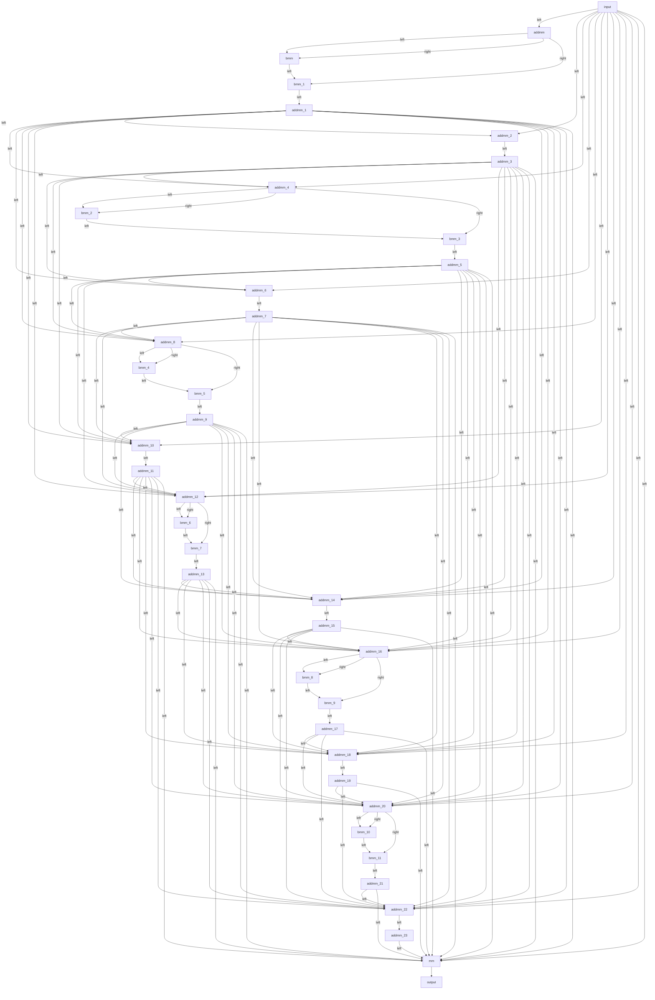

# Matrix-multiplication graph

37 matmuls, 127 edges, 2,596.4 MFLOPs; decomposed graph vs eager max relative diff 0.0e+00. Generated by `python -m tools.matmul_graph`.

| # | id | op | module | left | right | out | MFLOPs | deps |
|---|---|---|---|---|---|---|---|---|
| 0 | addmm | addmm | `transformer.blocks.0.attention.qkv_projection` | `activation` (view) [16, 768] | `transformer.blocks.0.attention.qkv_projection.weight` (permute) [768, 2304] | [16, 2304] | 56.62 | input |
| 1 | bmm | bmm | `transformer.blocks.0.attention` | `activation` (view→clone→expand→permute→view) [24, 8, 64] | `activation` (view→clone→expand→permute→permute→view) [24, 64, 8] | [24, 8, 8] | 0.20 | addmm |
| 2 | bmm_1 | bmm | `transformer.blocks.0.attention` | `activation` (view→expand) [24, 8, 8] | `activation` (view→clone→expand→permute→view) [24, 8, 64] | [24, 8, 64] | 0.20 | addmm, bmm |
| 3 | addmm_1 | addmm | `transformer.blocks.0.attention.output_projection` | `activation` (view→view→clone→permute→view) [16, 768] | `transformer.blocks.0.attention.output_projection.weight` (permute) [768, 768] | [16, 768] | 18.87 | bmm_1 |
| 4 | addmm_2 | addmm | `transformer.blocks.0.mlp.fc` | `activation` (view) [16, 768] | `transformer.blocks.0.mlp.fc.weight` (permute) [768, 3072] | [16, 3072] | 75.50 | input, addmm_1 |
| 5 | addmm_3 | addmm | `transformer.blocks.0.mlp.projection` | `activation` (view) [16, 3072] | `transformer.blocks.0.mlp.projection.weight` (permute) [3072, 768] | [16, 768] | 75.50 | addmm_2 |
| 6 | addmm_4 | addmm | `transformer.blocks.1.attention.qkv_projection` | `activation` (view) [16, 768] | `transformer.blocks.1.attention.qkv_projection.weight` (permute) [768, 2304] | [16, 2304] | 56.62 | input, addmm_1, addmm_3 |
| 7 | bmm_2 | bmm | `transformer.blocks.1.attention` | `activation` (view→clone→expand→permute→view) [24, 8, 64] | `activation` (view→clone→expand→permute→permute→view) [24, 64, 8] | [24, 8, 8] | 0.20 | addmm_4 |
| 8 | bmm_3 | bmm | `transformer.blocks.1.attention` | `activation` (view→expand) [24, 8, 8] | `activation` (view→clone→expand→permute→view) [24, 8, 64] | [24, 8, 64] | 0.20 | addmm_4, bmm_2 |
| 9 | addmm_5 | addmm | `transformer.blocks.1.attention.output_projection` | `activation` (view→view→clone→permute→view) [16, 768] | `transformer.blocks.1.attention.output_projection.weight` (permute) [768, 768] | [16, 768] | 18.87 | bmm_3 |
| 10 | addmm_6 | addmm | `transformer.blocks.1.mlp.fc` | `activation` (view) [16, 768] | `transformer.blocks.1.mlp.fc.weight` (permute) [768, 3072] | [16, 3072] | 75.50 | input, addmm_1, addmm_3, addmm_5 |
| 11 | addmm_7 | addmm | `transformer.blocks.1.mlp.projection` | `activation` (view) [16, 3072] | `transformer.blocks.1.mlp.projection.weight` (permute) [3072, 768] | [16, 768] | 75.50 | addmm_6 |
| 12 | addmm_8 | addmm | `transformer.blocks.2.attention.qkv_projection` | `activation` (view) [16, 768] | `transformer.blocks.2.attention.qkv_projection.weight` (permute) [768, 2304] | [16, 2304] | 56.62 | input, addmm_1, addmm_3, addmm_5, addmm_7 |
| 13 | bmm_4 | bmm | `transformer.blocks.2.attention` | `activation` (view→clone→expand→permute→view) [24, 8, 64] | `activation` (view→clone→expand→permute→permute→view) [24, 64, 8] | [24, 8, 8] | 0.20 | addmm_8 |
| 14 | bmm_5 | bmm | `transformer.blocks.2.attention` | `activation` (view→expand) [24, 8, 8] | `activation` (view→clone→expand→permute→view) [24, 8, 64] | [24, 8, 64] | 0.20 | addmm_8, bmm_4 |
| 15 | addmm_9 | addmm | `transformer.blocks.2.attention.output_projection` | `activation` (view→view→clone→permute→view) [16, 768] | `transformer.blocks.2.attention.output_projection.weight` (permute) [768, 768] | [16, 768] | 18.87 | bmm_5 |
| 16 | addmm_10 | addmm | `transformer.blocks.2.mlp.fc` | `activation` (view) [16, 768] | `transformer.blocks.2.mlp.fc.weight` (permute) [768, 3072] | [16, 3072] | 75.50 | input, addmm_1, addmm_3, addmm_5, addmm_7, addmm_9 |
| 17 | addmm_11 | addmm | `transformer.blocks.2.mlp.projection` | `activation` (view) [16, 3072] | `transformer.blocks.2.mlp.projection.weight` (permute) [3072, 768] | [16, 768] | 75.50 | addmm_10 |
| 18 | addmm_12 | addmm | `transformer.blocks.3.attention.qkv_projection` | `activation` (view) [16, 768] | `transformer.blocks.3.attention.qkv_projection.weight` (permute) [768, 2304] | [16, 2304] | 56.62 | input, addmm_1, addmm_3, addmm_5, addmm_7, addmm_9, addmm_11 |
| 19 | bmm_6 | bmm | `transformer.blocks.3.attention` | `activation` (view→clone→expand→permute→view) [24, 8, 64] | `activation` (view→clone→expand→permute→permute→view) [24, 64, 8] | [24, 8, 8] | 0.20 | addmm_12 |
| 20 | bmm_7 | bmm | `transformer.blocks.3.attention` | `activation` (view→expand) [24, 8, 8] | `activation` (view→clone→expand→permute→view) [24, 8, 64] | [24, 8, 64] | 0.20 | addmm_12, bmm_6 |
| 21 | addmm_13 | addmm | `transformer.blocks.3.attention.output_projection` | `activation` (view→view→clone→permute→view) [16, 768] | `transformer.blocks.3.attention.output_projection.weight` (permute) [768, 768] | [16, 768] | 18.87 | bmm_7 |
| 22 | addmm_14 | addmm | `transformer.blocks.3.mlp.fc` | `activation` (view) [16, 768] | `transformer.blocks.3.mlp.fc.weight` (permute) [768, 3072] | [16, 3072] | 75.50 | input, addmm_1, addmm_3, addmm_5, addmm_7, addmm_9, addmm_11, addmm_13 |
| 23 | addmm_15 | addmm | `transformer.blocks.3.mlp.projection` | `activation` (view) [16, 3072] | `transformer.blocks.3.mlp.projection.weight` (permute) [3072, 768] | [16, 768] | 75.50 | addmm_14 |
| 24 | addmm_16 | addmm | `transformer.blocks.4.attention.qkv_projection` | `activation` (view) [16, 768] | `transformer.blocks.4.attention.qkv_projection.weight` (permute) [768, 2304] | [16, 2304] | 56.62 | input, addmm_1, addmm_3, addmm_5, addmm_7, addmm_9, addmm_11, addmm_13, addmm_15 |
| 25 | bmm_8 | bmm | `transformer.blocks.4.attention` | `activation` (view→clone→expand→permute→view) [24, 8, 64] | `activation` (view→clone→expand→permute→permute→view) [24, 64, 8] | [24, 8, 8] | 0.20 | addmm_16 |
| 26 | bmm_9 | bmm | `transformer.blocks.4.attention` | `activation` (view→expand) [24, 8, 8] | `activation` (view→clone→expand→permute→view) [24, 8, 64] | [24, 8, 64] | 0.20 | addmm_16, bmm_8 |
| 27 | addmm_17 | addmm | `transformer.blocks.4.attention.output_projection` | `activation` (view→view→clone→permute→view) [16, 768] | `transformer.blocks.4.attention.output_projection.weight` (permute) [768, 768] | [16, 768] | 18.87 | bmm_9 |
| 28 | addmm_18 | addmm | `transformer.blocks.4.mlp.fc` | `activation` (view) [16, 768] | `transformer.blocks.4.mlp.fc.weight` (permute) [768, 3072] | [16, 3072] | 75.50 | input, addmm_1, addmm_3, addmm_5, addmm_7, addmm_9, addmm_11, addmm_13, addmm_15, addmm_17 |
| 29 | addmm_19 | addmm | `transformer.blocks.4.mlp.projection` | `activation` (view) [16, 3072] | `transformer.blocks.4.mlp.projection.weight` (permute) [3072, 768] | [16, 768] | 75.50 | addmm_18 |
| 30 | addmm_20 | addmm | `transformer.blocks.5.attention.qkv_projection` | `activation` (view) [16, 768] | `transformer.blocks.5.attention.qkv_projection.weight` (permute) [768, 2304] | [16, 2304] | 56.62 | input, addmm_1, addmm_3, addmm_5, addmm_7, addmm_9, addmm_11, addmm_13, addmm_15, addmm_17, addmm_19 |
| 31 | bmm_10 | bmm | `transformer.blocks.5.attention` | `activation` (view→clone→expand→permute→view) [24, 8, 64] | `activation` (view→clone→expand→permute→permute→view) [24, 64, 8] | [24, 8, 8] | 0.20 | addmm_20 |
| 32 | bmm_11 | bmm | `transformer.blocks.5.attention` | `activation` (view→expand) [24, 8, 8] | `activation` (view→clone→expand→permute→view) [24, 8, 64] | [24, 8, 64] | 0.20 | addmm_20, bmm_10 |
| 33 | addmm_21 | addmm | `transformer.blocks.5.attention.output_projection` | `activation` (view→view→clone→permute→view) [16, 768] | `transformer.blocks.5.attention.output_projection.weight` (permute) [768, 768] | [16, 768] | 18.87 | bmm_11 |
| 34 | addmm_22 | addmm | `transformer.blocks.5.mlp.fc` | `activation` (view) [16, 768] | `transformer.blocks.5.mlp.fc.weight` (permute) [768, 3072] | [16, 3072] | 75.50 | input, addmm_1, addmm_3, addmm_5, addmm_7, addmm_9, addmm_11, addmm_13, addmm_15, addmm_17, addmm_19, addmm_21 |
| 35 | addmm_23 | addmm | `transformer.blocks.5.mlp.projection` | `activation` (view) [16, 3072] | `transformer.blocks.5.mlp.projection.weight` (permute) [3072, 768] | [16, 768] | 75.50 | addmm_22 |
| 36 | mm | mm | `lm_head` | `activation` (view) [16, 768] | `lm_head.weight` (permute) [768, 50257] | [16, 50257] | 1,235.12 | input, addmm_1, addmm_3, addmm_5, addmm_7, addmm_9, addmm_11, addmm_13, addmm_15, addmm_17, addmm_19, addmm_21, addmm_23 |

