# Open-weight model graphs: from any checkpoint to one TMIR graph, served over TIP

**Purpose.** How Tensormorph turns any checkpoint of twenty open-weight LLM families, in any common model format,
into the project's one computation graph (TMIR: every operator and every tensor multiplication of the forward pass,
with shapes, FLOPs and data dependencies), and how that graph reaches TEL, TensorNodes, the tensor viewers, the
debugger and external runtimes through the Tensor Intelligence Protocol (TIP).

**Audience.** The owner, and engineers and coding agents who will plan the import, IR, protocol and debugger stages.

**Scope.** Components, layers, pipelines, data contracts and their relationships. It contains no source code. It
changes nothing in `docs/`; decisions it needs are listed as *proposed ADRs* in [§20](#20-risks-open-questions-and-proposed-adrs).

**How it was written.** Every claim about the existing system cites a bundle document as `docs/<file>:<lines>`.
Every claim about a model family or an external format says how it was checked. The checks ran on 2026-11-15:
832 `config.json` files of the twenty families, safetensors headers read by HTTP range (header bytes only), and
llama.cpp's `gguf-py` at `master` ([Appendix A](#appendix-a-how-external-facts-were-checked)).

## Status vocabulary

Two label sets, never mixed.

| Tag on a component | Meaning |
| --- | --- |
| **[built]** | Exists in the engine or the workbench today; the citation says where the bundle states it |
| **[partial]** | Exists for part of its design; the text says which part |
| **[accepted, not built]** | An Accepted ADR decides it; nothing implements it |
| **[proposed]** | Written in a Proposed ADR or a Proposed canon page; nothing implements it |
| **[new in this design]** | Introduced here; needs the owner's decision before it is planned |

| Label on an external fact | Meaning |
| --- | --- |
| **Checked** | Read from the primary source on 2026-11-15; the source is named |
| **To verify** | Not confirmed; the cell says how to confirm it |

The certainty of a *graph* (Observed, Inferred, Verified) is a third thing, defined in
[§16](#16-certainty-and-provenance-model).

---

## 1. Executive summary

**The problem.** A weight file is a `name → tensor` dictionary. It does not say which operations run in which order
(`docs/importer/README.md:15-17`). Today the engine builds a graph for a weight-only file from two architecture
templates, `gpt2` and `llama` (plus the `mistral` model type), selected by a two-member Rust enum
(`docs/engine/tm-import-templates-mod.rs:18-23,234-237`). Everything else opens as an inventory with `I_NO_GRAPH`.
The local test checkpoint is such a case: `model_type: qwen3_5`, nested `text_config`, three `linear_attention`
layers for every `full_attention` layer, FP8 weights with scale tensors
(`docs/reference/qwen3_5-27b-fp8.config.json`; `docs/adr/0056-state-scan-and-update-frequency.md:13-17`).

**The size of the problem, measured.** The twenty families do not have twenty architectures. Their 832 public
configs carry **144 distinct `model_type` values**, 271 of them wrap nested configs, and 208 need custom code
(`auto_map`). Upstream `transformers` has 548 model folders and llama.cpp names 173 GGUF architectures. One template
per name does not scale, and a name is the wrong key: `Qwen3.8-27B` declares `model_type: qwen3_5`, while
`Qwen3.8-2.4T-A95B` declares `qwen3_5_moe_text` (both Checked).

**The decision, in five points.**

1. **One architecture registry [new in this design].** It replaces the importer's template enum *and* the TURI
   specification's architecture adapters (`docs/spec/addressing/23-architecture-adapters.md:15-27`). One entry, an
   *architecture descriptor*, is data: matchers, a hyperparameter schema, name maps per naming scheme, a layer recipe
   and ties. It yields the module tree, the aliases, the dataflow edges and the TMIR graph from one build.
2. **Architectures are composed, not enumerated.** A descriptor composes a closed *block library* (attention
   variants, FFN and MoE variants, state-space and linear-attention mixers, norms, heads, towers). A new family adds
   a descriptor, rarely a block, and never a Core op (`docs/adr/0054-dynamic-ops-bounded-dims-and-ragged-types.md:54-58`).
3. **Evidence proposes, binding verification decides.** A file graph, the GGUF `general.architecture`, the
   `config.json` type, a tensor-name fingerprint and a model-name hint each only *propose* candidates. A candidate
   is accepted only when every weight it needs exists with the expected shape and every stored tensor is bound,
   tied, ignored by rule, attached as a quantization sidecar, or assigned to a declared component.
4. **One IR, many projections.** Every adapter emits TMIR L1 at the Canonical level. The matmul listing, the
   `tensormorph-matmul-graph` JSON, viz-graph, TensorNodes documents, `.tmir` text, TEL and the exports are
   projections of it. MoE stays conditional and recurrence stays a `scan`; neither is flattened.
5. **Three certainties, never mixed.** *Observed* is what the file states. *Inferred* is what a descriptor adds.
   *Verified* is what an export trace or a traced forward run confirms. Each graph claim carries its certainty, its
   TIP evidence level and its graph origin, and a contradiction demotes it.

**Reused versus new.**

| Reused as it is | Extended | New |
| --- | --- | --- |
| The readers and the header-only rule of `tm-import`; the graph passes; the matmul listing and its signatures; the five conformance oracles; TIS, TIP's lifecycle, pages, cursors and the data plane; TURI; the Model editor's options bar and empty-graph actions | The Canonical op list (state, routing and dynamic ops of ADR-0054 and ADR-0056); `graph/query` and `ir/query` answers (provenance fields); the matmul record (execution condition); the import report (binding and sidecar sections) | The architecture registry, descriptors, assemblies and the block library; quantization sidecar rules; generated name maps; `architecture/*` and `verify/*` TIP methods; the runtime-probe path for external runtimes; the header-only fixture corpus |

---

## 2. Glossary

Existing terms cite the bundle. New terms are marked **new**.

| Term | Meaning | Source |
| --- | --- | --- |
| TURI | Tensor Uniform Resource Identifier, grammar `turi/1`: `scheme://root/path[selector]?context#view` | `docs/guide/22-turi-addressing-and-address-bar.md:21-38,63-81` |
| Lens | The scheme of a TURI: how a resource opens. `model`, `tensor` and `graph` share one identity space | `docs/guide/22-turi-addressing-and-address-bar.md:23-24,45-49` |
| Selector | NumPy-style slice in one bracket, positional or by named axis (`[expert=3, 0:128]`) | `docs/guide/22-turi-addressing-and-address-bar.md:95-99` |
| Projection (TURI) | Mapping an address between lenses; an ambiguous one answers `W_PROJECTION_AMBIGUOUS` | `docs/guide/22-turi-addressing-and-address-bar.md:203-204` |
| Architecture adapter | The TURI specification's interface `detect / children / aliases / edges`, with a generic fallback | `docs/spec/addressing/23-architecture-adapters.md:15-36` |
| Node key | `<module path>/<canonical op>.<occurrence>`, the stable identity of a graph node | `docs/adr/0059-turi-identity-source-maps-and-annotations.md:35-41` |
| `TensorKey` | The stable name a stored tensor has in its file; goes into TURIs | `docs/guide/24-tip-tensor-intelligence-protocol.md:322` |
| `tm-import` | The engine crate of format readers, templates, graph passes and the listing; a Rust port of the reference | `docs/engine/README.md:10` |
| Reference importer | `tensormorph-model-import` (TypeScript): the behaviour oracle, never reused as code | `docs/superplan/10-decisions-and-risks.md:22` |
| Graph origin | `file_graph`, `template`, `external_graph` or `none`; always explicit | `docs/engine/tm-ir-graph.rs:221-233` |
| Architecture template | Name maps, ties, ignored tensors, scheme detection, `matches`, `resolveConfig`, `build` | `docs/importer/types.ts:292-307` |
| Graph passes | Composite expansion, deterministic toposort, header-only shape inference, elementwise decomposition, bias fusion | `docs/engine/README.md:10` |
| Matmul listing | Every multiplication in Kahn order with operands, contraction, FLOPs, deps, depth and blocks | `docs/importer/README.md:93-117` |
| Signature | A hash of a listing or of a block, compared modulo tie groups | `docs/importer/DECISIONS.md:50-54` |
| Conformance oracle | A test that holds the engine to the reference's numbers (13 / 27 / 3,473,408 for tiny GPT-2) | `docs/engine/README.md:25-35` |
| TMIR | The tensor IR's only name; crate `tm-ir` | `docs/adr/0048-the-ir-is-named-tmir.md:42-55` |
| L0 to L3 | Storage, semantic graph, index notation, bridges | `docs/adr/0049-tmir-is-layered-l0-to-l3.md:35-42` |
| Canonical op | One of the 36 importer ops of the L1 graph | `docs/engine/tm-ir-graph.rs:22,34-107` |
| Core op | One of about 25 specified ops every Canonical op decomposes into | `docs/adr/0053-core-op-set-and-decomposition.md:36-51` |
| Tensor descriptor | `TensorType` with optional facets: `axes`, `format`, `sparsity`, `structure`, `lineage`, `symmetry`, `placement` | `docs/adr/0050-the-tensor-descriptor.md:30-45` |
| `BlockScaled` | The parameterized numeric-format family (MXFP4, NVFP4, block FP8); sibling scale tensors become `Aux` | `docs/adr/0051-numeric-formats-are-parameterized.md:37-56` |
| Sparse encoding | Level types after MLIR `sparse_tensor`, with N:M as a parameterized level; a `format` facet | `docs/adr/0052-sparse-encodings-follow-mlir-levels.md:27-45` |
| Four annotations | `compute`, `format`, `placement`, `schedule`: independent on an L1 value | `docs/adr/0049-tmir-is-layered-l0-to-l3.md:44-52` |
| `route`, `Ragged` | The routing op and the ragged type that keep MoE conditional | `docs/adr/0054-dynamic-ops-bounded-dims-and-ragged-types.md:30-53` |
| `scan`, `delta_rule` | The loop op with explicit state, and the fast-weight update family | `docs/adr/0056-state-scan-and-update-frequency.md:25-41` |
| `.tmidx`, `.tmir`, `.tmirb` | The rebuildable cache; the text form; the planned binary document | `docs/adr/0055-serialization-versioning-and-compatibility.md:34-56` |
| Loss report | What an export could not carry, per TURI and facet | `docs/adr/0057-exports-to-stablehlo-and-mlir-with-loss-reports.md:37-43` |
| Target descriptor | A capability record that selection, legalization and the cost model read | `docs/adr/0058-target-capabilities-legalization-and-cost-model.md:33-43` |
| `x-<publisher>.<name>` | The namespace of everything an extension contributes; unknown content is kept as opaque | `docs/adr/0034-tensor-ir-is-extension-compatible.md:31-49` |
| TTIR | TEL's SSA IR: `tm.core` primitives and `tm.math` composites that keep their expansion | `docs/tel/ttir.ts:18-49` |
| TEL | The Tensor Expression Language; symbols bind to tensors by TURI | `docs/guide/23-tel-language-and-composer.md:82-101` |
| TensorNodes | The node editor of a model's graph: one graph, three projections | `docs/tensornodes/README.md` §Purpose |
| viz-graph | `tensormorph-viz-graph` v1: `tensors`, `ops`, derived `edges`, `groups`, `multiplications` | `docs/tensornodes/document-model-and-op-log.md` §Lower and rebuild |
| Σ, β | The symbol table (tensor name → record) and the parameter binding (checkpoint key, transpose, view, ties) | `docs/tensornodes/document-model-and-op-log.md` §Σ, §β |
| T♭, T, L | Flat TEL, grouped TEL, read-only LaTeX | `docs/tensornodes/tel-projections-and-checks.md` §Purpose |
| Verify D1 to D6 | Round-trip, compile, LaTeX, equation and import checks of a TensorNodes document | `docs/tensornodes/tel-projections-and-checks.md` §Verify |
| Model editor | The editor of a model file: Overview, Tensors, Graph, Matmuls; options bar; empty-graph actions | `docs/importer/README.md:74-89` |
| TIP | The Tensor Intelligence Protocol: JSON-RPC 2.0 beside LSP, with revisioned TURI snapshots | `docs/guide/24-tip-tensor-intelligence-protocol.md:9-28` |
| TIS | The Tensor Intelligence Server, crate `tm-tis` | `docs/engine/README.md:13` |
| Op class | Describe, Analyze, Read, Mutate | `docs/guide/24-tip-tensor-intelligence-protocol.md:37-45` |
| Evidence level | `declared`, `propagated`, `symbolic`, `template`, `heuristic`, `sampled` | `docs/engine/tip.meta.json` enum `Evidence` |
| Data plane | Tensor bytes travel by ticket in `tm-tile/1` frames, never as JSON | `docs/adr/0034-tensor-bytes-travel-only-on-the-data-plane.md:31-53` |
| DAP control plane | The debugger speaks the Debug Adapter Protocol; `tm-dap` serves it next to the runtime | `docs/adr/0035-the-debug-adapter-is-registered-by-the-workbench-and-served-by-rust.md:33-49` |
| Capture level | `off`, `stats`, `sampled`, `selective`, `full`, under explicit budgets | `docs/adr/0039-five-capture-levels-under-explicit-budgets.md:28-45` |
| `RuntimeProbe` | The adapter for runtimes Tensormorph does not lower itself (`tm-probe`) | `docs/adr/0039-five-capture-levels-under-explicit-budgets.md:54-56` |
| `ExecutionProvider` | The provider contract of `tm-runtime` | `docs/architecture/gpu-providers.md:31-46` |
| Kernel sources | Vendor libraries and compiled artifacts of existing stacks; Tensormorph writes no code generator | `docs/adr/0060-kernels-come-from-existing-stacks.md:34-43` |
| Tensor viewer | The tensor tab, compare, inspector and tiles; values arrive only over the data plane | `docs/guide/21-tensormorph-feature-placement.md:37-39` |
| Domain packages | `itensor`, `imodel`, `ilattice`, `threetex`: separate, never imported from `src/vs` | `docs/project/repository-rules.md:55-59` |
| Architecture registry | **new.** The one store of architecture descriptors, assemblies and blocks | [§7](#7-the-architecture-registry) |
| Architecture descriptor | **new.** Data that describes one decoder, tower or head as a recipe over blocks | [§7](#7-the-architecture-registry) |
| Assembly | **new.** A descriptor of a wrapper checkpoint: named components, their prefixes and connections | [§7](#7-the-architecture-registry) |
| Component | **new.** A part of an assembly: bound by a descriptor, or declared without a graph | [§7](#7-the-architecture-registry) |
| Block | **new.** A parameterized builder of Canonical ops with named weight roles | [§8](#8-block-library) |
| Layer recipe | **new.** The rule that picks a block specification for each layer from the hyperparameters | [§7](#7-the-architecture-registry) |
| Naming scheme | A spelling of the same tensors: `hf`, `gguf`, `mlx`, a vendor layout. Today `hf`, `hf_base`, `gguf` | `docs/engine/tm-import-templates-mod.rs:161-175` |
| Storage form | **new.** How a logical tensor is stored: as it is, stacked, per expert, fused, or packed with sidecars | [§15](#15-moe-hybrid-and-state-space-handling) |
| Logical tensor | **new.** The tensor a descriptor binds; it may be made of several stored tensors | [§14](#14-identity-and-addressing) |
| Sidecar rule | **new.** A format-level rule that binds quantization companions into a principal tensor's `format` | [§7](#7-the-architecture-registry) |
| Rung | **new.** One source of architecture evidence in the resolution ladder | [§6](#6-architecture-resolution-workflow) |
| Generic adapter | The fallback that groups tensors by name prefix; today's `model/modules` tree | `docs/spec/addressing/23-architecture-adapters.md:33-36` |
| Certainty | **new name, old idea.** Observed, Inferred or Verified, per graph claim | [§16](#16-certainty-and-provenance-model) |
| Verification record | **new.** What confirmed a claim: reference, method, policy, scope, revision | [§16](#16-certainty-and-provenance-model) |
| Execution condition | **new.** A matmul record's note that it runs for a routed subset or inside a `scan` | [§15](#15-moe-hybrid-and-state-space-handling) |
| Runtime adapter | An extension that connects to an execution engine | `docs/requirements/Global inference runtimes and model formats.md:329-344` |

Two wordings in older texts are corrected here. Σ is "the symbol table" and β "the parameter binding"; no document
calls Σ a binding table (`docs/tensornodes/document-model-and-op-log.md` §Σ, §β). A stack is not stored: it is a
`stack` field on member instances and a drawing as `<Def> × <N>`
(`docs/tensornodes/document-model-and-op-log.md` §Recognition from the module tree).

---

## 3. Current-state map

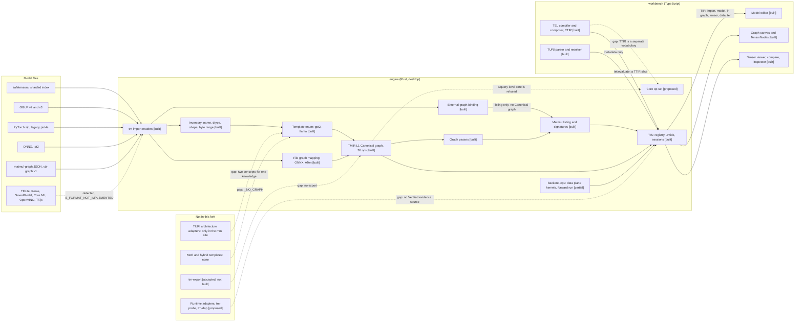

**Reading guide.** Solid arrows are connections the bundle states as built; dashed arrows are gaps. Files enter
through `tm-import`, which always produces an inventory and produces a Canonical graph from one of three origins: a
template, a file graph or (as a listing only) an external graph (`docs/engine/README.md:10`). The TIS holds the model
registry and answers TIP; the workbench surfaces never read a file themselves
(`docs/guide/24-tip-tensor-intelligence-protocol.md:328-351`). Five gaps matter for this design: the architecture
knowledge is split (templates here, adapters only in the old `mm` site,
`docs/spec/addressing/23-architecture-adapters.md:5-9`); no MoE or hybrid template exists
(`docs/adr/0054-dynamic-ops-bounded-dims-and-ragged-types.md:19-21`); Core is named and not implemented
(`docs/adr/0053-core-op-set-and-decomposition.md:3`); TTIR is its own vocabulary until Core exists
(`docs/adr/0053-core-op-set-and-decomposition.md:13-20`); and nothing can supply traced evidence, because the
debugger stream is Proposed (`docs/superplan/10-decisions-and-risks.md:45`).

**One stale statement.** `docs/guide/21-tensormorph-feature-placement.md:14` says no tensor feature code exists.
The stage index says S00 to S10 are done (`docs/superplan/README.md:53-67`) and the engine README lists built
crates. By the bundle's own precedence the engine README wins (`docs/README.md`).

**What is built that this design leans on.**

| Component | State | Evidence |
| --- | --- | --- |
| Readers: safetensors (+ index), GGUF, PyTorch zip and legacy, TorchScript inventory, ONNX, `.pt2`, TensorRT metadata, matmul-graph JSON, viz-graph | [built] | `docs/engine/README.md:10` |
| Templates `gpt2`, `llama`; schemes `hf`, `hf_base`, `gguf`; binding verification with `E_TEMPLATE_MISMATCH` | [built] | `docs/engine/tm-import-templates-mod.rs:124-272` |
| Canonical graph, passes, listing, `compare_signatures` | [built] | `docs/engine/README.md:10` |
| Five oracles and thirteen fuzz targets; 0 payload bytes | [built] | `docs/engine/README.md:25-59` |
| TIP: 27 requests, 10 notifications, 19 error codes | [built] | `docs/engine/tip.meta.json` |
| `graph/query`, `tensor/graph`, `graph/evaluate`, `tel/evaluate` | [built] | `docs/guide/24-tip-tensor-intelligence-protocol.md:153-177,279-305` |
| Data plane tickets and `tm-tile/1` | [built] | `docs/adr/0034-tensor-bytes-travel-only-on-the-data-plane.md:3-4` |
| Graph canvas for `*.tensornodes.json` and the `graph://` lens | [built] | `docs/superplan/10-decisions-and-risks.md:33` |
| Descriptor facets: lineage hash and permutation groups only | [partial] | `docs/adr/0050-the-tensor-descriptor.md:3` |
| Encodings `Plain`, `Block`, `Opaque`; `Affine` and `Composite` named in TIP only | [partial] | `docs/guide/24-tip-tensor-intelligence-protocol.md:320` |

---

## 4. Target layered architecture

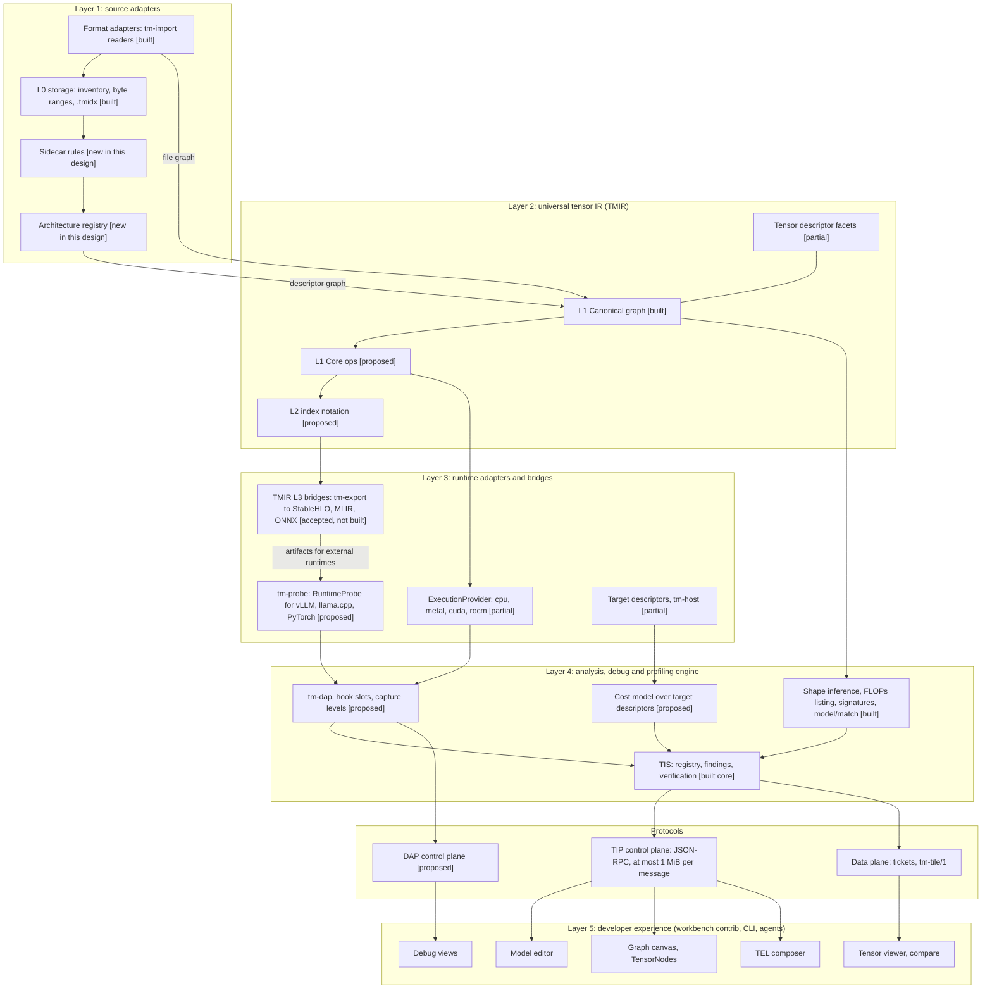

**Reading guide.** The five layers are those of the requirement document
(`docs/requirements/Global inference runtimes and model formats.md:232-299`); the boxes inside are Tensormorph's
own parts. Read it bottom-up. A file crosses a format adapter into L0 storage. Weight-only files then pass the
sidecar rules and the architecture registry, which lift them into the L1 Canonical graph; graph-carrying files reach
L1 directly. L1 lowers to Core and to index notation (`docs/adr/0049-tmir-is-layered-l0-to-l3.md:35-42`). Execution
is two things that must not be confused: native providers that run TMIR, and probes that observe a foreign runtime.
The protocols are not a layer. TIP carries meaning, the data plane carries bytes, and DAP carries the paused-program
model; none duplicates another (`docs/adr/0033-dap-is-the-inference-debugger-control-plane.md:31-43,56-57`).

**The six extension types, mapped.** The requirement document asks for six kinds of adapter and says one format may
have several runtime adapters (`docs/requirements/Global inference runtimes and model formats.md:329-344`).

| Extension type | Tensormorph mechanism | Home | State |
| --- | --- | --- | --- |
| Format adapter | A reader: detect, inventory, optional file graph | `tm-import` | [built] for nine formats |
| Architecture adapter | An architecture descriptor or assembly in the registry | `tm-import` (module `arch`) | [new in this design] |
| Runtime adapter | `ExecutionProvider` for native runs; `RuntimeProbe` for foreign runtimes | `tm-runtime`, `backend-*`; `tm-probe` | [partial]; [proposed] |
| Hardware adapter | A target descriptor plus the provider's capabilities; host facts | `tm-runtime`, `tm-host` | [partial] |
| Debug adapter | The DAP server, hook slots, external-debugger bridges | `tm-dap` | [proposed] |
| Profiler adapter | Capture level `stats` (timing, memory) and the measured device profile | `tm-probe`, `tm-runtime` | [proposed] |

**Four independent concerns.** A change of numeric format or placement never rewrites a node, an edge or a
`TensorKey` (`docs/adr/0049-tmir-is-layered-l0-to-l3.md:44-52`). This design depends on that rule: an FP8, a GPTQ
and a BF16 release of one model must produce the same graph and differ only in the `format` facet of their operands.

**Desktop and web.** The engine and its registry are Rust and desktop-only. The web build loads no Rust, including
no WebAssembly engine; its transport speaks TIP to the Cloud GPU API, which implements the same contract
(`docs/adr/0031-shared-typescript-desktop-local-gpu-web-cloud-gpu.md:52-83`). Nothing in this design adds a page-side
parser, resolver or graph builder, so the web version needs no second implementation: it needs a service that runs
the same engine crates behind the API.

---

## 5. End-to-end import pipeline

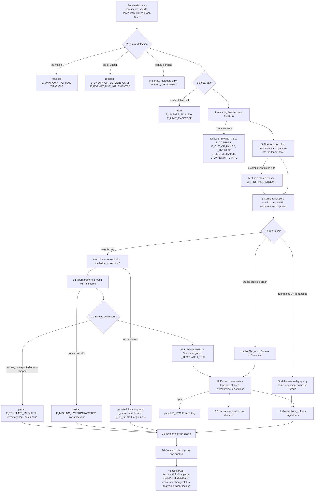

**Reading guide.** Each numbered box is a stage; each side exit names the import outcome and the diagnostic that
explains it. Container errors fail the whole import and commit nothing. Graph-stage errors keep the inventory and
commit a `partial` model, because the weights were read faithfully and only the graph is unavailable
(`docs/importer/DECISIONS.md:72-77`; `docs/guide/24-tip-tensor-intelligence-protocol.md:101-108`). A model with no
graph is not an error: `graph/query` answers `hasGraph: false`
(`docs/guide/24-tip-tensor-intelligence-protocol.md:159-162`). Stages 1 to 4, 6, 7, 11, 12 and 14 to 16 exist today
(`docs/engine/README.md:10,13`); stage 13 is Proposed. Stages 5 and 8 to 10 are where this design changes the
engine: stage 5 is new, and stages 8 to 10 move from two hard-wired templates to the registry.

**How the stages line up with the canon.** Guide 24 names the import as `detect → safety gate → probe → extract →
bind → lift → legalize → shapes → hierarchy and naming → verify → commit → publish`
(`docs/guide/24-tip-tensor-intelligence-protocol.md:326`).

| Guide 24 step | Stage here | Layer | State |
| --- | --- | --- | --- |
| detect, safety gate | 1 to 3 | format adapter | [built] |
| probe (0 payload bytes), extract | 4 | L0 | [built] |
| bind | 5, 8, 9, 10 | sidecar rules, registry | 5 is [new in this design]; 8 to 10 are [built] for two templates |
| lift, legalize | 7 (file graph), 11 | L1 Canonical | [built] |
| shapes | 12 | L1 | [built] |
| hierarchy and naming | 11, via canonical module paths | L1 | [built] (`docs/importer/DECISIONS.md:92-95`) |
| verify | 10, and later [§17](#17-verification-and-conformance-strategy) | registry, verification | [built] for binding; [new in this design] for traces |
| commit, publish | 15, 16 | TIS | [built] |
| (not named) Core | 13 | L1 Core | [proposed] (`docs/adr/0053-core-op-set-and-decomposition.md:3`) |

**Rules the pipeline keeps.**

- **Header only.** No stage reads payload bytes to build a graph. The three counted exceptions stay as they are: a
  GGUF metadata window, legacy pickle headers and ONNX shape constants of at most 1 KiB
  (`docs/importer/README.md:158-164`). One new exception is proposed in [§7.4](#74-quantization-sidecar-rules): a
  quantization state record of at most 1 KiB, counted the same way.
- **Nothing executes.** No pickle call, no `eval`, no content-driven import (`docs/importer/README.md:149-156`). A
  model repository's `modeling_*.py` is never run and never read by the engine; it is documentation for the humans
  and offline tools that write descriptors.
- **The `.tmidx` key grows.** The cache key gains the registry's version and the chosen descriptor's version, as
  `checkpointKey` and `includeOptimizer` already are part of it
  (`docs/guide/24-tip-tensor-intelligence-protocol.md:82-85`). A cache is rebuilt on any engine change, so no
  migration is needed (`docs/adr/0055-serialization-versioning-and-compatibility.md:34-36`).
- **New diagnostics are additive.** `W_SIDECAR_UNBOUND`, `I_SIDECAR_BOUND`, `W_ARCHITECTURE_ASSUMED`,
  `W_ARCHITECTURE_AMBIGUOUS`, `I_COMPONENT_NO_GRAPH` and `E_VERIFY_MISMATCH` are **[new in this design]**; the 42
  existing codes keep their meaning (`docs/architecture/tauri-rust.md:128`).

---

## 6. Architecture resolution workflow

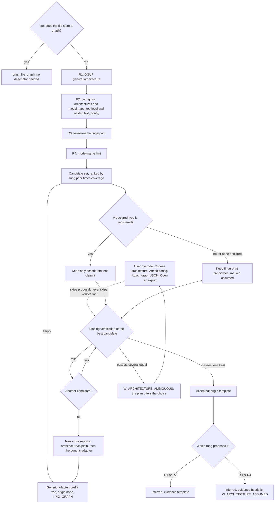

**Reading guide.** Rungs run in a fixed order and only add candidates; no rung accepts anything. The decision is
always the binding verification of [§7.5](#75-the-binding-verifier). The left exit is the short one: a
graph-carrying file needs no architecture knowledge at all. The bottom of the diagram separates two outcomes that
look alike in the Graph tab and must not: a graph proposed by a declared architecture key, and a graph proposed only
by tensor names. User actions enter at the top and jump to verification, as a named template does today ("A named
template is not gated by `matches`", `docs/engine/tm-import-templates-mod.rs:391-393`).

**The ladder.**

| Rung | Reads | Prior | A passing candidate gives | Today |
| --- | --- | --- | --- | --- |
| R0 file graph | The graph the file stores (ONNX, `.pt2`) | not ranked | origin `file_graph` | [built] |
| R1 GGUF architecture | `general.architecture` | 0.9 | Inferred, evidence `template` | [built] for `gpt2`, `llama` |
| R2 config type | `architectures`, `model_type`, also inside `text_config`, `llm_config`, `language_config`, `thinker_config` | 0.9 | Inferred, evidence `template` | [built] for a top-level `model_type` only |
| R3 fingerprint | Required name patterns per naming scheme | 0.3 to 0.6, by coverage | Inferred, evidence `heuristic`, `W_ARCHITECTURE_ASSUMED` | [built] as `detectScheme` |
| R4 name hint | Folder or repository name, GGUF `general.name` | 0.1 | Offered as a choice only; never accepted on its own | [new in this design] |

**Six rules.**

1. **A registered declared type gates.** When the file declares a type the registry knows, only descriptors that
   claim it are candidates. This keeps today's behaviour, where a config's model type outranks GGUF's architecture
   and gates the choice (`docs/engine/tm-import-templates-mod.rs:228-240,386-389`). When a GGUF file and an
   attached config declare different registered types, the config's type gates, as today, and the disagreement is
   reported.
2. **Fit is necessary, not sufficient.** Binding verification proves that a descriptor *fits* the tensors. It cannot
   prove the order of the forward pass: "Weight shapes alone do not uniquely identify the computation graph"
   (`docs/requirements/Top 20 open-weight LLM model families and flagship models.md:138`). So a graph reached only
   through R3 or R4 is marked assumed, shown with a warning, and can become Verified only through a trace
   ([§16](#16-certainty-and-provenance-model)).
3. **The class name outranks the brand name.** `architectures` names the code that runs; `model_type` often names
   the product. Both propose; when they point at different descriptors, the `architectures` candidate is tried first.
4. **Nested configs resolve per component.** A wrapper's `text_config` is resolved as its own unit, with its own
   type and its own name prefix ([§7.3](#73-assemblies-and-components)).
5. **Ambiguity is shown, not hidden.** Two verified candidates of equal rank raise `W_ARCHITECTURE_AMBIGUOUS` and
   the import plan offers the choice, through the `choices` field `import/plan` already has
   (`docs/guide/24-tip-tensor-intelligence-protocol.md:52,93-94`).
6. **A failure explains itself.** The best failing candidate's missing, unexpected and mis-shaped tensors are kept
   as a near-miss report. It is what a descriptor author reads first.

**Why the key is the architecture, not the brand (all Checked on 2026-11-15 against each repository's
`config.json`).**

| Checkpoint | Brand | Declares | So it resolves as |
| --- | --- | --- | --- |
| `moonshotai/Kimi-K2-Instruct` | Kimi | `model_type: kimi_k2`, `architectures: [DeepseekV3ForCausalLM]` | the DeepSeek-V3 forward pass (rule 3) |
| `moonshotai/Moonlight-16B-A3B` | Kimi | `model_type: deepseek_v3` | DeepSeek-V3 |
| `internlm/Intern-S2-397B` | InternLM | `model_type: qwen3_5_moe` | the Qwen 3.5 MoE assembly |
| `internlm/Atria-Dawn` | InternLM | `model_type: glm_moe_dsa` | the GLM-5 forward pass |
| `MiniMaxAI/MiniMax-H3-Image-PE` | MiniMax | `model_type: qwen3_5` | the Qwen 3.5 assembly |
| `nvidia/NVIDIA-Nemotron-3.5-Bolt-E4B-BF16` | Nemotron | `model_type: gemma4` | the Gemma 4 assembly |
| `deepseek-ai/DeepSeek-R1-Distill-Llama-70B` | DeepSeek | `model_type: llama` | Llama |
| `deepseek-ai/DeepSeek-R1-Distill-Qwen-32B` | DeepSeek | `model_type: qwen2` | Qwen 2 |
| `01-ai/Yi-1.5-34B`, `tiiuae/Falcon3-10B-Base`, `HuggingFaceTB/SmolLM2-1.7B` | Yi, Falcon, SmolLM | `model_type: llama` | Llama |
| `Qwen/Qwen3.8-27B-FP8` (the local sample) | Qwen 3.8 | `model_type: qwen3_5` | the Qwen 3.5 assembly |

A registry keyed by family would need every one of these rows as a special case. A registry keyed by architecture
needs none.

---

## 7. The architecture registry

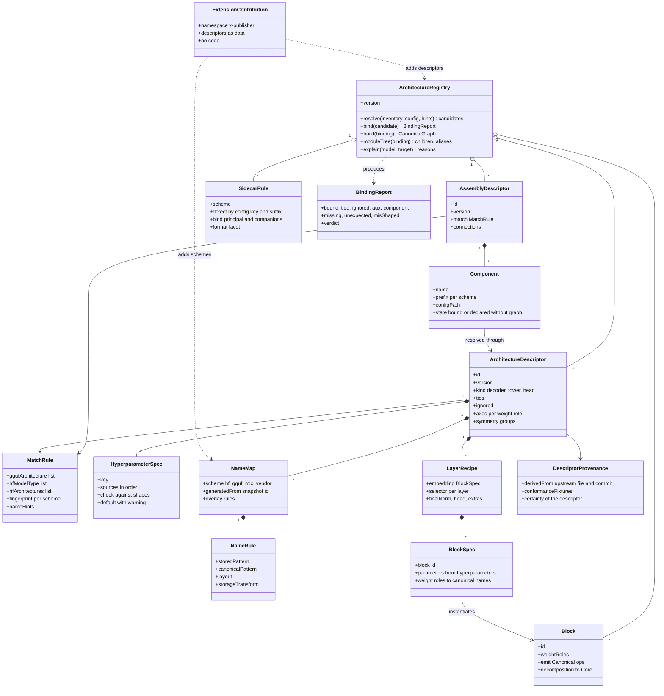

**Reading guide.** The registry owns four kinds of entry: assemblies, architecture descriptors, blocks and sidecar
rules. Only blocks are code; they are Rust builders inside the engine, a closed set
(`docs/adr/0034-tensor-ir-is-extension-compatible.md:31-34`). Everything else is data. A descriptor is the union of
what the importer's template holds today (`nameMaps`, `ties`, `ignored`, `layout`, `resolveConfig`, `build`:
`docs/importer/types.ts:292-307`) and what the TURI adapter interface asks for (`detect`, `children`, `aliases`,
`edges`: `docs/spec/addressing/23-architecture-adapters.md:15-27`). The dotted arrows at the bottom are the only
door for third parties: data in their own namespace, never code.

### 7.1 One registry serves both consumers

| TURI adapter member | Served by | Importer template member | Served by |
| --- | --- | --- | --- |
| `detect(header, config) → 0..1` | The ladder's score ([§6](#6-architecture-resolution-workflow)) | `matches`, `detectScheme` | `MatchRule`, the fingerprint |
| `children(parent)` | The module tree of canonical names, plus virtual children for expert slices | `nameMaps`, `layout` | `NameMap`, `NameRule` |
| `aliases(resource)` | Every scheme's stored name for the same canonical path | `ties`, `ignored` | The descriptor's `ties`, `ignored` |
| `edges(scope)` | The dataflow edges of the Canonical graph | `resolveConfig` | `HyperparameterSpec` |
| generic adapter | The prefix tree `model/modules` serves today | `build` | `LayerRecipe` over blocks |

The module tree, the aliases and the graph come from one binding, so they cannot disagree. Guide 22 already says
that the path is "the model's logical tree, not framework keys (framework keys are input aliases)"
(`docs/guide/22-turi-addressing-and-address-bar.md:89-90`). The name maps are exactly that alias table: a GGUF
tensor `blk.0.attn_q.weight` and an HF tensor `model.layers.0.self_attn.q_proj.weight` resolve to one logical path,
which `model/modules` already demonstrates for the gpt2 template
(`docs/guide/24-tip-tensor-intelligence-protocol.md:115-118`). The core still "knows nine levels and no
architectures" (`docs/spec/addressing/28-traps.md:18-19`): attention, experts and state live in descriptors.

### 7.2 What a descriptor says

A descriptor is a document, not a program. Its shape, as a sketch:

```text
architecture <id> @<version>                 core ids are bare; third-party ids are x-<publisher>.<name>
  kind         decoder | tower | head
  match        gguf.architecture = [...]  hf.model_type = [...]  hf.architectures = [...]
               fingerprint: { hf: [required patterns], gguf: [required patterns] }
  hyperparameters
     <key>  ←  option | config path | gguf key template | shape rule | default (W_ASSUMED_HYPERPARAMETER)
               check: <relation that the bound shapes must satisfy>
  schemes      hf, gguf, mlx, <vendor>:  generated table  +  overlay of storage transforms
  recipe       embedding:  <block spec>
               layer[i]:   select(<selector>) { <kind> → residual(<norm>, <mixer block spec>),
                                                          residual(<norm>, <ffn block spec>) }
               final:      <norm>, <head block spec>, <extras>
  ties, ignored, axes, symmetry
  provenance   upstream file @ commit, conformance fixtures
```

**Layer selectors.** A checkpoint can mix layer kinds, so the recipe never assumes a uniform stack. The selectors
below are the ones the Checked configs need.

| Selector | Picks the layer kind from | Checked example |
| --- | --- | --- |
| `uniform` | nothing; every layer is the same | `llama`, `qwen2`, `mistral` |
| `list(key)` | a per-layer list | `layer_types` in `qwen3_5_text` (3 × `linear_attention`, 1 × `full_attention`, 64 layers), `gpt_oss` (`sliding_attention`, `full_attention`), `gemma4_text` (5 × sliding, 1 × full), `olmo3`; `attn_type_list` in `minimax_text_01`; `layers_block_type` in `nemotron_h` |
| `first_k(key)` | a count of leading layers | `first_k_dense_replace` in `deepseek_v3`, `glm4_moe`, `kimi_linear` |
| `period(period, offset)` | two integers | `attn_layer_period` and `attn_layer_offset`, `expert_layer_period` and `expert_layer_offset` in `jamba` |
| `pattern(key)` | a string, one character per layer | `hybrid_override_pattern` in `nemotron_h` (`M-M-M-MM-M-M-M*-…`) |
| `index_sets(keys)` | lists of layer indexes | `full_attn_layers` and `kda_layers` in `kimi_linear`; `cross_attention_layers` in `mllama`; `no_rope_layers` in `smollm3`; `mlp_only_layers` in `qwen3_moe` |
| `per_layer_config(key)` | a list of block configurations | `block_configs` in `nemotron-nas` (attention replaced by a no-op or a linear layer per block) |
| `by_presence` | which role tensors exist in the layer | used only when the metadata gives no selector; the result is an assumed hyperparameter |

`by_presence` does not break the importer's core rule. The descriptor, not the names, defines the possible kinds;
names only choose among them, the choice is recorded with `W_ASSUMED_HYPERPARAMETER`, and the full binding must
still verify. It is the same move the `gpt2` template makes when it assumes `n_head` from a head size of 64
(`docs/importer/README.md:126`).

**Hyperparameters carry their source.** Each resolved value records where it came from: an option, a config key, a
GGUF key, a shape, or a default. The record feeds `architecture/explain` and the certainty of the nodes that use it.
A value from a shape is `propagated`; an assumed value is `heuristic`; a value read from the file is `declared`.

### 7.3 Assemblies and components

Most flagship checkpoints are wrappers: 271 of the 832 Checked configs nest at least one `*_config`. An assembly
names the parts and where each lives.

```text
assembly qwen3_5 @1
  match       hf.model_type = qwen3_5      hf.architectures = Qwen3_5ForConditionalGeneration
  components
     language_model  prefix hf: "model.language_model."   config: text_config     → architecture qwen3_5_text
     visual          prefix hf: "model.visual."           config: vision_config   → architecture qwen_vision_tower
     mtp             prefix hf: "mtp."                    config: text_config     → head mtp
     lm_head         prefix hf: "lm_head."                                          → head linear
  connections  visual.out → language_model.embedding (merge at image positions)
               language_model.hidden → mtp, lm_head
```

The local sample shows why the prefix matters. Its tensors are `model.language_model.layers.N.…`, `model.visual.…`,
`mtp.…` and `lm_head.weight` (Checked by reading four shard headers, 45,448 header bytes and 0 payload bytes). The
`llama` template looks for `model.layers.0.self_attn.q_proj.weight`
(`docs/importer/llama.ts:48-53`) and cannot match.

**A component has one of two states.**

| State | Meaning | What the user sees |
| --- | --- | --- |
| bound | A descriptor verified its binding; its ops are in the graph | Its modules and ops |
| declared without a graph | The assembly names the component, no descriptor exists yet, or its binding failed | One boundary node with typed ports, the component's tensor count and parameter count, and `I_COMPONENT_NO_GRAPH` |

This is how the design meets the rule that vision towers, audio towers, projectors and MTP layers are bound or
explicitly ignored and never silently dropped. A partial graph is honest when its edges stop at a named boundary.
`graph/query` reports the component list with each state, and the listing's totals say which components they cover.

Auxiliary checkpoints are recognised as such and not forced into a decoder: LoRA adapters, and the draft heads that
ship beside several families (`Qwen3DSparkModel`, `DFlashDraftModel`, `Qwen3Eagle3Model`, `Gemma4AssistantForCausalLM`;
Checked). They get their own small descriptors or stay inventory-only.

### 7.4 Quantization sidecar rules

Quantization is metadata on an operand, not graph structure. Guide 24 states the rule: "quantization lives in the
encoding, never in extra tensors" (`docs/guide/24-tip-tensor-intelligence-protocol.md:320`), and ADR-0051 says how a
sibling scale tensor is bound: it "becomes `TensorKind::Aux` and keeps its own `TensorKey` and TURI"
(`docs/adr/0051-numeric-formats-are-parameterized.md:53-56`). Sidecar rules run before the registry, so name maps
and the verifier see principals only, and one model's FP8, GPTQ and BF16 releases bind to the same graph.

| Scheme | Announced by | Stored tensors (Checked on the named repository's header) | Principal and facet |
| --- | --- | --- | --- |
| Block FP8 | `quantization_config.quant_method: fp8` | `…weight` `F8_E4M3` `[out, in]` and `…weight_scale_inv` `[out/128, in/128]` (`Qwen/Qwen3-8B-FP8`, the local sample, `deepseek-ai/DeepSeek-V3`, `zai-org/GLM-5.3`) | `weight`; `BlockScaled`, element E4M3, block 128 × 128, one scale level |
| Mistral FP8 | the same key, Mistral layout | `…w1.qscale_weight` beside `…w1` (`mistralai/Mistral-Large-4-1T-A52B`) | the same family, a second naming rule |
| MXFP4 | `quant_method: mxfp4` | `…gate_up_proj_blocks` `U8 [32, 5760, 90, 16]` and `…gate_up_proj_scales` `U8 [32, 5760, 90]` (`openai/gpt-oss-20b`) | the logical `gate_up_proj`; `BlockScaled`, element E2M1, block 32 |
| GPTQ | `quant_method: gptq` | `qweight` `I32 [in/8, out]`, `qzeros`, `scales`, `g_idx` (`Qwen/Qwen2.5-7B-Instruct-GPTQ-Int4`) | a synthesized logical `weight` `[out, in]`; `Composite` of four parts, `Affine` per group |
| AWQ | `quant_method: awq` | `qweight` `I32 [in, out/8]`, `qzeros`, `scales` (`Qwen/Qwen3-8B-AWQ`) | the same, a different packing |
| MLX | `quantization` in `config.json` | `weight` `U32 [out, in/8]`, `scales`, `biases` (`Qwen/Qwen3-8B-MLX-4bit`) | `weight`; `Affine` per group |
| compressed-tensors | `quant_method: compressed-tensors` and `format` | 32 configs Checked across `float-quantized`, `pack-quantized`, `mxfp4-pack-quantized`, `nvfp4-pack-quantized`, `mxfp8-quantized`; tensor names **to verify** by one header per format | per format |
| ModelOpt | `quant_method: modelopt`, `quant_algo` | `NVFP4`, `W4A16_NVFP4`, `MIXED_PRECISION`, `FP8` (Nemotron; Checked in configs); tensor names **to verify** | `BlockScaled` instances |
| bitsandbytes | `quant_method: bitsandbytes` or the name suffixes | `weight.absmax`, `weight.quant_map`, `weight.quant_state.*`; **to verify** on `01-ai/Yi-34B-Chat-4bits` | a logical `weight` whose shape is in the quant state record |
| GGUF | the tensor's own ggml type | none: no sidecar tensor exists | `Block { ggml type }` ([built]) |
| BitNet 1.58-bit | `quant_method: bitnet` (11 configs Checked) | **to verify** | a ternary format |

Three rules keep this safe:

- **A rule must verify shapes.** A scale tensor binds only when its shape equals the principal's shape divided by the
  block. A companion that fits no rule stays a stored tensor with `W_SIDECAR_UNBOUND`, and the binding verifier then
  treats it as unexpected. Nothing is dropped.
- **Logical shapes come from declared facts.** A packed principal's logical shape is derived from the packing and
  the config's `bits`, then checked against the hyperparameters. Where the shape is only in a small state record,
  reading at most 1 KiB of it is the proposed fourth counted exception to the header-only rule.
- **Until ADR-0051 lands, the binding is recorded, not decoded.** The import report and the matmul record's existing
  `quantized { dtype, scheme }` field (`docs/importer/types.ts:145`) carry the scheme. Reading logical values waits
  for the `BlockScaled` decoder ([proposed], `docs/adr/0051-numeric-formats-are-parameterized.md:3`).

### 7.5 The binding verifier

The verifier generalises what both templates do today: every weight present with the expected shape, every stored
tensor bound or explicitly ignored, else `E_TEMPLATE_MISMATCH` with the inventory kept
(`docs/importer/README.md:55-58`). After sidecar binding, every stored tensor must fall into exactly one class:

| Class | Decided by |
| --- | --- |
| bound | A name rule mapped it to a weight role, and its shape matches the resolved hyperparameters |
| tied | The descriptor allows it to be absent because another tensor stands for it |
| ignored | The descriptor lists it as known and unused (`rope_freqs.weight`, attention mask buffers) |
| aux | A sidecar rule attached it to a principal |
| component | It lies under the prefix of a component declared without a graph |

Anything else is unexpected. A missing role, an unexpected tensor or a wrong shape fails the candidate. The report
lists up to the diagnostic caps the TIS already applies (20 per code, 512 KiB:
`docs/guide/24-tip-tensor-intelligence-protocol.md:107`).

### 7.6 Name maps are generated

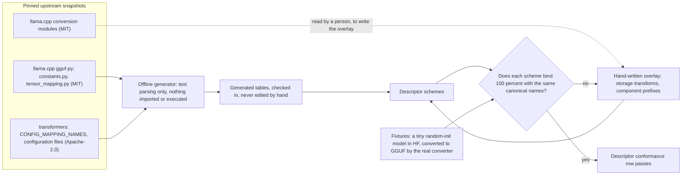

**Reading guide.** Three upstream sources feed one generator that only parses text. Its output is a set of tables
that are committed and never hand-edited (R-12, `docs/architecture/dependency-rules.md:74`), as `tip.meta.json`
generates the protocol types today (`docs/engine/README.md:12`). A small overlay carries what a table cannot say.
The loop on the right is the check: both spellings of one tiny model must bind completely to the same canonical
names, which is the property the reference already asserts for `gpt2` and `llama`
(`docs/engine/tm-import-templates-mod.rs:563-628`).

What the sources hold, Checked at llama.cpp `master` on 2026-11-15:

| Source | Holds | Size |
| --- | --- | --- |
| `constants.py` `MODEL_ARCH`, `MODEL_ARCH_NAMES` | Every `general.architecture` string | 173 architectures |
| `constants.py` `MODEL_TENSOR`, `TENSOR_NAMES` | The GGUF spelling of each tensor role, with `{bid}` for the block | 729 roles |
| `constants.py` `MODEL_TENSORS` | The roles each architecture may contain | 173 lists |
| `constants.py` `Keys` | Hyperparameter key templates such as `{arch}.expert_count`, `{arch}.attention.kv_lora_rank`, `{arch}.ssm.state_size` | 448 keys |
| `tensor_mapping.py` | For each role, the source names that map to it | 43 + 505 entries, 1,734 aliases |
| `conversion/*.py` | The transformations a rename cannot express | 119 modules |

**A rename table is not enough.** The converter also changes tensors. Four Checked examples: per-expert tensors are
stacked into one (`conversion/qwen.py`, `minimax.py`, `glm.py`); InternLM's fused `attention.wqkv` is split into Q,
K and V (`conversion/internlm.py:155-159`); gpt-oss's `gate_up_proj` is split into gate and up
(`conversion/gpt_oss.py:116-127`); Gemma's norm weights get `+ 1` (`conversion/gemma.py:68`). The overlay names
these as storage transforms on a name rule: `stack(axis)`, `split(parts)`, `fuse(parts)`, `transpose`, `layout`,
`offset`. A transform changes how a logical tensor is assembled from stored ones; it never adds a node to the graph.

**Licences (Checked from each repository's licence file).** llama.cpp and `gguf-py` are MIT; `transformers` and
`safetensors` are Apache-2.0. A derived table keeps the upstream copyright notice and licence text beside it and
records the commit it came from. The generator takes names and keys only, no code. Whether a table of names needs
more than that notice is a question for counsel, not for this document.

### 7.7 Third-party descriptors

An extension contributes a descriptor as a data file under its own namespace, `x-<publisher>.<name>`
(`docs/adr/0034-tensor-ir-is-extension-compatible.md:36-38`). It composes existing blocks. Where a model needs a
block the engine lacks, the descriptor declares an `opaque` node with typed inputs and outputs, which the IR already
preserves (`docs/adr/0034-tensor-ir-is-extension-compatible.md:40-47`). The engine advertises the contributed
descriptors as a capability; a client without them degrades to the generic adapter. Extensions get the same binding
verification as built-in descriptors, and their graphs can never claim more than Inferred. How the file reaches the
engine is an open decision ([§20](#20-risks-open-questions-and-proposed-adrs), PA-6).

---

## 8. Block library

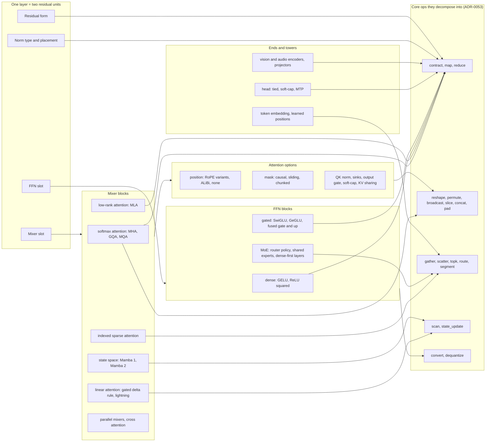

**Reading guide.** A layer is two residual units, each with a norm and one block from a slot. The middle column is
the library; the right column is the Core vocabulary of ADR-0053
(`docs/adr/0053-core-op-set-and-decomposition.md:36-47`). Three arrows carry the design's dependencies: indexed
attention and MoE need the data-dependent ops of ADR-0054, and linear attention and state-space mixers need the
state ops of ADR-0056. Everything else decomposes into ops the Canonical level already has.

**The blocks.** "Seen in" lists Checked `model_type` values whose config keys or tensor names show the block.
"Forward order" facts that a config cannot show are marked to verify against the upstream modeling file.

| Block | Parameters | Weight roles | Core ops | Needs | Seen in |
| --- | --- | --- | --- | --- | --- |
| Token embedding | scale (`scale_emb`), tied head | `embed` | `gather`, `map` | — | all |
| Learned positions | — | `wpe` | `slice`, `map` | — | `gpt2` |
| Softmax attention | heads, KV heads, head size; separate or fused QKV (`query_key_value`, `wqkv`); bias | `q`, `k`, `v`, `o` or `qkv`, `o` | `contract`, `map`, `reduce`, views | — | `llama`, `qwen2`, `gpt_neox`, `internlm2`, `phi3` |
| Position: RoPE, ALiBi, none | RoPE theta, partial factor, sections (`mrope_section`), scaling (`yarn`, `longrope`, `dynamic`, `llama3`); NoPE layers; ALiBi as an additive bias | none, or a frequency buffer | `iota`, `map`, `permute` | — | `qwen3_5_text` (`partial_rotary_factor: 0.25`), `smollm3` (`no_rope_layers`); `hf_olmo` carries an `alibi` switch, off in the config read |
| Mask | causal; sliding (`sliding_window`); chunked (`attention_chunk_size`); block-sparse | none | `constant`, `map` | — | `gemma2`, `gpt_oss`, `olmo3`, `llama4_text`, `phi3small` |
| QK norm | per layer or per head | `q_norm`, `k_norm` | `reduce`, `map` | — | `qwen3`, `qwen3_5_text`, `llama4_text`, `minimax_m2`, `glm4_moe` |
| Attention sinks | sink count | `sinks` | `concat`, `slice` | — | `gpt_oss` (`self_attn.sinks`) |
| Output gate | gate type | part of `q` (doubled) or a gate projection | `slice`, `map` | — | `qwen3_5_text` (`attn_output_gate`, `q_proj` is `[2·H·D, d]`), `kimi_linear` |
| Logit soft-cap | cap value | none | `map` | — | `gemma2` (`attn_logit_softcapping: 50`, `final_logit_softcapping: 30`), `gemma4_text` |
| KV sharing | source layer per layer | none | none: edges reuse values | — | `gemma3n_text`, `gemma4_text` (`num_kv_shared_layers`), `mistral_large4_text` (`kv_source_layers`) |
| MLA | `q_lora_rank`, `kv_lora_rank`, `qk_rope_head_dim`, `qk_nope_head_dim`, `v_head_dim` | `q_a`, `q_b`, `kv_a`, `kv_b`, `o` and their norms | `contract`, `slice`, `concat`, `reduce`, `map` | — | `deepseek_v2`, `deepseek_v3`, `kimi_k2`, `glm_moe_dsa`, `glm4_moe_lite`, `minicpm3` |
| Indexed sparse attention | `index_n_heads`, `index_head_dim`, `index_topk` | indexer projections | `contract`, `topk`, `gather` | ADR-0054 | `deepseek_v32`, `deepseek_v4`, `glm_moe_dsa`, `mistral_large4_text`, `qwen4_exp_text`; forward order to verify |
| Cross attention | layer indexes | `q`, `k`, `v`, `o`, gates | as attention | — | `mllama` (`cross_attention_layers`) |
| Gated delta rule | key heads, value heads, head sizes, conv kernel | `in_proj_qkv`, `in_proj_z`, `in_proj_a`, `in_proj_b`, `conv1d`, `A_log`, `dt_bias`, `norm`, `out_proj` | `contract`, `map`, `scan`, `state_update` | ADR-0056 | `qwen3_next`, `qwen3_5_text`, `olmo_hybrid`, `kimi_linear`; `nemotron_flash` (`deltanet`) |
| Lightning attention | head counts, scale | to verify | `scan` or a cumulative form | ADR-0056 | `minimax_text_01` (`attn_type_list`), `minicpm_sala`; forward order to verify |
| Mamba 1 | `mamba_d_state`, `mamba_d_conv`, `mamba_expand`, `mamba_dt_rank` | `in_proj`, `conv1d`, `x_proj`, `dt_proj`, `A_log`, `D`, `out_proj` | `contract`, `map`, `scan` | ADR-0056 | `jamba`, `falcon_mamba` |
| Mamba 2 | heads, groups, state size, chunk size | `in_proj`, `conv1d`, `A_log`, `D`, `dt_bias`, `norm`, `out_proj` | `contract`, `map`, `scan` | ADR-0056 | `granitemoehybrid`, `falcon_h1`, `nemotron_h`, `mamba2` |
| Parallel mixers | mixing multipliers | per mixer | `map` | as its mixers | `falcon_h1` (`ssm_multipliers`) |
| Dense FFN | activation | `fc_in`, `fc_out` | `contract`, `map` | — | `gpt2`, `gpt_neox`, `phi`, `nemotron` (`relu2`) |
| Gated FFN | activation; separate or fused gate and up | `gate`, `up`, `down` or `gate_up`, `down` | `contract`, `map` | — | `llama`, `gemma` (GELU), `phi3` |
| MoE | experts E, top-k K, shared experts S, scoring (`softmax`, `sigmoid`, `sqrtsoftplus`), groups, router bias, expert scale, latent size | `router`, `experts.gate`, `experts.up`, `experts.down`, `shared.*` | `contract`, `route`, `segment`, `scatter`, `map` | ADR-0054 | `mixtral`, `qwen3_moe`, `deepseek_v3`, `kimi_linear`, `glm4_moe`, `minimax_m2`, `llama4_text`, `gpt_oss`, `gemma4_text`, `phimoe`, `granitemoe`, `olmoe`, `jamba`, `nemotron_h` |
| Norm | LayerNorm or RMSNorm; pre, post or sandwich; a `+ 1` weight form | `norm.weight`, optional bias | `reduce`, `map` | — | all; `use_gemma_norm` in `minimax_m3_vl`; `post_layer_norm` in `chatglm`; `postnorm` in `minimax_text_01` |
| Residual form | sequential, parallel, scaled, recurrent loop | none | `map`; `scan` for loops | ADR-0056 for loops | `gpt_neox` (`use_parallel_residual`), `granite` (`residual_multiplier`), `minicpm` (`scale_depth`), `dory` (`n_recurrent_loops`) |
| Head | tied or untied, final norm, soft-cap | `lm_head` | `contract`, `map` | — | all |
| MTP head | extra layers, modules | `mtp.fc`, `mtp.layers.*`, `mtp.norm` | as the decoder's blocks | as its blocks | `qwen3_5_text` (`mtp_num_hidden_layers: 1`), `deepseek_v3` (`num_nextn_predict_layers`), `minimax_m2` (`num_mtp_modules`), `nemotron_h` |
| Vision tower | depth, patch size, merge size | patch conv, position table, `attn.qkv`, `attn.proj`, MLP, norms | `contract`, `map`, `reduce`, `pad` | — | `qwen3_5` (`model.visual.*`, Conv3d patch `[1152, 3, 2, 16, 16]`) |
| Projector | MLP, patch merger, resampler, Q-Former | per kind | `contract`, `map` | — | `qwen3_5` (`merger`), `granite_speech` (`blip_2_qformer`) |
| Audio tower | conv stem, layers | conv, attention, MLP | `contract`, `map` | — | `qwen2_audio`, `voxtral`, `gemma4_audio`; to verify per tower |

**Three properties of a block.**

- **It emits Canonical ops through the existing builder contract** (`docs/importer/types.ts:310-325`), with the
  module path of the canonical HF layout for every naming scheme, so the viewer clusters identically across formats
  (`docs/importer/DECISIONS.md:92-95`).
- **It registers its decomposition into Core once**, tested against the reference interpreter
  (`docs/adr/0053-core-op-set-and-decomposition.md:48-53`). TensorNodes shows a Canonical op as a group node whose
  body is that decomposition; it gets no vocabulary of its own.
- **It holds no model constant.** Expert counts, top-k and ranks are attributes read from the file
  (`docs/adr/0054-dynamic-ops-bounded-dims-and-ragged-types.md:54-56`). The 3-year test of ADR-0058 applies to
  blocks: no block may name a model (`docs/adr/0058-target-capabilities-legalization-and-cost-model.md:70-72`).

**What Canonical must gain.** Today's 36 ops cover every dense row above. Seven additions cover the rest: `topk`,
`scatter`, `route`, `segment`, `scan`, `state_update` and `pad`, plus the composites `moe`, `linear_attention` and
`ssm` that expand into them. They are additive (`docs/adr/0034-tensor-ir-is-extension-compatible.md:40-42`), and
they are the content of ADR-0054 and ADR-0056, both Proposed. They also end the reference importer's role as the
complete op list ([§20](#20-risks-open-questions-and-proposed-adrs), PA-3).

---

## 9. Family × architecture coverage matrix

The requirement document's flagship names were treated as unverified. Each was looked up; the second column says
what the name turned out to be. `model_type` values are Checked against `config.json` unless a cell says otherwise.
Gated repositories were read through a public mirror and are marked. **Wave** refers to
[§19](#19-phased-roadmap): 0 registry, 1 dense, 2 MoE, 3 hybrid and state, 4 assemblies and towers, 5 sparse
attention and unusual forms.

| # | Family | Flagship named → what the lookup found | Architectures the family spans (`model_type`) | Blocks beyond the dense baseline | Naming schemes seen | Quantization seen | Wave | To verify, and how |
| --- | --- | --- | --- | --- | --- | --- | --- | --- |
| 1 | Qwen | `Qwen3.8-2.4T-A95B` exists: `qwen3_5_moe_text`, 92 layers, 512 experts top-10 | `qwen`, `qwen2`, `qwen2_moe`, `qwen3`, `qwen3_moe`, `qwen3_next`, `qwen3_5`, `qwen3_5_moe`, `qwen3_5_moe_text`, `qwen4_exp`; wrappers `qwen2_vl`, `qwen2_5_vl`, `qwen2_audio`, `qwen2_5_omni`, `qwen3_vl`, `qwen3_vl_moe`, `qwen3_omni_moe`, `qwen3_asr`, `qwen3_tts` | QK norm, MoE with shared expert and shared-expert gate, gated delta rule, output gate, MTP, vision tower, indexer (`qwen4_exp`) | HF per expert (`mlp.experts.{e}.gate_proj.weight`), HF stacked and fused (`mlp.experts.gate_up_proj` `[E, 2·d_ff, d]`), GGUF (`qwen2`, `qwen2moe`, `qwen3`, `qwen3moe`, `qwen3next`, `qwen35`, `qwen35moe`, `qwen4exp`), MLX | FP8 `weight_scale_inv`, GPTQ, AWQ, MLX 4-bit, GGUF | 1, 2, 3, 4 | Forward order of the gated delta rule: `modeling_qwen3_5.py` |
| 2 | DeepSeek | `DeepSeek-V4-Pro` exists: `deepseek_v4` | `llama`, `qwen2`, `qwen3` (distills), `deepseek`, `deepseek_v2`, `deepseek_v3`, `deepseek_v32`, `deepseek_v4`, `deepseek_v41`, `deepseek_vl_v2`, `multi_modality` | MLA, MoE (softmax, then sigmoid, then `sqrtsoftplus`; groups; shared experts; dense-first layers), MTP, indexer (V3.2 on), sliding window and low-rank output (V4) | HF per expert with `q_a_proj`, `kv_a_proj_with_mqa`, `kv_b_proj` (91,991 tensors in V3); GGUF (`deepseek`, `deepseek2`, `deepseek32`, `deepseek4`, `deepseek41`) | FP8 `weight_scale_inv`, `scale_fmt: ue8m0`, `expert_dtype: fp4` | 2, 5 | V4's `num_hash_layers` and `hc_sinkhorn_iters`: `modeling_deepseek_v4.py` |
| 3 | Kimi | `Kimi K3.1 Pro` exists: `kimi_k31`, text part `kimi_linear` | `kimi_k2` (class `DeepseekV3ForCausalLM`), `kimi_k25`, `kimi_linear`, `kimi_k3`, `kimi_k31`, `kimi_vl`; also `deepseek_v3`, `qwen2` | MLA, MoE (K3: 896 experts top-16, 2 shared), Kimi Delta Attention on `kda_layers`, output gate, vision tower | HF, prefix `language_model.model.layers.{i}` (K3); GGUF (`kimi-linear`, `kimi-k3`, `kimi-k31`) | compressed-tensors `pack-quantized` (K2) | 2, 3 | K2's GGUF architecture string; KDA forward order: `modeling_kimi_linear.py` |
| 4 | MiniMax | `MiniMax M3` exists: `minimax_m3_vl` | `minimax_text_01`, `minimax` (upstreamed), `minimax_m1`, `minimax_vl_01`, `minimax_m2`, `minimax_m3_vl` | Linear attention on 7 of 8 layers and post-norm (Text-01), MoE (M2: 256 top-8; M3: 128 top-4 with a shared expert), QK norm, MTP modules, indexer (M3) | HF per expert (`block_sparse_moe.experts.{e}.w1`), `e_score_correction_bias`; GGUF (`minimax-01`, `minimax-m2`, `minimax-m3`) | FP8, MXFP8 | 2, 3, 5 | Lightning attention's forward order: `modeling_minimax.py` |
| 5 | GLM | `GLM-5.3` exists: `glm_moe_dsa` | `chatglm`, `glm`, `glm4`, `glm4_moe`, `glm4_moe_lite`, `glm_moe_dsa`, `glm5_next`; wrappers `glm4v`, `glm4v_moe`, `glm_ocr`, `glmasr` | MoE (160 or 256 experts, top-8, first 3 layers dense), QK norm, MTP, MLA, indexer, linear attention (`glm5_next`) | HF; GGUF (`chatglm`, `glm4`, `glm4moe`, `glm-dsa`, `glm5-next`) | FP8 `weight_scale_inv` | 1, 2, 5 | The indexer's forward order: `modeling_glm_moe_dsa.py` |
| 6 | Llama | `Llama 4 Maverick` exists, gated; mirror config: `llama4` | `llama`, `mllama`, `llama4` | Cross attention (`mllama`), MoE with a shared expert, QK norm, NoPE layers, chunked attention, vision tower (`llama4`) | HF; Llama 4 stacked and fused (`feed_forward.experts.gate_up_proj` `[E, d, 2·d_ff]`), `router.weight`; GGUF (`llama`, `llama4`) | FP8, GGUF | 0, 2, 4 | The gated originals: accept the licence and re-read |
| 7 | Gemma | `Gemma 4 31B` exists: `gemma4` | `gemma`, `gemma2`, `gemma3_text`, `gemma3`, `gemma3n`, `gemma4`, `gemma4_unified`, `gemma4_assistant` | Alternating sliding and full layers, soft-capping, KV sharing, GeGLU, an optional MoE block (`gemma-4-26B-A4B`: `experts.gate_up_proj`, `router.proj`, `router.per_expert_scale`), audio and vision towers | HF; GGUF (`gemma`, `gemma2`, `gemma3`, `gemma3n`, `gemma4`) | QAT `q4_0`, `quant_method: gemma`, compressed-tensors | 1, 2, 4 | QK norm in Gemma 3 and 4: one header read |
| 8 | Mistral | `Mistral Large 4` exists: `mistral_large4` (`Mistral-Large-4-1T-A52B`) | `mistral`, `mixtral`, `ministral3`, `mistral3`, `mamba2`, `voxtral`, `voxtral_realtime`, `mistral_large4` | MoE (8 experts top-2 in Mixtral), Mamba 2 (Mamba-Codestral), Pixtral and audio towers, indexed attention with KV sharing and soft-cap (Large 4) | HF (`block_sparse_moe.experts.{e}.w1`), Mistral's own layout (`layers.{i}.attention.wq`, `experts.{e}.w1`, `consolidated-*.safetensors`); GGUF (`mistral3`, `mistral4`, `mistral-large4`) | FP8 with `qscale_weight` | 0, 2, 3, 5 | The GGUF string of Mistral 7B (expected `llama`): one GGUF header |
| 9 | GPT-OSS | `gpt-oss-120b` exists: `gpt_oss` | `gpt_oss` | Alternating sliding and full layers, attention sinks, MoE top-4 with a router bias | HF stacked and fused (`mlp.experts.gate_up_proj_blocks`, `_scales`, `_bias`); GGUF (`gpt-oss`) | MXFP4 | 2 | Expert count of the 120b: its `config.json` |
| 10 | Phi | `Phi-4` exists: `microsoft/phi-4` declares `phi3` | `phi`, `phi3`, `phi3small`, `phimoe`, `phi3_v`, `phi4mm`, `phi4flash`, `phi4-siglip` | Block-sparse attention (`phi3small`), MoE 16 top-2, LoRA adapters stored in the checkpoint (`phi4mm`) | HF; GGUF (`phi2`, `phi3`, `phimoe`) | ONNX int4 releases, GGUF | 1, 2, 4 | `phi4flash`: custom code, read its modeling file; fused `qkv_proj` names: one header |
| 11 | Granite | `Granite 4` is three lines: 4.0 `granitemoehybrid`, 4.1 and 4.2 `granite` | `gpt_bigcode`, `llama`, `granite`, `granitemoe`, `granitemoehybrid`, `granite_swa`, `granitemoe_swa`, `granite_switch`; speech and vision wrappers | Residual multipliers, MoE 32 top-8, Mamba 2 by `layer_types`, sliding layers | HF (`model.layers.{i}.mamba.*`); GGUF (`granite`, `granitemoe`, `granitehybrid`, `granite_swa`, `graniteswitch`) | FP8, MXFP4, NVFP4, MLX | 1, 2, 3 | — |
| 12 | Nemotron | `Nemotron 3 Ultra` exists: `nemotron_h` (`NVIDIA-Nemotron-3-Ultra-550B-A55B`) | `llama`, `nemotron-nas`, `nemotron`, `nemotron_h`, `nemotron_flash`, `dory`; wrappers `nemotron_h_omni`, `NemotronH_Nano_VL_V2` | Mamba 2 and attention and MoE chosen per layer by a pattern string or `layers_block_type`; MTP; per-block NAS configs; recurrent loops (`dory`) | HF; GGUF (`deci`, `nemotron`, `nemotron_h`, `nemotron_h_moe`) | ModelOpt NVFP4, MXFP8, FP8, mixed precision | 1, 3, 5 | Sidecar tensor names of ModelOpt: one header per format |
| 13 | OLMo | `OLMo 3` exists: `olmo3` | `hf_olmo`, `olmo2`, `olmo3`, `olmo_hybrid`, `olmoe` | Sliding layers 3 of 4 (`olmo3`), linear attention 3 of 4 (`olmo_hybrid`), MoE 64 top-8 | HF; GGUF (`olmo`, `olmo2`, `olmoe`) | FP8 on derived repositories | 1, 2, 3 | Norm placement of `olmo2`: `modeling_olmo2.py`; GGUF strings for `olmo3` and `olmo_hybrid` |
| 14 | Falcon | `Falcon 3` and `Falcon-H1` exist: `llama` and `falcon_h1` | `falcon`, `llama`, `falcon_mamba`, `falcon_h1` | Mamba 1 (`falcon_mamba`), parallel Mamba 2 and attention (`falcon_h1`) | HF; GGUF (`falcon`, `falcon-h1`, `mamba`) | GPTQ, AWQ, 1.58-bit BitNet | 1, 3 | `falcon` (7B, 40B): not among the repositories read; fetch `tiiuae/falcon-7b` |
| 15 | Yi | `Yi-1.5-34B` exists: `llama` | `llama`, `llava` | None for the text models | HF; GGUF (`llama`) | bitsandbytes 4-bit and 8-bit repositories | 0 | Run today's `llama` template on a header fixture |
| 16 | InternLM | `InternLM 3` exists: `internlm3`, custom code | `internlm`, `internlm2`, `internlm3`, `internvl_chat`, `internvl`, `interns1`, `interns1_pro`, `intern_s2_preview`, `interns2_mobius`; also `qwen3_5_moe`, `glm_moe_dsa` | Fused `attention.wqkv`; the rest through the Qwen and GLM descriptors | HF; GGUF (`internlm2`) | FP8 | 1, 4 | `internlm3` names: one header |
| 17 | MiniCPM | `MiniCPM-o`: **to verify** | `minicpm`, `minicpm3`, `minicpm_sala`, `llama`, `qwen3` | Embedding and depth scaling, MLA (`minicpm3`), lightning and sparse attention (`minicpm_sala`) | HF; GGUF (`minicpm`, `minicpm3`) | — | 1, 4 | Fetch `openbmb/MiniCPM-o-2_6/config.json` and the `-V` wrappers |
| 18 | Jamba | `Jamba 1.6`: **to verify**, gated | `jamba` (v0.1, Jamba2, Reasoning-3B) | Mamba 1 with attention by period and offset, MoE by period and offset | HF (`model.layers.{i}.mamba.{A_log, D, conv1d, x_proj, dt_proj, in_proj, out_proj}`); GGUF (`jamba`) | FP8 | 3 | Accept the licence, then read the 1.5, 1.6 and 1.7 configs |
| 19 | Pythia | `Pythia-12B`: family Checked on the 14m, 70m and 160m models: `gpt_neox` | `gpt_neox` | Fused `attention.query_key_value`, parallel residual | HF (`gpt_neox.layers.{i}`); GGUF (`gptneox`) | — | 1 | The 12B config itself |
| 20 | SmolLM | `SmolLM3-3B` exists: `smollm3` | `llama`, `smollm3`, `idefics3`, `smolvlm` | NoPE on every fourth layer (`no_rope_layers`) | HF; GGUF (`llama`, `smollm3`) | ONNX, MLX | 0, 1, 4 | — |

**How to read the GGUF column.** The strings are the entries of llama.cpp's `MODEL_ARCH_NAMES` that belong to the
family (Checked). Which checkpoint converts to which string was Checked only for Qwen, from GGUF headers
(`qwen3moe`, `qwen3next`); the others are to verify with one GGUF header each.

**What the matrix shows.**

- **Coverage today is narrow.** Only checkpoints that declare `llama`, `mistral` or `gpt2` and use the plain layout
  can get a graph. That is expected to include the text models of rows 6, 14, 15 and 20 and several distills; it was
  not run for this document and is listed as a first oracle in [§17](#17-verification-and-conformance-strategy).
- **Every flagship of the first seven priority families needs a new block.** MoE for all of them, MLA for DeepSeek,
  Kimi and GLM, a state mixer for Qwen, Kimi and MiniMax-Text-01.
- **One model, several storage forms.** `Qwen3.8-2.4T-A95B` stores stacked, fused experts in its BF16 repository and
  one tensor per expert with scale sidecars in its FP8 repository (both Checked). `Qwen3.5-35B-A3B` stores stacked
  experts in the trunk and per-expert tensors in its MTP head. Llama 4 and Qwen 3.5 name the same fused tensor
  `gate_up_proj` and lay it out in opposite orders. The descriptor binds *logical* tensors; storage form is a name
  rule ([§15](#15-moe-hybrid-and-state-space-handling)).
- **A fifth architecture class appeared.** The requirement document lists dense, sparse MoE, hybrid, multimodal and
  recurrent variants (`docs/requirements/Top 20 open-weight LLM model families and flagship models.md:68-80`). Six
  current flagships add *indexed sparse attention*: an indexer picks the top-k keys before attention. It makes
  attention itself data-dependent and is priced like MoE, by its bound.

---

## 10. Format adapter matrix

**Representation classes.** W: weights only. WM: weights and metadata. GW: graph and weights. G: graph only (a
compiler IR). C: compiled artifact, target-specific, the original graph fused or lost. A: an API, not a file. S: a
serving layout over other files.

**Routes.** *Direct*: a reader exists or is planned. *Via source*: ask for the file it was compiled from. *Refused*:
with the reason. "Schema Checked" means the public schema or specification file was retrieved on 2026-11-15.
Priorities are the requirement document's (`docs/requirements/Global inference runtimes and model formats.md:56-191`).

**Adapter type.** Every row is a format adapter. Rows whose class is A have nothing to open and are reached only
through a runtime or hardware adapter; a row of class C or S also has runtime adapters in
[§11](#11-runtime-and-ecosystem-adapters).

### 10.1 Western and international

| Format | Artifact | Class | Gives | Graph origin | TIP priority | State | Route |
| --- | --- | --- | --- | --- | --- | --- | --- |
| safetensors, sharded index | `.safetensors`, `*.index.json` | W | inventory | registry | P0 (Phase 1) | [built] | Direct |
| GGUF v2, v3 | `.gguf` | WM | inventory, metadata | registry, by `general.architecture` | P0 | [built] | Direct |
| Legacy GGML | `.bin` with a GGML magic | W | nothing | — | — | [built] refusal | Refused: `E_UNSUPPORTED_VERSION`, convert to GGUF |
| PyTorch zip, legacy pickle | `.pt`, `.pth`, `.bin`, `.ckpt` | W | inventory, checkpoint unwrapping | registry | — | [built] | Direct; a full-model pickle is refused with `E_UNSAFE_PICKLE` |
| TorchScript | `.pt`, `.ts` | GW as code | inventory | none | P1 | [built] inventory | Via source: re-export as `.pt2` (`I_TORCHSCRIPT_GRAPH_UNSUPPORTED`) |
| PyTorch Export | `.pt2` | GW | both | `file_graph` | P0 (Phase 1) | [built], schema major 8 | Direct |
| ONNX, external data | `.onnx`, `.onnx.data` | GW | both | `file_graph` | P0 (Phase 1) | [built] | Direct |
| ONNX Runtime format | `.ort` | GW, optimized | both | `file_graph` | P0 as a runtime | [new in this design]; schema Checked (`ort.fbs`) | Via source `.onnx` first; direct later |
| StableHLO | text, MLIR bytecode, VHLO artifact | G | graph; weights as constants | `file_graph` | P0 (Phase 1) | import [new in this design]; export [accepted, not built] | Direct, text first; specification Checked |
| MLIR | `.mlir`, `.mlirbc` | G | graph, for the dialects read | `file_graph` | Phase 1 | [new in this design] | Direct for `stablehlo`, `tosa`, `linalg` subsets; other dialects stay Source-level opaque |
| TOSA | MLIR dialect, `.tosa` flatbuffer | GW | both | `file_graph` | — | [new in this design]; schema Checked | Direct, later |
| XLA HLO | HLO proto | G | graph | `file_graph` | P1 | [new in this design]; schema Checked | Via StableHLO |
| OpenVINO IR | `.xml` and `.bin` | GW | both | `file_graph` | P0 | detected, `E_FORMAT_NOT_IMPLEMENTED` | Direct, planned |
| Core ML | `.mlmodel`, `.mlpackage` | GW | both | `file_graph` | P0 | detected; schema Checked (`Model.proto`, `MIL.proto`) | Direct, planned |
| Core AI | `.aimodel` | GW, to verify | to verify | `file_graph` | — | [new in this design] | Exists (Apple's converter README Checked: it lowers an `ExportedProgram` to Core AI IR). Container **to verify**; via the source `.pt2` until then |
| LiteRT | `.tflite` | GW | both | `file_graph` | P0 | detected; schema Checked | Direct, planned |
| ExecuTorch | `.pte` | GW, lowered | inventory; graph outside delegates | `file_graph`, partial | P0 | [new in this design]; schema Checked (`program.fbs`) | Direct for the portable part; a delegate blob is one `opaque` node. Prefer the source `.pt2` |
| TensorFlow SavedModel | directory | GW | both | `file_graph` | P0 | detected | Direct, planned; schema Checked |
| TensorFlow GraphDef | `.pb` | G, weights when frozen | graph | `file_graph` | P1 | [new in this design]; schema Checked | Direct, later |
| TF checkpoint | `.index`, `.data-*` | W | inventory | registry | — | detected; schema Checked | Direct, planned |
| Keras, TF.js | `.keras`, `.h5`, `model.json` | GW | both | `file_graph` | — | detected | Direct, planned |
| Flax, Orbax | checkpoint directory | W | inventory | registry | — | [new in this design] | Direct, later; layout **to verify** |
| MLX | `.safetensors`, `.npz`; exported function file | W; G for an export | inventory | registry, scheme `mlx` | P1 | [built] for safetensors | Direct. The export file format is documented (Checked); a reader is later work |
| TensorRT | `.engine`, `.plan` | C | metadata | none | P0 | [built], `W_OPAQUE_FORMAT` | Via source ONNX. A layer-info JSON is reserved as `W_TRT_LAYER_INFO` |
| IREE | `.vmfb` | C | module metadata | none | P1 | [new in this design]; schema Checked | Via source StableHLO or MLIR |
| TVM | Relay or Relax text; compiled library and params | G; C | to verify | — | P0 | [new in this design] | Via source ONNX; **to verify** whether a stable Relax text form is worth a reader |
| Qualcomm QNN | model library, context binary; DLC | C | to verify | none | P0 | [new in this design] | Via source ONNX; **to verify** against the SDK documentation |
| HailoRT | `.hef` | C | metadata | none | P1 | [new in this design]; schema Checked (`hef.proto`) | Via source ONNX |
| AMD MIGraphX | `.mxr` | GW | both | `file_graph` | P1 | [new in this design] | Direct, later (a MessagePack program; loader source Checked) |
| AMD Vitis AI | `.xmodel` | GW, quantized | both | `file_graph` | P1 | [new in this design]; schema Checked | Direct, later |
| Triton | model repository, `config.pbtxt` | S | which model file to open | of the model it points at | P1 | [new in this design]; schema Checked | Bundle discovery reads the layout and opens the inner model |
| NNEF | text graph and tensor files | GW | both | `file_graph` | — | [new in this design] | Direct, later |
| Caffe | `.prototxt`, `.caffemodel` | GW | both | `file_graph` | — | [new in this design]; schema Checked | Direct, later |
| MXNet | `-symbol.json`, `.params` | GW | both | `file_graph` | — | [new in this design] | Direct, later |
| Glow | compiler-internal IR | — | — | — | — | none | No stable file to read |
| DirectML, WebNN, WebGPU | APIs | A | nothing to open | — | P1 | none | Runtime or hardware adapter only |
| Headerless `.bin` | unknown | — | nothing | — | — | [built] refusal | Refused: `E_UNKNOWN_FORMAT`, never guessed |

### 10.2 China

| Format | Artifact | Class | Gives | Graph origin | TIP priority | State | Route |
| --- | --- | --- | --- | --- | --- | --- | --- |
| PaddlePaddle | `.pdmodel` and `.pdiparams`; PIR `.json` | GW | both | `file_graph` | P0 | [new in this design]; both schemas Checked (`framework.proto`, PIR `schema.h`) | Direct, Phase 3. Two readers: a `.pdmodel` is not always the same IR (`docs/requirements/Global inference runtimes and model formats.md:125`) |
| Paddle Lite | `.nb` | GW, optimized | both | `file_graph` | P1 | [new in this design]; schema Checked | Direct, later |
| MindSpore MindIR | `.mindir` | GW | both | `file_graph` | P0 | [new in this design]; schema Checked (`mind_ir.proto`) | Direct, Phase 3 |
| MindSpore Lite | `.ms` | GW, optimized | both | `file_graph` | P1 | [new in this design]; schema Checked | Direct, later |
| Huawei CANN | AIR; OM `.om` | G; C | **to verify** | `file_graph` for AIR; none for OM | P0 | [new in this design] | OM via the source MindIR or ONNX; **to verify** against CANN documentation |
| MNN | `.mnn`; MNN-LLM layout | GW | both | `file_graph` | P0 | [new in this design]; schema and LLM layout Checked | Direct, Phase 3 |
| ncnn | `.param` and `.bin` | GW | both | `file_graph` | P0 | [new in this design]; file structure Checked | Direct, Phase 3 |
| TNN | `.tnnproto` and `.tnnmodel` | GW | both | `file_graph` | P1 | [new in this design] | Direct, later; schema **to verify** |
| RKNN, RKLLM | `.rknn`, `.rkllm` | C | **to verify** | none | P0 | [new in this design] | Via source ONNX; the container has no public schema that was found |
| Cambricon MagicMind | model file | C | **to verify** | none | P1 | [new in this design] | Via source |
| Sophgo TPU-MLIR | `.mlir`; `.bmodel` | G; C | graph; metadata | `file_graph` for the MLIR; none for the `.bmodel` | P0 | [new in this design]; `bmodel.fbs` Checked | The MLIR through the MLIR reader; the `.bmodel` as metadata |
| OpenPPL | ONNX in; `pmx` | GW | both | `file_graph` | P1 | [new in this design]; schema Checked | Through the ONNX reader |
| MegEngine | `.mge` | GW | both | `file_graph` | P1 | [new in this design]; schema Checked | Direct, later |
| Horizon OpenExplorer | `.bin`, `.hbm` | C | **to verify** | none | P1 | [new in this design] | Via source ONNX |
| AXera Pulsar | `.axmodel` | C | **to verify** | none | P1 | [new in this design] | Via source ONNX |
| Moore Threads MUSA | a device API | A | nothing to open | — | P1 | none | Hardware adapter only; **to verify** |
| Baidu Kunlun XPU | compiled model | C | **to verify** | none | P1 | none | **To verify**; no public artifact description was found |

### 10.3 Japan, Russia, others

| Format | Artifact | Class | Graph origin | TIP priority | State | Route |
| --- | --- | --- | --- | --- | --- | --- |
| Sony NNabla | `.nnp` (an archive of a network text or protobuf and parameters), `.nntxt`, `.h5`; NNB for the C runtime | GW | `file_graph` | P0 | [new in this design]; file-format document and NNB layout Checked | Direct, Phase 5 |
| Renesas DRP-AI Translator | ONNX in, compiled out | C | none | P1 | [new in this design] | Via source ONNX |
| Renesas DRP-AI TVM | TVM-derived artifacts | C | none | P2 | [new in this design]; README Checked | Via source ONNX |
| MN-Core | a hardware-specific representation | C | none | P2 | none | **To verify.** The requirement document attributes it to AIST; it is generally known as a Preferred Networks processor. No artifact format was confirmed |
| Russian-developed models | ONNX, PyTorch and Hugging Face artifacts | — | that of the format read | P2 | covered by existing readers | No country-specific adapter, as the requirement document recommends (`docs/requirements/Global inference runtimes and model formats.md:171`) |
| CatBoost | `.cbm` | a tree ensemble | — | P2 | out of scope | Not a tensor graph; a separate adapter category if ever wanted (schema Checked) |

**Four rules for every new reader.** It is a format adapter in `tm-import`; it reads headers only; it emits TMIR L1
(or an inventory), never its own schema; and it ships with a fuzz target, as each existing parser does
(`docs/engine/README.md:41-59`). A reader for a compiled artifact reports metadata and `W_OPAQUE_FORMAT` and points
at the source; it never reconstructs a graph it cannot see.

---

## 11. Runtime and ecosystem adapters

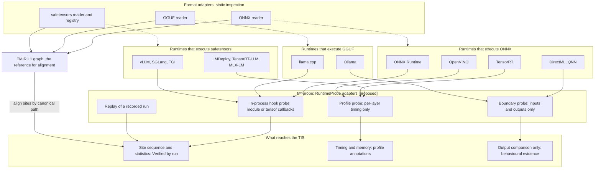

**Reading guide.** The top row is static: a format adapter opens a file and produces TMIR without running anything.
The dotted arrows say only that a runtime can execute that format; they are not data paths in the IDE. The solid
path is live: a runtime adapter is a probe beside or inside a running engine, and what it can report depends on the
runtime, not on the format. Three kinds of evidence result, and only the first can make a graph Verified.

**Adapter kinds are separate on purpose.** One format has several runtime adapters: ONNX is read once and may be
executed by ONNX Runtime, TensorRT, OpenVINO, DirectML or QNN; GGUF by llama.cpp or Ollama; safetensors by vLLM,
SGLang, TGI, LMDeploy, TensorRT-LLM or MLX-LM
(`docs/requirements/Global inference runtimes and model formats.md:339-344`).

| Kind | Question it answers | Contract | Runs where |
| --- | --- | --- | --- |
| Format | What does the file contain? | A reader in `tm-import` | The engine |
| Architecture | What graph do these weights imply? | A descriptor in the registry | The engine |
| Runtime, native | Can TMIR run here? | `ExecutionProvider` (`docs/architecture/gpu-providers.md:31-46`) | The engine, or a worker for vendor code |
| Runtime, foreign | What did that engine actually do? | `RuntimeProbe` in `tm-probe` (`docs/adr/0039-five-capture-levels-under-explicit-budgets.md:54-56`) | Beside the runtime, in the user's environment |
| Hardware | What can this device do, and how fast? | Capabilities and a target descriptor (`docs/adr/0058-target-capabilities-legalization-and-cost-model.md:33-43`) | The engine |
| Debug | Where is execution paused, and what is on each port? | DAP served by `tm-dap` (`docs/adr/0035-the-debug-adapter-is-registered-by-the-workbench-and-served-by-rust.md:45-47`) | The engine host |
| Profiler | How long, how much memory? | Capture level `stats` and the device profile | With the runtime adapter |

**Foreign runtimes are observed, never embedded.** The engine runs no Python and no framework loader
(`docs/adr/0005-compute-runtime-architecture.md:22`; `docs/guide/24-tip-tensor-intelligence-protocol.md:355-359`).
A probe is installed by the user in the runtime's own environment; the inspection canon already names a pip package
and a vLLM or SGLang plugin, and says serving probes are observe-only
(`docs/adr/0039-five-capture-levels-under-explicit-budgets.md:17-19,54-56`). The IDE attaches to it through the
debugger's attach flow (`docs/adr/0044-external-debuggers-attach-as-relayed-child-sessions.md:36-38`).

**Observability classes.** This is the limit the requirement document warns about: "a compiled TensorRT engine or
RKNN binary may not expose its original graph or intermediate activations"
(`docs/requirements/Global inference runtimes and model formats.md:302`). The hook surfaces of individual runtimes
were not checked for this document; each row's class is the design's assumption until the adapter's own spike
confirms it.

| Class | What the runtime exposes | Evidence it can give | Runtimes (class **to verify** per adapter) |
| --- | --- | --- | --- |
| O1 source-level | Callbacks at module or tensor boundaries with values | Site sequence, shapes, statistics, selected tensors: Verified by run | PyTorch-based serving (vLLM, SGLang, TGI, LMDeploy's PyTorch engine), MLX-LM, the PyTorch reference; llama.cpp through its evaluation callback |
| O2 graph-level | Named intermediate outputs when the graph is edited to expose them | The same, for the exposed values | ONNX Runtime |
| O3 profile-only | Per-layer timing of fused layers | Timing and memory annotations; no op inside a fusion | TensorRT, TensorRT-LLM, OpenVINO, MindIE |
| O4 black box | Inputs and outputs | Behavioural comparison of outputs only | RKNN and RKLLM, Ascend OM, HEF, QNN context binaries, Ollama's API, hosted endpoints |

Two consequences. A fused or compiled region reports "not observable here" with its reason, which the debug design
treats as an answer and not a failure (`docs/adr/0040-tensormorph-debug-info-survives-every-lowering-stage.md:51-52`).
And a class O3 or O4 runtime can never promote an Inferred graph to Verified; it can only add profile annotations or
a behavioural result ([§16](#16-certainty-and-provenance-model)).

**LLM runtimes, by phase.** The requirement document lists fourteen
(`docs/requirements/Global inference runtimes and model formats.md:199-217`). All are **[proposed]** here and attach
to the debugger stage.

| Runtime | Loads | Priority | Planned class |
| --- | --- | --- | --- |
| llama.cpp | GGUF | P0 | O1 |
| vLLM, SGLang, Hugging Face TGI | safetensors through PyTorch | P0 | O1 |
| LMDeploy | PyTorch or TurboMind | P0 | O1 for PyTorch; O3 for TurboMind |
| TensorRT-LLM | compiled engines | P0 | O3 |
| Ollama | GGUF blobs | P0 | O4 through its API; O1 only by attaching to its llama.cpp |
| MLX-LM | MLX safetensors | P1 | O1 |
| MindIE, MNN-LLM | Ascend and MNN artifacts | P1 | O3 or O4 |
| Xinference, LocalAI, OpenLLM, MindSpore Serving | other runtimes | P1, P2 | The class of the backend they wrap |

---

## 12. TIP communication design

TIP keeps LSP's mechanics and replaces its data model: resources are revisioned snapshots addressed by TURI, and no
control message exceeds 1 MiB (`docs/guide/24-tip-tensor-intelligence-protocol.md:11-28,248-249`). The design adds
methods and fields; it changes none. TIP stays at `tip/0.x` with additive fields only
(`docs/adr/0050-the-tensor-descriptor.md:79-80`), and each new method enters through a guide-24 update before the
stage that needs it (`docs/superplan/10-decisions-and-risks.md:44`).

### 12.1 Opening a Qwen MoE safetensors folder

The example is `Qwen/Qwen3.5-35B-A3B`: `model_type: qwen3_5_moe`, 1,811 tensors, stacked experts in the trunk and
per-expert tensors in the MTP head (Checked).

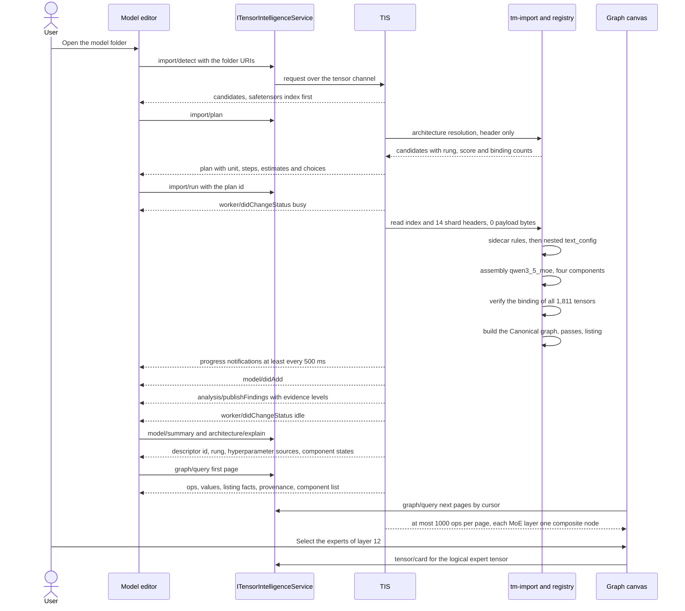

**Reading guide.** Time runs downward. The first third is today's protocol unchanged: detect, plan, run
(`docs/guide/24-tip-tensor-intelligence-protocol.md:51-55,75-114`). The registry does its work inside `import/plan`
and `import/run`, so the editor needs no new call to get a graph. The middle third is the engine alone; nothing
crosses the channel while it reads headers and verifies. The last third shows two clients reading one graph through
the same paged method, which is why the Graph tab and the Graph canvas cannot disagree
(`docs/guide/24-tip-tensor-intelligence-protocol.md:163-171`). The page cap already exists: 256 ops by default,
at most 1,000.

### 12.2 A TEL cell that reads weights by TURI

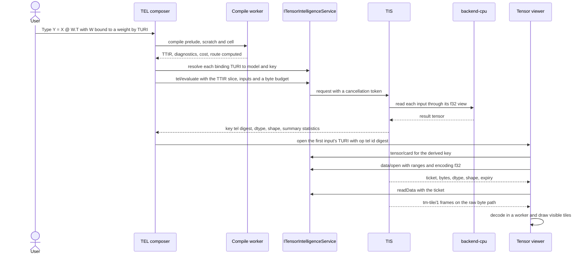

**Reading guide.** Text is compiled in the page's worker; values never are. The route is chosen from the compiled
TTIR, not from the text (`docs/guide/23-tel-language-and-composer.md:94-101`). `tel/evaluate` sends metadata only:
a TTIR slice and, per input, a model, a key and optional ranges. The engine reads the tensors itself, evaluates on
the CPU in f32 and holds the result under `tel:<digest>`
(`docs/guide/24-tip-tensor-intelligence-protocol.md:279-289`). Bytes then travel by ticket on the data plane and
never as JSON (`docs/adr/0034-tensor-bytes-travel-only-on-the-data-plane.md:31-45`). This flow is built. What this
design changes is what a binding can name: a logical tensor or an expert slice, not only a stored key
([§14](#14-identity-and-addressing)).

**Two limits to state plainly.** An input with no f32 view answers -33006
(`docs/guide/24-tip-tensor-intelligence-protocol.md:285-286`), so a cell over FP8 or MXFP4 weights waits for the
`BlockScaled` decoder. And TEL can name fewer ops than the graph holds; [§13](#13-projections-of-one-graph) says
which.

### 12.3 A runtime adapter that turns an Inferred graph into a Verified one

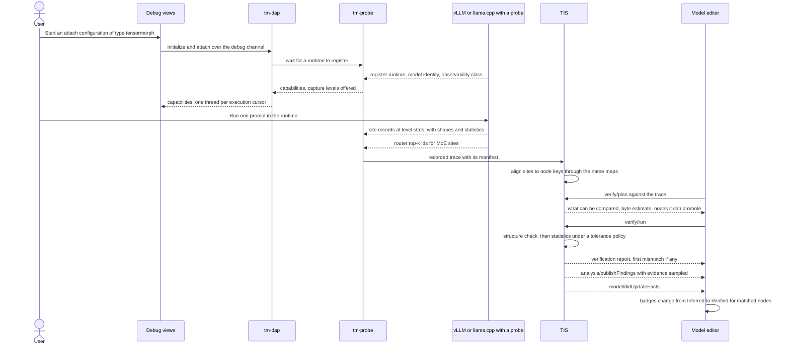

**Reading guide.** Two control planes appear and stay separate. The attach, the pause model and the capture level
are DAP's (`docs/adr/0033-dap-is-the-inference-debugger-control-plane.md:31-43`); the trace as a resource, its
alignment and the verdict are TIP's. The runtime runs in the user's environment and the probe only reports: sites,
shapes and ADR-0006 statistics at level `stats`, which already includes MoE top-k ids
(`docs/adr/0039-five-capture-levels-under-explicit-budgets.md:30-36`). No tensor payload moves unless the user
raises the capture level, and then it moves by ticket. Alignment is by canonical path and port, as the comparison
ADR requires (`docs/adr/0043-reference-comparison-uses-explicit-recorded-tolerance-policies.md:58-59`). Everything
in this diagram except the Model editor is **[proposed]** or **[new in this design]**.

### 12.4 Proposed methods, fields and notifications

| Method | Class | Purpose | State |
| --- | --- | --- | --- |
| `architecture/list { cursor?, limit? }` | Describe | The registry's entries: id, version, kind, blocks used, schemes, provenance | [new in this design] |
| `architecture/describe { id, cursor? }` | Describe | One descriptor: match rules, hyperparameters, recipe, name rules in pages | [new in this design] |
| `architecture/resolve { model or uris, options? }` | Analyze | Ranked candidates with rung, score and binding counts. Reads headers only and commits nothing | [new in this design] |
| `architecture/explain { model, target? }` | Describe | Why this graph: the rung, each hyperparameter's source, the name rule that bound a tensor, sidecar bindings, assumptions, the near-miss report | [new in this design] |
| `verify/plan { model, reference }` | Analyze | What a verification would compare, its byte estimate, which nodes it can promote | [new in this design] |
| `verify/run { planId, budgetBytes? }` | Read | Runs the structural and numeric checks, streams results, stores verification records. Creates no revision | [new in this design] |
| `verify/report { model }` | Describe | The stored verification records | [new in this design] |
| `runtime/list` | Describe | Registered runtime adapters with their observability class and capture levels | [new in this design] |
| `ir/annotations`, `export/plan`, `export/run`, `analysis/cost` | as their ADRs say | Already named as later methods | `docs/guide/24-tip-tensor-intelligence-protocol.md:71-73` |

| Existing shape | Added field | Why |
| --- | --- | --- |
| `ServerCapabilities` | `architectures`, `verification` | Features are gated by capability flags, never by version (`docs/guide/24-tip-tensor-intelligence-protocol.md:34-35`) |
| `ImportPlan.choices` | architecture candidates with their scores | The plan "offers the `architecture` choice" already (`docs/guide/24-tip-tensor-intelligence-protocol.md:93-94`) |
| `ImportReport` | `binding` counts, `sidecars`, `components` | The report is where a binding is recorded (`docs/adr/0051-numeric-formats-are-parameterized.md:55-56`) |
| `ArchitectureInfo` | `descriptor { id, version }`, `rung`, `components`, `certainty` | Today it holds `name`, `origin`, `config`, `dims`, `tied` (`docs/engine/tip.meta.json`) |
| `GraphOp` | `provenance { certainty, evidence, confidence?, rule?, verification? }`, `execution?` | [§16](#16-certainty-and-provenance-model), [§15](#15-moe-hybrid-and-state-space-handling) |
| `MatmulRecord` | `execution { kind, of?, active?, scan? }` | Conditional and recurrent multiplications |
| `GraphPage` | `components`, a provenance summary | One page tells a client what it is looking at |

| Notification | Use |
| --- | --- |
| `model/didUpdateFacts` | Reused. A verification, or a re-resolution with other options, changes facts at the same revision, which is this notification's meaning (`docs/guide/24-tip-tensor-intelligence-protocol.md:109-112`) |
| `analysis/publishFindings` | Reused. Binding, sidecar, assumption and verification findings, each with its evidence level |
| `architecture/didChangeRegistry` | **New.** A contributed descriptor was added or removed; clients re-run resolution for affected models |

**Roles.** `architecture/*` and `verify/report` are Describe and Analyze, so every role may call them. `verify/run`
is Read, so `ui`, `cli` and trusted built-in extensions may; an `agent` may not
(`docs/guide/24-tip-tensor-intelligence-protocol.md:44-45`). No new method needs Mutate.

**Workbench side.** Nothing new crosses the Tauri bridge. The methods travel inside the existing `tensor` channel as
JSON-RPC text, so no new channel, permission or shell code is needed for TIP (R-06, R-08:
`docs/architecture/dependency-rules.md:68-70`). The debugger's `debug` channel is a separate, asked-for item of the
debugger stream (`docs/adr/0035-the-debug-adapter-is-registered-by-the-workbench-and-served-by-rust.md:64-65`).

---

## 13. Projections of one graph

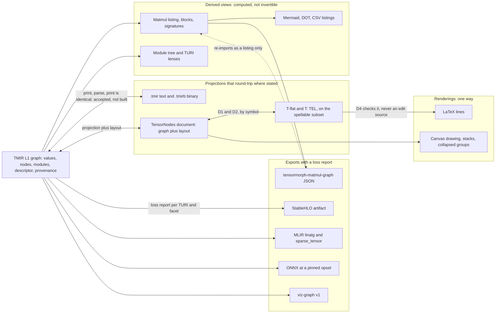

**Reading guide.** Four groups, four promises. The top group is computed from the graph and cannot rebuild it. The
second group is where a round trip is claimed, and each arrow names the check that holds it. The third group is
pixels and typesetting. The bottom group leaves the system; each export ends with a loss report
(`docs/adr/0057-exports-to-stablehlo-and-mlir-with-loss-reports.md:37-43`). The only arrow that returns from the
bottom is the matmul-graph JSON, and it returns as a listing with no Canonical graph, origin `external_graph`
(`docs/guide/24-tip-tensor-intelligence-protocol.md:88-91`).

| Projection | Kind | What holds, and where it stops | State |
| --- | --- | --- | --- |
| Matmul listing | Derived | A deterministic function of the graph: Kahn order, contraction, FLOPs `2·numel(out)·k`, deps, depth (`docs/importer/README.md:110-117`). It drops every op that is not a multiplication | [built] |
| `tensormorph-matmul-graph` v1 JSON | Export, and an import dialect | Recomputed on import with `W_EXTERNAL_MISMATCH`; binds by name, canonical name and tie group | [built] |
| viz-graph v1 | Import dialect; the base of a TensorNodes file | A `*.tensornodes.json` is a viz-graph plus one key, `tensornodes` (`docs/tensornodes/document-model-and-op-log.md` §Purpose) | [built] |
| TensorNodes document | Projection plus layout | `lower(raise(J))` equals the file; raise is deterministic. Shown on one model only (`docs/tensornodes/document-model-and-op-log.md` §Lower and rebuild, §Raise) | [built] |
| T♭ and T | Round trip by symbol | D1 and D2. T♭ does not carry roles, bindings, aliases or layout; those travel through Σ (`docs/tensornodes/tel-projections-and-checks.md` §Verify) | [built] for the spellable subset |
| LaTeX | Rendering | "LaTeX is a *rendering*, not an inverse" (`docs/adr/0053-core-op-set-and-decomposition.md:72`) | [built] |
| `.tmir` text | Print only today | "There is no parser, and no print-parse-print property is claimed" (`docs/adr/0055-serialization-versioning-and-compatibility.md:12-13`). The document form with a parser is decided | print [built]; parser [accepted, not built] |
| StableHLO, MLIR, ONNX | Export with a loss report | Round trip is verified per target against the reference interpreter, not promised as identity | [accepted, not built] |
| Module tree, TURI lenses | Projection by identity | `identity`, `contained`, `related` or `none` between lenses | [built] |

**The 1:1 claim, as narrowed by ADR-0053.** Bijections are claimed only where they hold: TEL ⇔ TMIR graph on the
subset TEL can spell, and graph ⇔ TensorNodes as projection plus layout
(`docs/adr/0053-core-op-set-and-decomposition.md:68-73`). This design adds what "the subset TEL can spell" excludes
today, read from the TEL surface document:

| Graph construct | TEL today | Consequence for T♭ |
| --- | --- | --- |
| `topk`, `sort` | Compile with no IR binding (`docs/tel/tel-language-surface.md:138`) | A routed layer cannot be a runnable statement |
| `rmsnorm`, `attention`, `gelu`, `silu`, `swiglu` | Opaque `tm.math`: they compile and are refused at run time (`docs/tel/tel-language-surface.md:137`) | Printed as calls; D3's op counts need expansions first |
| A contraction over several axes | Refused with `TM2104` (`docs/tensornodes/tel-projections-and-checks.md` §Implementation status) | Cannot be printed |
| `route`, `scan`, `state_update`, tuples | No spelling; TEL has no tuples (`docs/tensornodes/document-model-and-op-log.md` §Make group) | Not spellable |

So the rule for new blocks is: **a Canonical composite prints in T♭ as one call when TEL has the name, and as a
marked, read-only line when it does not.** Verify D1 to D5 run over the spellable statements and report the rest as
counted exclusions, never as passes. Giving TEL the missing spellings is TEL work, outside this design; nothing here
depends on it. TensorNodes gets no op vocabulary of its own: its node kinds are Canonical ops and their registered
decompositions (`docs/adr/0053-core-op-set-and-decomposition.md:50-51`). Its prototype registry of eight primitives
has no routing, state or conditional concept at all (`docs/tensornodes/registry-and-axis-inference.md`), which is a
known gap and not a design choice to copy.

---

## 14. Identity and addressing

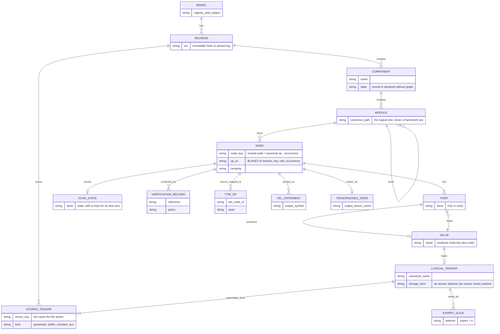

**Reading guide.** Read it as three columns. On the left is containment: a model revision holds components, modules
and nodes. In the middle is data: a node's output port produces a value, and a value that is a weight loads a
logical tensor, which is assembled from one or more stored tensors. On the right are the four things that point at
a node from outside: a TTIR op, a TEL statement, a TensorNodes node and a verification record. Every one of them
finds its node through the value the node produces, so the output value is the join key.

**Spellings.** All follow guide 22's lens table and ADR-0059; none is new grammar
(`docs/guide/22-turi-addressing-and-address-bar.md:45-49`;
`docs/adr/0059-turi-identity-source-maps-and-annotations.md:35-50`).

| Thing | Identity | TURI |
| --- | --- | --- |
| Model at a revision | registry, subject, revision | `model://hf/Qwen/Qwen3.5-35B-A3B@<rev>/` |
| Component, module | canonical path | `model://…@<rev>/model/language_model/layers/12/mlp` |
| Stored tensor | `TensorKey` | `tensor://…@<rev>/model/language_model/layers/3/self_attn/q_proj/weight` |
| Parts of a quantized encoding | facet | `…/q_proj/weight:raw`, `…/q_proj/weight:scales` |
| Logical tensor | canonical name | `tensor://…@<rev>/model/language_model/layers/12/mlp/experts/down_proj` |
| Expert slice | selector on the `expert` axis | `…/mlp/experts/down_proj[expert=7]` |
| Node | node key | `graph://…@<rev>/model/language_model/layers/12/mlp/~op/route.0` |
| Port | facet on a node | `graph://…/~op/matmul.0:out` |
| Activation | the producing port, with a trace | `tensor://…@<rev>/model/language_model/layers/12/mlp:out?trace=<id>` |
| `scan` state | `:state`, with a trace for time | `tensor://…@<rev>/model/language_model/layers/0/linear_attn:state?trace=<id>` |
| Derived tensor | `?op` | `tensor://…/q_proj/weight?op=tel(id=<digest>)` |

**Five rules.**

1. **The path is the logical tree.** Stored names under every scheme are input aliases of one canonical path
   (`docs/guide/22-turi-addressing-and-address-bar.md:89-90`). Pasting `blk.12.ffn_down_exps.weight` or
   `model.language_model.layers.12.mlp.experts.down_proj` reaches the same resource.
2. **A per-expert stored tensor and a slice of a stacked tensor are one resource.** When experts are stored one
   tensor each, the logical tensor is their stack and `…experts.7.down_proj.weight` is an alias of
   `…experts/down_proj[expert=7]`. When they are stored stacked, the slice is a selector on the stored tensor. The
   projection between the two is `identity`. Named selectors resolve once the descriptor fills the `axes` facet
   (`docs/adr/0050-the-tensor-descriptor.md:50-57`); until then a named selector answers `E_AXIS_UNKNOWN`
   (`docs/guide/22-turi-addressing-and-address-bar.md:97-99`).
3. **Experts are virtual children.** A module with 896 experts lists them as a counted, lazy sequence, as the
   addressing specification already requires for blocks, experts and embedding rows
   (`docs/spec/addressing/19-virtual-resources.md:22-25`). Nothing materialises 896 × 93 rows.
4. **A node's id is its key.** `Node.id` becomes `<module path>/<canonical op>.<occurrence>`; today it is
   `<module>/<source op>_n` (`docs/engine/tm-ir-graph.rs:190`). Dense indexes stay inside the server. This is
   ADR-0059's decision, restated because five incompatible op identities exist today
   (`docs/adr/0059-turi-identity-source-maps-and-annotations.md:15-26`).
5. **Outside references use the output value.** A TensorNodes node is named `n:<output tensor name>` and T♭ maps a
   statement by its output symbol (`docs/tensornodes/document-model-and-op-log.md` §The op log;
   `docs/tensornodes/tel-projections-and-checks.md` §Verify). A TTIR op carries the semantic node and span it came
   from (`docs/tel/ttir.ts:24-49`). Each resolves to a node key through the value `<node key>:out`. Array positions
   are never identity; the prototype renumbers them on every add and remove.

**One disagreement to settle.** Guide 22 addresses a runtime value with `?trace=` and lists `step` as a context key
(`docs/guide/22-turi-addressing-and-address-bar.md:48,100-102`). ADR-0041, Proposed and written against the older
five-scheme grammar, uses `?run=` and `?step=`
(`docs/adr/0041-debug-state-is-addressed-by-tensor-uris-with-a-runtime-cursor.md:28-38`). ADR-0059 follows guide 22.
This document uses `trace`; ADR-0041 should be amended when the debugger stream is accepted.

---

## 15. MoE, hybrid and state-space handling

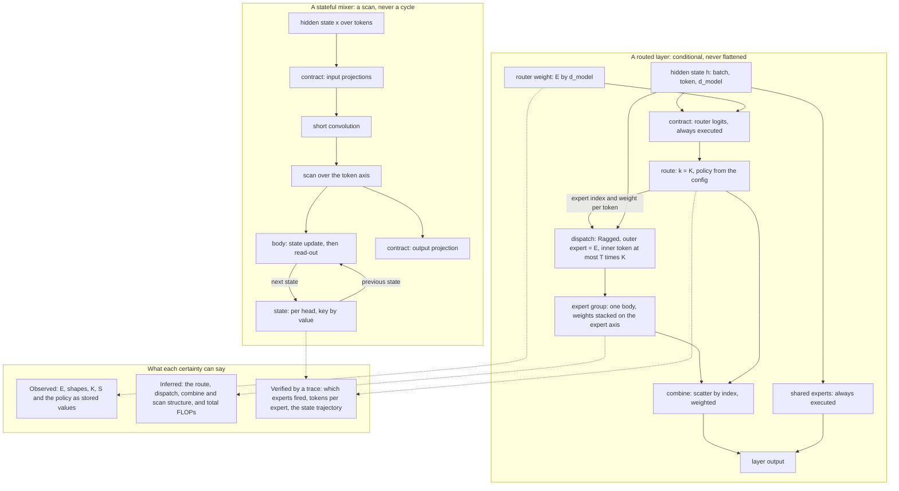

**Reading guide.** The top box is one MoE layer as ADR-0054 writes it: `route`, `dispatch`, `map_experts`,
`combine`, plus shared experts (`docs/adr/0054-dynamic-ops-bounded-dims-and-ragged-types.md:40-53`). Only two paths
always run: the router and the shared experts. The expert group runs for the routed tokens only, and its weights
stay one stacked tensor per role with an `expert` axis. The middle box is a stateful mixer: the loop is a `scan`
whose body is a pure region, and the two arrows between body and state are the body's argument and result, not a
cycle in the graph (`docs/adr/0056-state-scan-and-update-frequency.md:25-29`). The bottom box says which certainty
can state which fact; the dotted arrows connect each fact to where it lives.

### 15.1 MoE stays conditional

**FLOPs count active experts only.** Each token goes to exactly K experts, so the token-expert pairs of one layer
total `B·T·K` whatever the routing. The existing rule, `2 · numel(out) · k` (`docs/importer/README.md:114`), applies
unchanged to the ragged value, whose element count is that total.

| Path | Executes | FLOPs per layer |
| --- | --- | --- |
| Router | always | `2 · B·T · E · d_model` |
| Expert gate, up | for routed pairs | `2 · B·T·K · d_ff · d_model` each |
| Expert down | for routed pairs | `2 · B·T·K · d_model · d_ff` |
| Shared experts | always | as a dense gated FFN, times S |

Drawing every expert as executing would overstate the expert FLOPs by `E / K`: 51 times for `Qwen3.8-2.4T-A95B`
(512 experts, top-10) and 56 times for `Kimi-K3` (896, top-16), both Checked.

**The listing collapses the group.** One record per role per layer, with an execution condition:

```text
id          model.layers.12.mlp/experts.gate
operands    left: activation (dispatched), right: model.layers.12.mlp.experts.gate_proj  [expert, d_ff, d_model]
out_shape   [batch*sequence*K, d_ff]              a ragged total; per-expert counts are not known statically
contraction { batch: [], m: batch*sequence*K, n: d_ff, k: d_model }
flops_expr  2 * batch*sequence*K * d_ff * d_model
execution   { kind: routed, of: E, active: K, route: model.layers.12.mlp/~op/route.0 }
```

A 92-layer model with 512 experts lists `92 × 7 = 644` records (router, three expert roles, three shared-expert
roles) and not `92 × 512 × 3 = 141,312`. `Dim` already holds symbolic expressions such as `10*batch`
(`docs/engine/tm-ir-graph.rs:143-149`); the upper bound on a dim is ADR-0054's addition. The `execution` field is
additive in `MatmulRecord` and in the exported JSON; a v1 reader that ignores it still recomputes the same FLOPs.

**Storage forms are name rules, not graph shapes.** All four forms below were Checked on real headers, and all bind
to the same logical tensor `experts.<role>` with axes `[expert, out, in]`.

| Storage form | Example | Name rule |
| --- | --- | --- |
| One tensor per expert | `mlp.experts.{e}.gate_proj.weight` (`qwen3_moe`, `qwen3_next`); `block_sparse_moe.experts.{e}.w1.weight` (`mixtral`, `phimoe`, `minimax_m3_vl`) | `stack(axis = expert)`; the logical tensor is a `Composite` of E parts |
| Stacked per role | `blk.{i}.ffn_gate_exps` (GGUF) | as stored |
| Stacked and fused, `[E, 2·d_ff, d_model]` | `mlp.experts.gate_up_proj` (`qwen3_5_moe`) | `split(gate, up)` on axis 1 |
| Stacked and fused, `[E, d_model, 2·d_ff]` | `feed_forward.experts.gate_up_proj` (`llama4`) | `split(gate, up)` on axis 2, layout `in_out` |
| Stacked, fused and packed | `mlp.experts.gate_up_proj_blocks` and `_scales` (`gpt_oss`) | the sidecar rule first, then `split` |

Two tensors with one name and opposite layouts is exactly the mistake a name-only importer would make. The binding
verifier catches it because the expected shape comes from the hyperparameters, not from the name.

**Router policies are attributes.** `softmax`, `sigmoid` and `sqrtsoftplus` scoring, grouped top-k, a router bias, a
shared-expert gate and a per-expert scale all appear in Checked configs or tensors. They are values of `route`'s
`policy` attribute or small `map` nodes around it; an unknown policy is an `x-<namespace>` value
(`docs/adr/0054-dynamic-ops-bounded-dims-and-ragged-types.md:33-34`). GGUF records the same choice as
`{arch}.expert_gating_func` with three values (Checked).

**In TensorNodes.** A routed layer is one composite node. Opened, it shows the router, `route`, one expert body
drawn as `Expert × E, K active`, the shared experts and `combine`. The prototype draws a *sequential* stack as
`<Def> × <N>` (`docs/tensornodes/canvas-layout-and-rendering.md` §Folds, stacks and regions); a *parallel* group is
a new drawing of the same kind, and the document still holds one body, not E copies. Expert `e` is a slice, shown
in the tensor viewer, never a node.

### 15.2 Hybrid and state-space layers

A hybrid checkpoint mixes mixers by layer. The local sample has 48 gated-delta layers and 16 softmax layers
(`docs/adr/0056-state-scan-and-update-frequency.md:13-17`); its linear layers store `in_proj_qkv`, `in_proj_z`,
`in_proj_a`, `in_proj_b`, `conv1d`, `A_log`, `dt_bias`, `norm` and `out_proj`, and its softmax layers store
`q_proj` of twice the usual width (the output gate), `k_proj`, `v_proj`, `o_proj`, `q_norm` and `k_norm` (Checked
on its headers).

| Mixer | Graph form | State | Listing |
| --- | --- | --- | --- |
| Gated delta rule, Kimi Delta Attention | `scan(delta_rule …)` with a gate (`docs/adr/0056-state-scan-and-update-frequency.md:30-41`) | per head, `[key, value]`, updated per token | The body's contractions, each with `execution { kind: scan, length: sequence }`; FLOPs are per step times T |
| Mamba 1, Mamba 2 | `scan` over a selective state update | `[inner, state]` | The same |
| Recurrent loops (`dory`) | `scan` over a shared body with `length` the loop count; parameters referenced, not copied (`docs/adr/0056-state-scan-and-update-frequency.md:49-52`) | the hidden state | Per loop times the count |
| Lightning attention | to verify; a `scan` or a cumulative form | to verify | — |

Three rules follow ADR-0056. The graph stays acyclic. A chunked evaluation is a schedule hint, not a different
graph. And a state sequence is addressable as `…/<module>:state?trace=<id>` once a trace exists
(`docs/adr/0056-state-scan-and-update-frequency.md:53-55`). The exact forward order of each mixer is a property of
its block, taken from the upstream modeling file and confirmed by the block's conformance fixture; this document
asserts none of them.

### 15.3 What is Observed, Inferred, Verified

| Fact | Certainty | Evidence | Where it comes from |
| --- | --- | --- | --- |
| Expert count, stacked shapes, the state sizes | Observed | `declared` | Header shapes |
| Top-k, shared-expert count, scoring, dense-first layers, the layer-kind list | Observed as values | `declared` | `config.json` or GGUF keys |
| That those values drive a `route`, a `scan`, a mask | Inferred | `template` | The descriptor's recipe |
| Shapes of activations, total FLOPs | Inferred | `propagated`, `symbolic` | Shape inference over the graph |
| A layer kind chosen by tensor presence | Inferred, assumed | `heuristic` | `by_presence`, with a warning |
| Which experts fire, tokens per expert, expert frequency | Verified only | `sampled` | Router ids in a trace (`docs/adr/0059-turi-identity-source-maps-and-annotations.md:61-62`) |
| The state trajectory | Verified only | `sampled` | A captured `:state` |

---

## 16. Certainty and provenance model

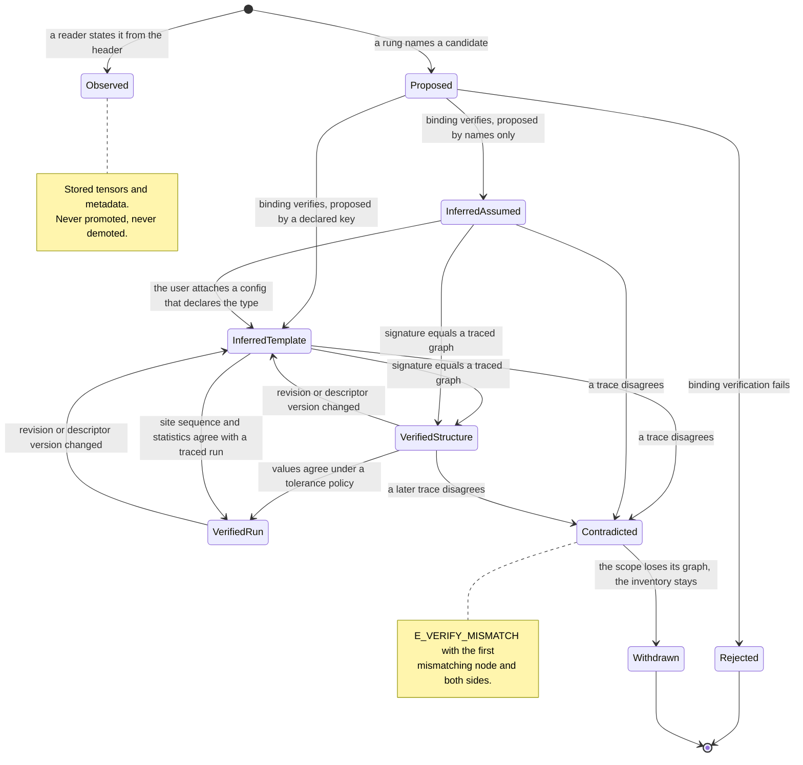

**Reading guide.** There are two tracks. A stored fact enters as Observed and stays there. A graph claim enters as
Proposed and can only move along the arrows. Promotion needs evidence that an execution produced; demotion happens
when the thing that was verified changes, or when a trace disagrees. No arrow leads from Proposed to a graph without
passing binding verification, and none leads to Verified without a trace.

### 16.1 Three axes, one record per claim

Every node, edge, binding and attribute of the graph carries one record:

```text
provenance {
  certainty      observed | inferred | verified
  evidence       declared | propagated | symbolic | template | heuristic | sampled      (TIP's enum)
  origin         file_graph | template | external_graph | none                          (the graph's)
  confidence     0..1, only for inferred                                                (ranks, never upgrades)
  rule           descriptor id @ version, block, name rule, or hyperparameter source
  verification   reference, method, policy, scope, revision, date                        (only for verified)
}
```

| Certainty | Meaning | Graph origin | Evidence levels it may carry |
| --- | --- | --- | --- |
| **Observed** | The file states it: name, dtype, shape, byte range, encoding, a metadata value | any, including `none` | `declared`; `propagated` for a fact derived from declared facts alone, such as a parameter count |
| **Inferred** | A descriptor or a rule adds it: an op, an edge, a role, an axis name, a quantization binding | `template` | `template` when a declared key proposed it; `heuristic` when names proposed it or a value was assumed; `propagated` and `symbolic` for what shape inference derives from it |
| **Verified** | An execution agrees: the graph comes from a trace, or matches one | `file_graph`; or `template` or `external_graph` with a verification record | `declared` when the trace is the opened file's own graph; `sampled` when a comparison or a run established it here |

**A derived fact takes the weakest certainty of its inputs.** The shape of an activation computed through an
Inferred op is Inferred. The total FLOPs of a model with one assumed layer kind are assumed.

**The six evidence levels need definitions.** Guide 24 lists them and does not define them
(`docs/guide/24-tip-tensor-intelligence-protocol.md:23`); ADR-0034 implies `declared` is the weakest claim the
engine can make about opaque content (`docs/adr/0034-tensor-ir-is-extension-compatible.md:49`). The table above is
this design's proposed reading, listed as PA-2.

**Where a file graph sits.** The requirement document defines Verified as "operations traced from an actual model
forward pass" (`docs/requirements/Top 20 open-weight LLM model families and flagship models.md:286`). An ONNX or
`.pt2` export is such a trace, and for the opened artifact its graph is not a prediction at all. So a graph of
origin `file_graph` is Verified with evidence `declared`: the engine relays a trace and has sampled nothing. It
becomes `sampled` only when a runtime run confirms it. That keeps two honest distinctions visible at once: stated
versus predicted, and taken on the file's word versus checked here.

**A model name proposes and nothing more.** Rung R4 can put a candidate in the plan's choices. It can never produce
a graph on its own, and a graph it led to stays assumed until a trace confirms it.

### 16.2 What promotes and what demotes

| Transition | Needs | Recorded as |
| --- | --- | --- |
| Proposed → Inferred | The full binding partition of [§7.5](#75-the-binding-verifier) | `I_TEMPLATE`, the descriptor id and version, the rung |
| Inferred → Verified by structure | The listing's signature, or a block's, equals that of a traced graph of the same model: an ONNX or `.pt2` export, or a runtime's site sequence. Compared with the existing `compare_signatures`, modulo tie groups | A verification record with scope (whole model, block or node) |
| Inferred → Verified by run | Captured statistics agree with the engine's own forward values under a named tolerance policy (`docs/adr/0043-reference-comparison-uses-explicit-recorded-tolerance-policies.md:33-52`) | The policy as applied, the trace id, the capture level |
| Verified → Inferred | The model revision, the descriptor version or the reference changed | The old record is kept as history, marked stale |
| Any → Contradicted | A structural mismatch, or a first divergence beyond the policy | `E_VERIFY_MISMATCH` with the first mismatching node, both sides and the policy |
| Contradicted → Withdrawn | Automatic for the mismatching scope | The scope's ops are removed, origin `none` for that scope, the inventory untouched; the descriptor is flagged in the registry |

A contradiction never silently repairs a graph. It removes the claim, says why, and offers what the empty-graph
state already offers: attach a graph, choose an architecture, open an export
(`docs/importer/README.md:74-75`).

### 16.3 How it reaches the user

| Surface | Shows | Mechanism |
| --- | --- | --- |
| Model editor, Overview | Origin, descriptor and version, rung, the count of nodes per certainty, component states | `model/summary`, `architecture/explain` |
| Graph tab and Graph canvas | A badge per node and per collapsed group: Observed, Inferred, Inferred (assumed), Verified. A group shows its weakest member | `GraphOp.provenance`; colours through `registerColor`, with a shape and a label so colour is never the only signal |
| Matmuls tab, exports | A certainty column; totals split by certainty and by execution condition | `MatmulRecord` |
| Problems | `W_ARCHITECTURE_ASSUMED`, `W_ASSUMED_HYPERPARAMETER`, `W_SIDECAR_UNBOUND`, `I_COMPONENT_NO_GRAPH`, `E_VERIFY_MISMATCH`, each with its evidence level | `IMarkerService` owner `tip` (`docs/guide/24-tip-tensor-intelligence-protocol.md:346`) |
| Exports | The provenance record on every node; a loss report when the target cannot hold it | `export/plan` |

The exported `tensormorph-matmul-graph` keeps its `source` field (`docs/importer/types.ts:172-183`) and gains the
record per node. The requirement document's `inference { method, confidence, verified }` block
(`docs/requirements/Top 20 open-weight LLM model families and flagship models.md:228-232`) maps onto it field for
field: `method` is `rule`, `confidence` is `confidence`, `verified` is `certainty = verified`.

---

## 17. Verification and conformance strategy

**What exists.** Five oracles hold the engine to the reference importer's numbers, with 0 payload bytes, and
thirteen seeded fuzz tests cover every parser (`docs/engine/README.md:25-59`). The strategy below extends that
discipline to descriptors; it adds no new kind of test.

**The conformance row of a descriptor.** A descriptor is Done when all six hold.

| # | Check | Input | Passes when |
| --- | --- | --- | --- |
| C1 | Binding, per naming scheme | A header-only fixture of a real checkpoint: `config.json`, the index, the shard headers | Every stored tensor falls in one class of [§7.5](#75-the-binding-verifier); 0 payload bytes |
| C2 | Structure against a trace | A tiny random-init model of the upstream class, saved as safetensors and exported with `torch.export` or ONNX | The descriptor graph's signature equals the file graph's, modulo tie groups |
| C3 | Scheme equivalence | The same tiny model converted to GGUF by the real converter | The GGUF binding gives the same canonical names and the same signature, as oracles 2 and 3 do today |
| C4 | Golden numbers | The tiny configuration | Matmul count, edge count and total FLOPs equal hand-derived values |
| C5 | Hostile input | Mutated descriptor files, sidecar inputs and configs | A typed error or a bounded result, never a panic |
| C6 | Determinism | Two runs | Byte-identical listing and `.tmir` text |

C2 is the Verified reference the requirement document asks for. It is produced offline, by a fixture generator that
needs Python and vendor toolchains and never runs inside the IDE; ADR-0057 already proposes moving the existing
export scripts into the repository for this purpose and leaves it to the owner
(`docs/adr/0057-exports-to-stablehlo-and-mlir-with-loss-reports.md:64-65`).

**Known limits, and what replaces the missing check.**

| Limit | Why | Replacement |
| --- | --- | --- |
| Data-dependent routing does not survive a trace export | An exporter either fails or specializes to one routing; a dense variant runs every expert | Normalize before comparing: E isomorphic expert branches fold into one group. That verifies structure. Conditionality is verified by a runtime trace's router ids |
| A `scan` exports unrolled for a fixed length | The trace has T copies of the body | Compare one body's signature and the count |
| Custom-code models | 208 of 832 Checked configs need `auto_map` code to build a tiny model | Only the offline generator runs that code, in a sandbox. Prefer the upstreamed class when one exists (548 model folders upstream). Otherwise the descriptor stays Inferred, and says so |
| Gated repositories | Headers cannot be redistributed | A test that skips with a message when the fixture is absent, as the `weights/` corpus does (`docs/superplan/10-decisions-and-risks.md:51`) |
| Header size | A per-expert MoE index is large (75,944 names for `Qwen3-Next-80B-A3B`) | Store the index and one shard header; or a synthetic header generated from the descriptor at tiny dims |
| Quantized values | No `BlockScaled` decoder yet | C1 verifies the sidecar binding by shape; value checks wait for ADR-0051 |

**The header-only fixture corpus.** One folder per checkpoint: `config.json`, the index if any, each needed shard's
header bytes, and a provenance file with the URL, the revision hash, the date and the licence. The local sample
measures the cost: four shard headers are 45,448 bytes. Fetching uses HTTP range requests; a fixture never contains
a payload byte.

**Oracles to add first.**

1. **A measured baseline.** Run today's `llama` template over header fixtures of the checkpoints that declare
   `llama` (Yi-1.5, Falcon3, SmolLM2, Llama 3.x through a mirror, the DeepSeek distills) and record which bind.
   Today's coverage is a belief until this runs.
2. **The local sample.** `Qwen3.8-27B-FP8` binds completely: 64 layers of two kinds, the MTP head, the vision tower,
   and every `weight_scale_inv` attached to its principal. ADR-0051 already names this checkpoint as the first
   format oracle (`docs/adr/0051-numeric-formats-are-parameterized.md:73-75`), and ADR-0056 names `qwen3_5` as the
   first template to use `scan` (`docs/adr/0056-state-scan-and-update-frequency.md:67-68`).
3. **A tiny synthetic MoE** with known routing FLOPs (`docs/adr/0054-dynamic-ops-bounded-dims-and-ragged-types.md:71`).

**What "covered" means for a family.** Coverage is a table, not a flag. For each architecture row of
[§9](#9-family--architecture-coverage-matrix): the descriptor's six checks; one bound real fixture per naming scheme
the family publishes; one bound fixture per quantization format it publishes; and either a Verified reference (C2)
or the stated reason it stays Inferred. A family is *covered* when its flagship architecture and its simplest
architecture both meet this, and *partly covered* otherwise, with the missing cells named.

---

## 18. Placement in the repository

Take the first place that can do the job (J-03: `docs/project/repository-rules.md:43-53`). Almost everything here is
engine work, because it is parsing and graph analysis, and the shell must hold none of it (R-06:
`docs/architecture/dependency-rules.md:68`).

| Component | Home | Rule that decides |
| --- | --- | --- |
| Registry, descriptors, assemblies, layer recipes, the binding verifier | `engine/tm-import`, module `arch` (today's `templates`) | J-01: no new crate until a second consumer needs part of it (`docs/architecture/dependency-rules.md:111`) |
| Block library | `engine/tm-import`, with decompositions registered in `engine/tm-ir` | The Canonical vocabulary stays closed and owned by the engine (`docs/adr/0034-tensor-ir-is-extension-compatible.md:31-34`) |
| Sidecar rules | `engine/tm-import`, beside the readers | They are format knowledge |
| Descriptor data and generated tables | data files in the `tm-import` crate, checked in | R-12: generated files are never edited by hand |
| Table generator | a stdlib script beside the crate, as `gen_tip.py` is in `tm-tip` (`docs/engine/README.md:12`) | No new dependency (C-06) |
| New Canonical ops, provenance, the `execution` field | `engine/tm-ir` | R-03, R-04: no Tauri, no GPU API |
| `architecture/*`, `verify/*` | `engine/tm-tis` | TIS orchestrates and does not duplicate the runtime |
| Protocol shapes | `engine/tm-tip/tip.meta.json`, generating Rust and `tipProtocol.generated.ts` | One meta-model (R-12) |
| Structural verification | `tm-import` (signatures) and `tm-tis` | — |
| Numeric verification | `backend-cpu` through `graph/evaluate` | The CPU provider is the oracle (`docs/adr/0005-compute-runtime-architecture.md:18`) |
| Runtime probes, alignment | `engine/tm-probe` [proposed]; the probe packages live outside the repository | ADR-0039 clause 9 |
| The debug adapter | `engine/tm-dap` and a workbench factory | ADR-0035; SP-D29 still decides its folder |
| Exports | `engine/tm-export` | ADR-0057 |
| Model editor additions: architecture picker, explain panel, badges | `contrib/tensormorph/browser/`, with pure types in `common/` | D3: the umbrella contribution; R-02, R-03 |
| Graph canvas composite and parallel-group nodes | `contrib/tensormorph/browser/` | A `ViewPane` or `EditorPane`, never a webview (R6.8) |
| Findings | `IMarkerService`, owner `tip` | Reuse VS Code first (ADR-0030) |
| Settings | `tensormorph.import.*` | D4 naming |
| Desktop adapter | none new | The transport exists; a `tauri-browser/` file would be feature logic in the wrong layer |
| Tauri shell | nothing new for TIP | "Only `platform/tensor/` imports engine crates" (`docs/architecture/tauri-rust.md:96-97`) |
| REH sidecar | nothing | Node never hosts the server (`docs/guide/24-tip-tensor-intelligence-protocol.md:351`) |
| Built-in extension | none needed | First-party descriptors ship in the engine. A contribution point for third parties needs the proposed `vscode.tensor` API (PA-6) |
| Fixture generator, header fetcher | offline tools, outside the IDE runtime | Python and vendor toolchains never enter the engine (`docs/adr/0060-kernels-come-from-existing-stacks.md:50-51`) |
| Domain packages `itensor`, `imodel`, `ilattice`, `threetex`, the reference importer | untouched | Never imported from `src/vs` (OQ-A9) |

**Desktop and web.**

| Concern | Desktop | Web |
| --- | --- | --- |
| Registry, readers, verification | The local engine | The same crates behind the Cloud GPU API |
| Transport | `tauriTipTransport.ts` over the `tensor` channel | The web transport to the API |
| Model files | Local `file:` URIs only | Where the web version's models live is open (`docs/adr/0031-shared-typescript-desktop-local-gpu-web-cloud-gpu.md:120-121`) |
| Third-party descriptors | Files the user or an extension provides | Sent to the service, or disabled by capability |
| Runtime probes | A probe on a reachable host | A probe beside the service; a remote window does not reach `tensor` today |

Feature code never branches on the platform. A missing capability (`architectures`, `verification`) disables UI
through a context key on both builds (`docs/adr/0031-shared-typescript-desktop-local-gpu-web-cloud-gpu.md:92-93`).

**Rules this placement keeps.** No page code touches the Tauri bridge, and `common/` and `browser/` import no
`tauri-browser/` file (R-01, R-02: `docs/architecture/dependency-rules.md:63-64`). The shell stays thin (R-06). No
tensor value crosses as JSON: every new method carries metadata, and values go by ticket (R-07). Third-party content
is namespaced `x-<publisher>` and can never edit the core vocabulary (ADR-0034). No kernel is generated and no
compiler stack becomes a build dependency of the engine (ADR-0060). Every new surface reuses a VS Code mechanism
(ADR-0030): the editor resolver, `IMarkerService`, the configuration registry, `registerColor`.

---

## 19. Phased roadmap

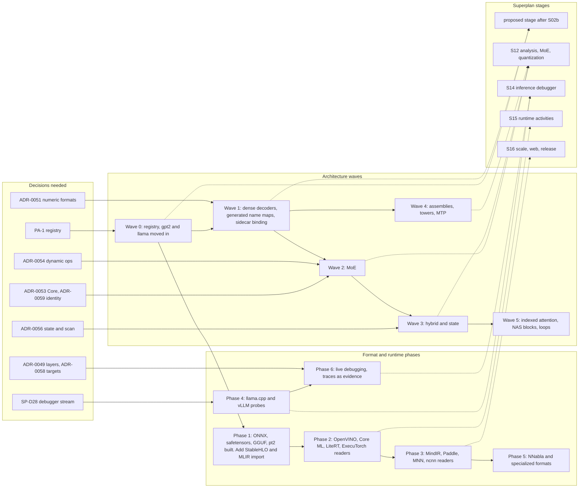

**Reading guide.** Three lanes run in parallel and meet at a few arrows. The left lane is decisions; a wave cannot
start before the decisions pointing at it are recorded, which is the superplan's own rule for a stage with an open
decision (`docs/superplan/10-decisions-and-risks.md:9-12`). The middle lanes are the two requirement documents'
orders: the seven priority families first, and the format phases 1 to 6
(`docs/requirements/Top 20 open-weight LLM model families and flagship models.md:290-304`;
`docs/requirements/Global inference runtimes and model formats.md:307-327`). The dotted arrows say which superplan
stage would carry each piece; stages S11 to S16 are outlines today (`docs/superplan/README.md:68-73`).

| Wave | Delivers | Entry | Exit | Depends on | Attaches to |
| --- | --- | --- | --- | --- | --- |
| 0 Registry | The template enum becomes a registry; `gpt2` and `llama` are descriptors; the generic adapter is explicit; provenance fields; `architecture/list`, `resolve`, `explain` | PA-1 accepted | The five oracles unchanged; 0 payload bytes; the measured baseline of [§17](#17-verification-and-conformance-strategy) | nothing Proposed | A proposed stage after S02b |
| 1 Dense | Generated name maps; descriptors for `qwen2`, `qwen3`, `gemma` to `gemma3_text`, `phi3`, `glm`, `glm4`, `gpt_neox`, `olmo2`, `olmo3`, `granite`, `internlm2`, `minicpm`, `smollm3`; sidecar binding as metadata | Wave 0; PA-4 | Six checks per descriptor; rows 15 and 19 covered; the dense architectures of the seven priority families covered | ADR-0050 axes (Accepted); ADR-0051 for decoding only | The same stage |
| 2 MoE | `route`, `topk`, `scatter`, `segment` and the `moe` composite; collapsed listing; descriptors for `qwen3_moe`, `deepseek_v2` and `deepseek_v3` with MLA, `kimi_k2`, `glm4_moe`, `minimax_m2`, `llama4_text`, `mixtral`, `gpt_oss`, `phimoe`, `granitemoe`, `olmoe` | ADR-0054 accepted; PA-3 | The synthetic MoE oracle; FLOPs for active experts only; every storage form of [§15.1](#151-moe-stays-conditional) binds | ADR-0053, ADR-0054, ADR-0059 | S12 |
| 3 Hybrid | `scan`, `state_update`; gated delta rule, Mamba 1 and 2; descriptors for `qwen3_next`, `qwen3_5_text`, `qwen3_5_moe_text`, `kimi_linear`, `minimax_text_01`, `jamba`, `granitemoehybrid`, `falcon_h1`, `nemotron_h`, `olmo_hybrid` | ADR-0056 accepted | The local sample's text decoder binds and lists | ADR-0056, ADR-0049 | S12 |
| 4 Assemblies | Components and partial graphs; vision and audio towers, projectors, MTP heads; the wrappers of [§9](#9-family--architecture-coverage-matrix) | Waves 1 and 3 | The local sample binds completely; no tensor outside a class | none new | S12 |
| 5 Sparse and unusual | Indexed attention; per-layer NAS configs; recurrent loops; `deepseek_v32`, `deepseek_v4`, `glm_moe_dsa`, `mistral_large4`, `minimax_m3_vl`, `nemotron-nas`, `dory` | Waves 2 and 3 | The flagships of rows 2, 5, 8 and 12 covered | ADR-0054 | S12 or later |

| Phase | Delivers | Entry | Exit | Attaches to |
| --- | --- | --- | --- | --- |
| 1 Universal inspection | Four of six formats are built. Add StableHLO text and an MLIR subset as file graphs | Wave 0 | A StableHLO export of the tiny models opens with origin `file_graph` | The stage after S02b |
| 2 Western runtimes' formats | OpenVINO, Core ML, LiteRT, ExecuTorch readers | The importer's phases P4 to P6 (`docs/importer/README.md:49-51`) | One reader, one fuzz target, one fixture each | S15 or a format stage |
| 3 Chinese formats | MindIR, Paddle (two readers), MNN, ncnn | Phase 2 | The same | Later |
| 4 LLM execution | Probes for llama.cpp and vLLM, then SGLang, MLX-LM | SP-D28 | A traced forward run of a tiny model aligns with its graph | S14 |
| 5 Specialized | NNabla; compiled artifacts as metadata | Phase 3 | The same | Later |
| 6 Live debugging | Breakpoints, capture levels, traces as verification evidence | ADR-0033 (DAP) to ADR-0045 accepted | An Inferred graph of a tiny MoE becomes Verified by a run | S14 |

Exports follow ADR-0057 in a later export stage (`docs/superplan/10-decisions-and-risks.md:56`). Custom accelerator
work is not scheduled (`docs/superplan/10-decisions-and-risks.md:57`); the design only keeps `route`, `topk`,
`BlockScaled` and `delta_rule` expressible, as ADR-0058 asks.

---

## 20. Risks, open questions and proposed ADRs

### Proposed ADRs

Each would be written in the IDE's ADR folder by the owner's decision. None is written here.

| ID | Decision to record | Options | Recommendation |
| --- | --- | --- | --- |
| PA-1 | One architecture registry replaces the template enum and the TURI specification's adapters | (a) Keep two concepts and port the adapters. (b) One registry of descriptors as data over a closed block library. (c) One template per `model_type`, as code | (b). 144 `model_type` values make (c) unbounded, and (a) keeps two sources that can disagree |
| PA-2 | Certainty, evidence and origin are three axes; the six evidence levels get definitions; a file graph is Verified with evidence `declared` | (a) As [§16](#16-certainty-and-provenance-model). (b) A file graph is Observed. (c) One merged scale | (a). It matches both requirement documents and loses no distinction |
| PA-3 | The Canonical op list grows beyond the reference importer's 36 | (a) Grow it in the engine, with engine-owned oracles for the new ops. (b) Represent MoE and state as `opaque`. (c) Extend the TypeScript reference first | (a). (b) breaks the rule that MoE stays conditional; (c) revives code SP-D05 retired. Accept ADR-0053, ADR-0054 and ADR-0056 in that order |
| PA-4 | Name maps and hyperparameter keys are generated from pinned upstream snapshots, with an overlay | (a) Generate and overlay. (b) Type them by hand. (c) Depend on the upstream packages at run time | (a). (c) would put Python in the engine. Record the commits and the licence notices |
| PA-5 | The matmul record gains `execution`; the exported JSON stays v1 with additive fields | (a) Additive in v1. (b) A v2 schema | (a) while readers ignore unknown fields; (b) the first time a field must be required |
| PA-6 | How a third-party descriptor reaches the engine | (a) A workspace or user setting that lists descriptor files. (b) An extension contribution point through the proposed `vscode.tensor` API. (c) Not supported | (a) first: it needs no new API. (b) when that API leaves proposed status |
| PA-7 | Foreign runtimes are observed through `RuntimeProbe` and attached through DAP; a trace is a TIP resource and verification evidence | (a) As [§11](#11-runtime-and-ecosystem-adapters). (b) Session control over TIP. (c) Embed runtimes | (a). (b) duplicates DAP's session model; (c) breaks the security model. Needs SP-D28 |
| PA-8 | Assemblies, components and partial graphs | (a) A component may be declared without a graph. (b) No graph unless every component binds | (a). It is the only way a multimodal flagship shows anything, and it never hides a tensor |

### Open questions for the owner

| # | Question | Options | Recommendation |
| --- | --- | --- | --- |
| Q1 | Does the registry get its own crate? | A module of `tm-import`; a crate `tm-arch` | A module now (J-01); a crate when the Cloud service or third-party loading needs it alone |
| Q2 | In what form are descriptors written? | A data format; Rust tables; `.tmir` regions | A data format for descriptors, Rust for blocks. Revisit `.tmir` regions for third-party blocks once ADR-0055's parser exists |
| Q3 | May the fixture corpus hold copies of public `config.json` files and headers? | Commit them; fetch them in a script; keep them local | Commit only what a test needs, with provenance and licence; gated checkpoints stay local and their tests skip |
| Q4 | Do the offline generators (tiny models, exports, conversions) move into the repository? | Yes, as tools; no | Yes. ADR-0057 already asks; it is the only source of Verified references |
| Q5 | Is the MTP head part of the forward graph by default? | Bound and shown; bound and hidden; ignored | Bound as its own component, off the main path, shown on demand |
| Q6 | What does a sliding-window layer list as FLOPs? | The full contraction; the windowed count | The full contraction with the window as an annotation; the cost model prices the window |
| Q7 | Should a graph reached only by fingerprint be built at all without a user action? | Build and warn; offer only | Build and warn. It is useful and it cannot become Verified by itself |
| Q8 | Which runtime context key names a trace? | `trace` (guide 22); `run` (ADR-0041) | `trace`, and amend ADR-0041 |
| Q9 | A stage for Waves 0 and 1? | A new stage after S02b; fold into S12 | A new stage: it is import work and S12 depends on it |

### Risks

| ID | Risk | Mitigation |
| --- | --- | --- |
| R1 | The landscape moves faster than descriptors: 173 GGUF architectures and 548 upstream folders today | Descriptors are data; generated tables refresh from a snapshot; the generic adapter always works; near-miss reports make a new descriptor an afternoon, not a release |
| R2 | A descriptor that fits and is wrong (the order of a forward pass) | Fit never claims more than Inferred; check C2 for every descriptor with an upstreamed class; traces can contradict and withdraw |
| R3 | Upstream renames or restructures (llama.cpp already split its converter into 119 modules) | Pin snapshots; the generator fails loudly on a shape it does not know; the overlay is small |
| R4 | Custom-code architectures cannot get a Verified reference | State it; prefer upstreamed classes; keep those descriptors Inferred |
| R5 | Core, dynamic ops and state are all Proposed, and three waves depend on them | Wave 0 and 1 need none of them; the decisions are listed at the head of the roadmap |
| R6 | Scale: 91,991 tensors in one checkpoint, 896 experts per layer | Header-only; collapsed listings; virtual children; paged cursors; the existing 700 GB scenario (`docs/adr/0054-dynamic-ops-bounded-dims-and-ragged-types.md:22-23`) |
| R7 | Sidecar rules bind the wrong companion | Shape relations are verified; an unbound companion fails the partition loudly |
| R8 | Certainty badges are ignored or misread | One badge per node, the weakest member on a group, the same words in every surface, findings in Problems |
| R9 | Hostile descriptor files from third parties | They are data under limits, fuzzed (C5), namespaced, and can only compose existing blocks |
| R10 | Licence exposure of derived tables and fixtures | Names and keys only; notices kept; counsel asked (Q3) |
| R11 | The TEL and TensorNodes projections cannot express new blocks | Marked read-only lines and counted exclusions; no dependency on TEL changes |
| R12 | Runtime hook surfaces differ from the planned observability class | A spike per adapter before it is planned; a runtime's class is data it reports, not a constant |

---

## Appendix A: how external facts were checked

All checks ran on 2026-11-15 from public sources, with header-only reads and no model payload.

| Source | What was read | Count |
| --- | --- | --- |
| Hugging Face `config.json` | Model type, architecture class, nested configs, the keys that shape a graph | 832 configs of the twenty families and their organisations; 144 distinct top-level `model_type` values; 112 distinct nested ones; 271 with nested configs; 208 with `auto_map` |
| Hugging Face repository listings | Which repositories exist, including each named flagship | Twelve organisations |
| Safetensors headers and index files | Tensor-name patterns, dtypes, shapes | 16 remote checkpoints by HTTP range, 41 saved headers, and four shards of the local sample (45,448 header bytes) |
| llama.cpp `gguf-py` at `master` | `constants.py`, `tensor_mapping.py`, the conversion modules | 173 architectures, 729 tensor roles, 448 keys, 1,734 aliases, 119 modules |
| `transformers` at `main` | The list of model folders | 548 folders |
| Licence files | llama.cpp, `gguf-py`, ggml, `transformers`, safetensors, compressed-tensors, llm-compressor, AutoAWQ, AutoGPTQ, bitsandbytes, MLX | MIT or Apache-2.0 as stated in [§7.6](#76-name-maps-are-generated) and its neighbours |
| Format schemas | The public schema or specification file of each format marked "schema Checked" in [§10](#10-format-adapter-matrix) | 77 files retrieved (schemas, specifications and READMEs) |

**Not checked, and so marked "to verify" in the text.** The forward order of any block (no modeling file was
analysed); the gated originals of Llama, Gemma and Jamba 1.x (mirrors were read instead, or nothing); MiniCPM-o and
the MiniCPM-V wrappers; `falcon` 7B and 40B; the sidecar tensor names of compressed-tensors, ModelOpt, bitsandbytes
and BitNet; the containers of RKNN, OM, AIR, MagicMind, Horizon, AXera, QNN and Core AI; the hook surface of every
LLM runtime; and whether today's `llama` template binds the checkpoints that declare `llama`.

**A caution about names.** Several architecture strings in these sources are newer than any description this
document could rely on. The design never needs to know what a name means: it needs the file's declared key, a
descriptor that claims it, and a binding that verifies.

