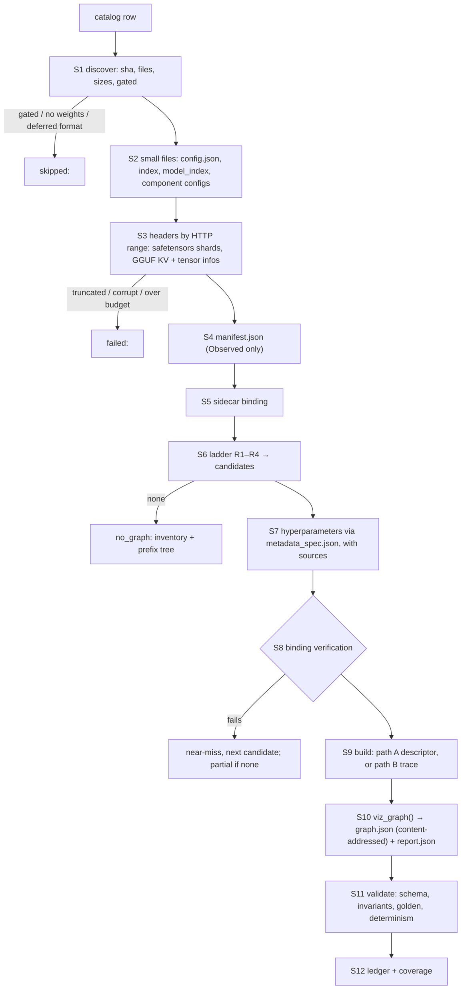

# Hugging Face weights → tensor manifest JSON → computation-graph JSON (→ TEL)

**What this is.** This is the master document for `/create-plan`. It asks for a resumable plan to build an offline
Python pipeline with three steps:

1. Take every Hugging Face URL in the model catalog.
2. Read only the *headers* of its safetensors or GGUF weights, plus its small config files, and write a **tensor
   manifest** (the middle JSON, Observed facts only).
3. Turn that manifest into a **computation-graph JSON** in the `tensormorph-viz-graph` v1 format of `json/*.json`, using
   a registered architecture library.

It also asks for a *design* of how that graph becomes Tensor Expression Language (TEL), with one proof run. The TEL
converter itself is not built in this stage.

**Run it as:** `/create-plan prompts/hf-weights-to-graph-json-pipeline.md`

**Final goal, not this stage.** The Tensormorph IDE and TensorAgora, a tensor hub that opens any Hugging Face URL and
draws its tensor graph from header metadata. This stage produces the data and the converters that site will need:
URL → manifest → graph.

**Why a registry is needed.** A weight file is a `name → tensor` dictionary. Its header gives names, dtypes and shapes.
It does not give the order of operations, the activations, the residual wiring, masks, routing or recurrence. Two
models with identical shapes can run different forward passes (`open-weight-model-graphs.md` §1, §6 rule 2). The
graph must therefore come from a **registered architecture**: a descriptor or library class that is chosen by the
metadata and then *verified* against the header. Verified means every weight it needs exists with the expected shape,
and every stored tensor is accounted for. The header proposes a candidate. The binding verifier decides.

---

## 1. Requirements

Each requirement has one runnable check. The plan keeps the IDs.

| ID | Requirement | Check |
| --- | --- | --- |
| R-00 | One URL end to end: `python -m tools.hf_graph <huggingface_url> [--revision R]` → manifest → report → graph. The batch runner (R-14) is a loop over this same function | `tools.hf_graph https://huggingface.co/Qwen/Qwen2.5-7B-Instruct` writes all three files, and the graph passes §8.2 |
| R-01 | Read the catalog `csv/categories/<category>/<format>.csv` and turn each row into a job: `huggingface_url` → repo id. Golden repos missing from the catalog (§8.1) are added from `goldens.csv` | The job count equals `csv/categories/index.csv`'s total (29,779) plus the golden extras (1 today) |
| R-02 | Discover each repo: pinned revision `sha`, the file list with sizes, `gated`, the weight files to read (§5.1) | On a 100-row smoke set, every row has a `sha` or a terminal `skipped:*` status |
| R-03 | Fetch the small files listed in §3, cached by `(repo, sha, path)` | A second run makes 0 network requests for cached rows |
| R-04 | Read safetensors headers (every shard) by HTTP range, with 0 payload bytes | A unit test on a fixture header; on real repos, `payload_bytes_read == 0` and the tensor count equals the index's `weight_map` |
| R-05 | Read GGUF headers (KV and tensor infos) by incremental HTTP range, with large arrays summarized and a byte budget (D3) | A unit test on a fixture header; the tensor count equals the GGUF `tensor_count` |
| R-06 | Write `manifest.json` (tensor manifest v1, §5.2) with a JSON Schema and a validator. Observed facts only | Every manifest validates; a re-run is byte-identical |
| R-07 | Bind quantization sidecars (§7.4 of the design doc) and record each binding in `report.json` | The Qwen3.8-27B-FP8 golden: every `weight_scale_inv` attached to its principal and 0 unbound sidecars |
| R-08 | Resolve the architecture with the ladder R1–R4 (§4), producing ranked candidates | A unit test: Kimi-K2 (`model_type: kimi_k2`, `architectures: [DeepseekV3ForCausalLM]`) resolves to the deepseek_v3 descriptor |
| R-09 | Resolve hyperparameters from `metadata_spec.json` expressions, each recorded with its source (config key, GGUF key, shape, catalog, default) | Every dim in a graph has a recorded source in `report.json` |
| R-10 | Verify the binding: every stored tensor falls in exactly one class (bound, tied, ignored, aux, component); failures give a near-miss report | A unit test with one tensor removed or misshaped must fail and name it |
| R-11 | Build the graph: a descriptor over the block library on `Program` (path A, §6), then `viz_graph()` | The golden repos rebuild structurally equal to `json/*.json` (§8.1) |
| R-12 | Library-trace fallback (path B, §6) for timm and diffusers classes and LLM `model_type`s with no descriptor, on the `meta` device, never running remote code | A tiny timm model and a tiny diffusers UNet give valid graphs whose parameters all bind |
| R-13 | Write `graph.json` (viz-graph v1 plus the additive fields of §5.3) and `report.json`. Graphs are stored once per content key (D9) | Every graph passes the §8.2 invariants; duplicate configs share one stored graph |
| R-14 | Run the batch over all rows: resumable ledger, bounded concurrency, backoff, `HF_TOKEN` optional and never logged | Killing a run and restarting it skips completed rows; `coverage.csv` sums to the R-01 job count |
| R-15 | Report coverage: category × format × status, `model_type` × status, and a near-miss backlog ranked by unlockable rows | The files exist and the totals match the ledger |
| R-16 | Design graph ⇔ TEL (§9): mapping, bindings, counted exclusions; a per-graph round-trip check over T♭ (§9.5, §9.6) | On the 8 goldens the check reproduces §9.5: with `--const-as-buffer`, 0 differences and 6 of 8 pass D3; adding `--fix-contract`, 8 of 8 have 0 differences, compile and pass D3 |

---

## 2. Inputs the plan must read first

| Input | Path | What it gives |
| --- | --- | --- |
| Model catalog | `csv/categories/<category>/<format>.csv`, `all_models.csv`, `index.csv`, `README.md` | 29,779 HF repos in 21 graph categories × 5 formats. Columns include `huggingface_url`, `model_type`, `architectures`, `gguf_architecture`, `num_layers`, `hidden_size`, `num_attention_heads`, `num_kv_heads`, `routed_experts`, `graph_flags`, `metadata_origin`, `metadata_files`, `base_model`, `gated` |
| Per-category metadata spec | `csv/categories/<category>/metadata_spec.json` | For every output dim symbol (D, V, F, H, Hkv, Dh, Dq, Dkv, E, Fe, QR, KR, Hk, Hv, …): the `config.json` expression and the GGUF KV expression; plus `attrs`, safetensors and GGUF header fields. GGUF keys are validated against `gguf.constants.Keys` |
| Catalog generator | `tools/split_model_catalog.py` | Regenerate with `uv run --with gguf python tools/split_model_catalog.py --check` |
| Target output examples | `json/*.json`, 8 files | The exact viz-graph v1 shape: `format, version, source, model, example, dims, axes, aliases, elided_modules, regions, inputs, outputs, totals, tensors[], ops[], edges[], groups, multiplications[], verification[], roles, lanes, checkpoint` |
| Design reference | `open-weight-model-graphs.md` | The architecture to follow (§4 below lists the sections) |
| Existing Python graph code | `src/gpt2_pytorch/tensorprog/program.py`, `tensorprog/viz.py`, `tensorprog/qwen3_5.py`, `tensorprog/lower.py`, `checkpoint/safetensors_loader.py` | Reuse these; do not re-implement them:<br>• `program.py`: the `Program` builder, with `contract`, `elementwise`, `reduce`, `gather`, `slice`, `reshape`, `permute`, `rename`, `composite`<br>• `viz.py`: `viz_graph()`, program → viz-graph<br>• `qwen3_5.py`: a full hybrid lowering from `config.json`<br>• `lower.py`: the GPT-2 lowering<br>• `safetensors_loader.py`: `read_safetensors_header` |
| Existing CLI | `tools/model_graph.py`, `tools/viz_graph.py`, `tools/viz_to_tel.py`, `tools/tel_compile.mjs` | `model_graph.py` reads a local folder's headers, builds a viz-graph and checks the binding; it is the one-model path that R-11 generalizes. `viz_to_tel.py` turns a viz-graph into Quick TEL |
| Existing JS architecture library | `/Users/thanh/Tensormorph/TensormorphDesignUI/tensormorph/ui/activity_bar/viewport/graphs/arch.mjs` (378 lines) | Produced 6 of the 8 examples, "spelled from the model config" in `../shared/mock.js`. It has three graphs (`llamaGraph`, `mixtralGraph`, `deepseekGraph`) and six blocks (`rms`, `rope`, `softmax`, `gqa`, `swiglu`, `experts`). Port the blocks to Python on `Program` |
| TEL operator catalog and ADRs | `/Users/thanh/Tensormorph/tensormorph-source/tensorexpressionlanguage/tensorexpressionlanguage/docs/operators/`, `../adr/`, `../architecture/` | The target vocabulary for R-16 (§9) |
| TEL bridge notes | `docs/TEL_NEXT_STEPS.md` | The DistilGPT2 × TEL analysis and its golden contract |

The plan's first task reads these and confirms every path. A missing path goes to `HARNESS.md`, not into an assumption.

**Catalog numbers this plan works from** (measured from `all_models.csv`):

- **Rows in scope:** 23,372 of 29,779. These are safetensors and GGUF rows outside `classic_nlp`: 19,580 safetensors
  and 3,792 GGUF. The other 6,407 are pytorch, ONNX, TF or Flax and get `skipped:deferred_format`.
- **Exceptions:** 671 rows are gated, 1,844 need remote code, and 7,744 have neither a `model_type` nor a GGUF
  architecture in the catalog. Most of those resolve by `backbone_class` (diffusers) or `timm_module`. The truly
  unkeyed rows number 1,870: diffusion_dit 772, unknown 360, diffusion_unet 333, decoder_dense 202, encoder 72, and
  111 elsewhere. They must resolve from the fetched `config.json` / `model_index.json`, and only then fall to R3
  fingerprints.

| Category | Rows in scope | Distinct keys | Top keys (rows) |
| --- | --- | --- | --- |
| decoder_dense | 6,025 | 269 | llama 1533, qwen3 955, qwen2 817, mistral 392, hf_olmo 354, gemma2 101, gemma3_text 95 |
| encoder | 4,122 | 259 | bert 1237, modernbert 553, xlm-roberta 497, roberta 373, deberta-v2 304, distilbert 189 |
| multimodal_vlm | 3,004 | 202 | qwen3_5_text 930, qwen3_5_moe_text 269, gemma4_text 186, qwen3_vl_text 123, qwen4_exp_text 113, paligemma 76 |
| diffusion_dit | 2,540 | 255 | (unknown 772), WanTransformer3DModel 134, FluxTransformer2DModel 134, QwenImageTransformer2DModel 109 |
| diffusion_unet | 2,271 | 43 | UNet2DConditionModel 1759, (unknown 333), UNet2DModel 71 |
| decoder_moe | 925 | 111 | qwen3_moe 132, mixtral 74, gpt_oss 57, deepseek_v3 54, glm_moe_dsa 52, deepseek_v4 37, deepseek_v2 34 |
| vision_cnn | 892 | 51 | resnet 150, efficientnet 119, convnext 102, regnet 65 |
| decoder_hybrid | 823 | 33 | qwen35 (GGUF) 271, lfm2 124, qwen3_5_text 116, jamba 71, nemotron_h 39, falcon_h1 38 |
| encoder_decoder | 757 | 27 | t5 234, bart 117, marian 117, mt5 90 |
| vision_vit | 612 | 26 | vision_transformer 285, eva 73, xcit 42 |
| others | 1,401 | — | unknown 375, decoder_hybrid_moe 260, diffusion_control_adapter 192, vision_hybrid 177, diffusion_vae 138, vision_multimodal 137, diffusion_multimodal 79, diffusion_lm 23, speculative_draft 12, ssm_rnn 8 |

The distribution is long-tailed. About 25 keys (llama, qwen2/3, mistral, bert family, t5/bart, qwen3_5_text, UNet2D,
resnet/vit, …) cover most rows. Wave 0 recomputes this table from the fetched manifests and orders the descriptor
backlog by rows unlocked.

---

## 3. Constraints

- **Header only.** Never download a weight payload.
  - A safetensors header is the first `8 + N` bytes, where N is a u64 LE.
  - A GGUF header is read incrementally up to the end of its tensor-info table.
  - Count the bytes read per model and assert 0 payload bytes.
  - The only other files fetched are `config.json`, `*.safetensors.index.json`, `model_index.json`,
    `<component>/config.json`, the timm `config.json` (with `pretrained_cfg`), and `params.json` (Mistral).
- **Nothing from the repo executes.** Never run a repo's `modeling_*.py` (`trust_remote_code`). Library classes that
  ship inside `transformers`, `timm` or `diffusers` may be built on the `meta` device for tracing (path B).
- **Pin revisions.** Every manifest records the commit `sha` it was read at.
- **Gated repos** get status `skipped:gated` unless `HF_TOKEN` is set. A token alone is not enough: the user must
  have accepted each repo's terms, otherwise the status is `skipped:gated_not_accepted`. The token never appears in logs, manifests or
  reports. Nothing about the user is sent to Hugging Face beyond the token.
- **Rate limits.** Use bounded concurrency, exponential backoff on 429 and 5xx, and honour `Retry-After`. The plan
  measures throughput on 100 rows before it sizes the full run.
- **Python tooling.** Use `uv` and the existing `.venv` (not conda). Add a dependency only when the stdlib or an
  installed package cannot do the job.
  - Likely needed: `huggingface_hub` (`model_info`, `hf_hub_url`, possibly `get_safetensors_metadata`) and `gguf`
    (constants only).
  - Path B goes in an optional extra: `transformers`, `timm`, `diffusers`.
- **Determinism.** The same `(repo, sha, registry version)` produces byte-identical output.
- **No IDE, Rust, TIP or TIS work.** The design doc's engine placement (§18) is where this goes later. This stage
  builds the offline Python reference that the engine will be held to.

---

## 4. Design reference: what to take from `open-weight-model-graphs.md`

| Section | Use it for |
| --- | --- |
| §5 End-to-end import pipeline | The stage order and each side exit's outcome (failed, partial, no graph); §5 below adapts it |
| §6 Architecture resolution | The ladder of evidence rungs. Rungs only propose; binding verification decides:<br>• R1: GGUF `general.architecture`<br>• R2: `config.json` `architectures` / `model_type`, also nested in `text_config`, `llm_config`, `language_config` or `thinker_config`<br>• R3: tensor-name fingerprint<br>• R4: name hint<br>`architectures` outranks `model_type` |
| §7.2 Descriptor | The descriptor document: `match`, `hyperparameters` (sources in order, plus a shape check), `schemes` (hf, gguf and mlx name maps), `recipe`, `ties`, `ignored`, `provenance` |
| §7.2 Layer selectors | `uniform`, `list(key)` (e.g. `layer_types`), `first_k(key)` (e.g. `first_k_dense_replace`), `period`, `pattern` (e.g. `hybrid_override_pattern`), `index_sets`, `per_layer_config`, `by_presence` |
| §7.3 Assemblies | Wrapper checkpoints such as VLMs. Each component is either *bound* or *declared without a graph*, and is never silently dropped |
| §7.4 Sidecar rules | FP8 `weight_scale_inv`; MXFP4 `_blocks`/`_scales`; GPTQ/AWQ `qweight`/`qzeros`/`scales`/`g_idx`; MLX `scales`/`biases`; bitsandbytes; GGUF ggml types. A sidecar binds only if its shape relation holds |
| §7.5 Binding verifier | Every stored tensor falls in exactly one class: bound, tied, ignored, aux or component. Anything else fails the candidate with a near-miss report |
| §7.6 Name maps | HF↔GGUF tables generated from a pinned `gguf-py` (`tensor_mapping.py`, `constants.py`), plus an overlay of storage transforms (`stack`, `split`, `fuse`, `transpose`, `offset`) |
| §8 Block library | The closed set of blocks and the config keys that select each one |
| §15 MoE and hybrid | What is conditional, what is a scan, and the four expert storage forms. §5.3 decides how this is represented in viz-graph v1 (D8) |
| §16 Certainty | Each graph claim carries `certainty`, `evidence` and `origin` |
| §17 Conformance | C1–C6 per descriptor, and the header-only fixture corpus |
| §19 Waves | The order: registry, dense, MoE, hybrid, assemblies, sparse |

Adapt; don't copy. Out of scope: TIP methods, `.tmidx`, Rust crates, and the Canonical-op ADRs. In this repo their
analogues are the `Program` primitives and the viz-graph format.

---

## 5. Pipeline



### 5.1 Fetching (S1 to S3)

- **S1 discover.** Use `HfApi.model_info(repo, files_metadata=True)` for the `sha`, siblings with sizes and `gated`.
  Then pick the files:
  - **safetensors:** every shard named by `*.safetensors.index.json`. If there is no index, every root
    `*.safetensors`. For diffusers layouts, each component folder.
  - **GGUF:** one representative quant per repo (rule in D2), with the other variants listed. Multi-part
    `-0000N-of-0000M.gguf` files are one logical file.
  - `pytorch`, `onnx` and `other` rows get `skipped:deferred_format` (D7).
- **S2 small files.** Fetch through `hf_hub_url(repo, path, revision=sha)` with a local cache.
- **S3 headers.**
  - **safetensors:** Range `bytes=0-7` gives N; Range `bytes=8-(7+N)` gives the header JSON. Check whether
    `huggingface_hub.get_safetensors_metadata` already does this for sharded repos, and use it if it does.
  - **GGUF:** read the magic, version, `tensor_count` and `kv_count`, then stream the KV section in growing windows
    (1 MiB, doubling), then the tensor-info table. Large arrays (`tokenizer.ggml.tokens`, `scores`, `merges`) are
    stored as `{type, count, head}` and never whole. Value types and ggml type names come from `gguf.constants`.
    Don't use `GGUFReader`: it memory-maps a whole local file.
  - Assert 0 payload bytes read.

### 5.2 The tensor manifest (middle JSON): Observed facts only

The manifest holds only what the files state. Anything that depends on a chosen architecture (resolved
hyperparameters, roles, bindings) goes in `report.json` and the graph's `provenance`, because a symbol like `H` means
different things in different recipes.

The proposed schema is `tensormorph-tensor-manifest` v1. The plan finalizes it as a JSON Schema plus a validator.

```text
format: "tensormorph-tensor-manifest", version: 1
model       { id, url, revision_sha, category, format, license, gated, library_name, base_model, catalog_row }
files       [ { path, size, kind: safetensors|gguf|config|index|model_index, header_bytes, shard_of } ]
config      { "config.json": <verbatim>, "model_index.json": <verbatim>, "<component>/config.json": <verbatim> }
gguf        { version, kv: { key: value | {type, count, head} }, alignment }
tensors     [ { key, file, dtype, shape, ne?, numel, nbytes, offset_begin, offset_end } ]   sorted by (file, key); ne only for GGUF
safetensors_metadata { file: __metadata__ }
stats       { tensor_count, params_by_dtype, weight_bytes, header_bytes_read, payload_bytes_read: 0 }
provenance  { fetched_at, tool_version, urls, catalog_sources }
diagnostics [ { code, message, tensor? } ]
```

`fetched_at` is the only non-deterministic field. Determinism checks exclude it.

**Shape order.** GGUF stores dims innermost-first (`ne`). For each GGUF tensor the manifest stores `ne` as read and
`shape` in row-major PyTorch order (`ne` reversed). Binding always uses `shape`. The mixtral golden confirms it:
`blk.0.attn_k.weight` is `[1024, 4096]` (Dkv, D) and `blk.0.ffn_gate_exps.weight` is `[8, 14336, 4096]` (E, Fe, D).

A GGUF manifest keeps the llama.cpp names as stored (`blk.N.attn_q.weight`), just as
`json/mixtral-8x7b-instruct-q4km.json` keeps them in `checkpoint_key`.

### 5.3 Graph JSON

`graph.json` is viz-graph v1 exactly, built by the existing `viz_graph()`. A v1 reader must still open every file.
Only these additive fields are allowed:

- `checkpoint`: `{files, tensors, bound, unbound}`, as `tools/model_graph.py` writes it.
- `provenance`: `{certainty, evidence, origin, descriptor: "<id>@<version>", rung, path: "A"|"B", hyper_sources}`.
- `components`: `[ {name, state: bound|declared_without_graph, tensors, params} ]`.
- `execution` on ops and on `multiplications[]` (D8).

Every parameter names its `checkpoint_key`. A tensor stored in another form names that form in `view`, as
`arch.mjs` and `model_graph.py` do today. Examples: a packed int4, per-expert tensors that make up one logical tensor,
or an FP8 weight with its scale.

**D8: how MoE and recurrence appear (measured on the goldens).** The goldens use only the eight v1 primitives:

- **MoE is dense.** `json/mixtral-8x7b-instruct-q4km.json` contracts over an `E` axis in 128 of its 385
  multiplications, and DeepSeek-V3 in 232 of 1,026. Every expert is drawn, weighted by the router's top-k.
- **The delta rule is unrolled.** `json/qwen3.8-27b-fp8.json` has 70 contractions per linear-attention layer at T=8.
  This is the `--seq` unrolling in `tools/model_graph.py`.

The design doc's goals of keeping MoE conditional and recurrence as a `scan` cannot be expressed with those
primitives. **Recommendation:** keep the v1 primitives so the viewer and TensorNodes still render the graph, and
carry the structure as additive annotations:

- `execution: {kind: "routed", of: E, active: K, router: <op>}` on expert ops.
- `execution: {kind: "scan", axis: "T", step: i, body: <group id>}` on unrolled steps.
- Report FLOPs both ways in `totals`: `contraction_flops` (as drawn) and `active_flops` (K of E experts).

The alternative is new route/scan primitives in a viz-graph v2 with regenerated goldens. The owner decides D8.

### 5.4 Output layout and size

The example graphs are 0.3–9.2 MB each. Many catalog rows are fine-tunes or quantizations with identical configs,
and those produce identical graphs except for keys and views. So graphs are stored once (D9):

```text
output/categories/
  ledger.jsonl                            append-only: repo, sha, stage, status, code, duration (drives resume)
  coverage.csv, coverage_model_type.csv, near_misses.csv
  graphs/<content-key>.json               one graph per (descriptor@version, resolved-hyper hash, naming scheme)
  <category>/<format>/<org>__<repo>/
      manifest.json                       Observed facts
      report.json                         status, candidates, near-misses, binding partition, hyper sources, bytes read
      graph.json                          only when the binding differs from the shared graph; else
      graph.ref                           { content_key, checkpoint_key overrides }
  <category>/README.md
```

Statuses: `ok`, `ok_assumed` (proposed by fingerprint or name only), `partial` (some components declared without a
graph), `no_graph`, `skipped:gated|gated_not_accepted|no_weights|deferred_format|remote_code`, `failed:<code>`.

---

## 6. The registered library: two build paths

| | Path A: descriptor + block library | Path B: library trace |
| --- | --- | --- |
| Builds the graph from | A descriptor (data) whose recipe calls blocks. Blocks are Python functions on `Program`, ported from `arch.mjs` and `qwen3_5.py` | The upstream class in `transformers`, `timm` or `diffusers`, built from `config.json` on the `meta` device and traced with `torch.export` or `torch.fx`. ATen ops are mapped to `Program` primitives |
| Good at | Clean, named graphs in the style of the goldens (GQA as a named-axis contraction, MLA, MoE, delta rule) | The long tail: about 548 `transformers` architectures, timm vision models, diffusers UNet/DiT/VAE |
| Weak at | Each new architecture needs a descriptor, and sometimes a block | Data-dependent MoE (traces specialize or fail), raw ATen names, models that need remote code |
| Binding | Descriptor name maps → header keys | The traced module's parameter names → header keys. Both paths go through the same verifier |
| Certainty | Inferred (`template`), or `assumed` when R3/R4 proposed it | Traced from the library class for this config: Verified-structure for that class, but bound by fit, not by values |
| Serves first | decoder_dense, decoder_moe, decoder_hybrid(_moe), the multimodal_vlm text tower, speculative_draft, encoder, encoder_decoder | vision_*, diffusion_*, and LLM `model_type`s that have no descriptor yet |

**Recommendation.** Path A is the canonical builder for language models; it is the design doc's registry. Path B is
the coverage fallback and the source of Verified-structure checks (design C2): for a tiny config of the same class,
the path-A matmul signature must equal path B's, modulo dense-vs-routed experts. Path B never runs remote code (D4).
Its ops are normalized onto `Program` primitives; ops with no mapping become `opaque` ops with typed ports (D5).

**GGUF storage transforms belong in the name-map overlay.** llama.cpp's converter permutes the rows of Q and K for
llama-family models (the rope interleave in `convert_hf_to_gguf.py` / `conversion/llama.py`; check this at the pinned
commit). Shapes still bind, so the graph is right. But any later numeric or TEL run on GGUF weights must undo the
permutation, so record it as a storage transform on those name rules. The same applies to the design doc's other
examples (§7.6): split fused QKV, split `gate_up`, and Gemma norm `+1`.

**Proposed registry layout** (the plan may simplify it; D1):

```text
src/gpt2_pytorch/registry/
  blocks/      embedding, norm (rms|layer, +1 form), rope variants, attention (mha|gqa|mqa), mla, ffn (dense|gated|fused),
               moe (router policy, shared, dense-first), delta_rule, mamba, head, mtp
  descriptors/ <id>.json   match, hyperparameters, schemes, recipe, ties, ignored, provenance
  namemaps/    generated from pinned gguf-py (commit and MIT notice kept) + overlay.json
  sidecars.py  resolve.py  bind.py  build.py  trace.py
```

---

## 7. Waves

| Wave | Delivers | Exit check |
| --- | --- | --- |
| 0 Foundations | R-00…R-06; the registry skeleton (R-08…R-11); `qwen3_5.py`, the GPT-2 lowering and `arch.mjs` (llama, mixtral, deepseek) ported as descriptors; 100-row smoke run | §8.1 goldens structurally equal; throughput and header-byte budget measured (D3) |
| 1 Dense decoders | Generated HF↔GGUF name maps; FP8/GPTQ/AWQ/MLX sidecars (R-07); descriptors for the top dense keys by rows | C1, C4 and C6 per descriptor; coverage rises by the predicted rows |
| 2 MoE | Router, top-k and experts per D8; all four expert storage forms | The mixtral and deepseek-v3 goldens; `active_flops` equals the K-of-E hand count |
| 3 Hybrid and state | Delta rule and Mamba blocks; `layer_types` selectors; scan annotation per D8 | The qwen3.8-27b-fp8 golden |
| 4 Assemblies | VLM wrappers: text tower bound; towers, projectors and MTP bound or declared without a graph; draft heads | No stored tensor falls outside a class |
| 5 Encoders | The BERT family; T5/BART | C1 and C4 per descriptor |
| 6 Library trace | Path B (R-12) for timm, diffusers and the uncovered LLM keys | C2 signature check for every path-A descriptor that has an upstream class |
| 7 Full run | R-14 and R-15 over all rows | Every row has a terminal status; reports add up to the R-01 job count |
| T TEL design (runs in parallel from Wave 0) | R-16: §9 written into a design doc, the coverage analyzer, the distilgpt2 proof | §9.5 checks |

---

## 8. Verification

### 8.1 Golden repos

The plan pins each golden repo at a `sha` and diffs its real `config.json` against the config the golden was spelled
from: `shared/mock.js` for `arch.mjs` goldens, and the local sample for qwen3.8. Some deltas are expected. The exit
check is **structural equality**: the same `dims`, the same parameter set with the same shapes, the same `checkpoint_key`
or `view` per parameter, and the same op, edge and multiplication counts and `totals`. Each remaining difference is
listed with its cause.

| Golden | Repo | Notes |
| --- | --- | --- |
| `json/distilgpt2.json` | `distilbert/distilgpt2` | Built by this repo (`tools/viz_graph.py`). It must stay byte-identical |
| `json/qwen2.5-7b-instruct.json` | `Qwen/Qwen2.5-7B-Instruct` | |
| `json/mistral-7b-instruct-v0.3.json` | `mistralai/Mistral-7B-Instruct-v0.3` | |
| `json/phi-3.5-mini-instruct.json` | `microsoft/Phi-3.5-mini-instruct` | |
| `json/gemma-2-2b-it.json` | `google/gemma-2-2b-it` | Gated (manual). The test skips with a message when the header fixture is absent (design §17); it never blocks the Wave 0 exit |
| `json/deepseek-v3.json` | `deepseek-ai/DeepSeek-V3` | 174 parameters are keyless `view`s (per-expert storage). The rebuild must match the views, not invent keys |
| `json/mixtral-8x7b-instruct-q4km.json` | A Mixtral-8x7B-Instruct-v0.1 Q4_K_M GGUF repo (to verify; for example `TheBloke/Mixtral-8x7B-Instruct-v0.1-GGUF`) | **Not in the catalog.** Add it as an extra golden row |
| `json/qwen3.8-27b-fp8.json` | `Qwen/Qwen3.8-27B-FP8` | Built by `tools/model_graph.py`; its weights also exist locally |

### 8.2 Invariants on every output

- **graph.json:**
  - It validates against a viz-graph v1 JSON Schema, which the plan writes from the goldens.
  - The graph is acyclic.
  - Every op input is produced earlier, or is an input or a parameter.
  - Every parameter's shape equals its header tensor's shape.
  - `totals` recompute exactly.
- **manifest.json:** it validates against its schema, `payload_bytes_read == 0`, and the tensor count equals the
  header's.
- **ledger:** one terminal status per row. A re-run with unchanged `sha`s is a no-op.

### 8.3 Per descriptor (design C1–C6)

| Check | What it tests |
| --- | --- |
| C1 | Binding on a real header fixture |
| C2 | Structure against a path-B trace of a tiny config |
| C3 | The HF and GGUF schemes give the same canonical names |
| C4 | Golden matmul, edge and FLOP counts |
| C5 | Hostile input is handled |
| C6 | Output is deterministic |

Fixtures live in `tests/fixtures/headers/<org>__<repo>@<sha>/`. Each folder holds `config.json`, the index, the raw
header bytes and a provenance file. Tests run offline from these fixtures.

---

## 9. Graph → TEL (design only, plus one proof)

Paths: `OPS` = `/Users/thanh/Tensormorph/tensormorph-source/tensorexpressionlanguage/tensorexpressionlanguage/docs/operators`,
`ADR` = `…/docs/adr`, `PKG` = `…/tensorexpressionlanguage/packages`.

### 9.1 Where TEL sits relative to the graph

- **The graph is already at TEL's primitive level.** Every viz-graph `primitive` (Contraction, Elementwise, Reduce,
  Gather, Slice, Reshape, Permute, Rename) is one of TEL's 48 TensorIR primitives (`OPS/61-tensorir-primitives.md` §2).
  So graph → TEL is a printing problem, not a lowering problem.
- **The operator catalog** (`OPS/00-operator-model.md` §2.1) has one 12-cell row per operator: `tel | category | aliases |
  aten | torch | signature | shape | dtype | axes | effects | lowering | status`. The `lowering` cell is one of:
  - `P:<Primitive>`: a single primitive.
  - `D:<expr>`: a composition recipe.
  - `S:` / `K:`: a semantic op or an opaque kernel.
  - `X`: not a graph node.
- **Reverse lookup.** `OPS/generated/pytorch-tel-mapping.md` maps 1,276 ATen and 973 `torch` tokens to TEL names.
  `OPS/generated/tel-operator-index.md` lists the 606 operators. Path B (§6) uses the same table to name traced ATen
  ops.
- **What to emit.** Emit **Quick TEL source plus out-of-band bindings**, the shipped importer pattern
  (`PKG/model-import/src/program/emit.ts:190-201`). It returns `{source, bindings: [{name, uri, declared}],
  viewBindings, layerSpans, dialect: 'quick'}`.
  - Quick TEL is the canonical saved source (ADR-0025 DR-01). The LaTeX surface ADRs 0001 and 0013 are Contested.
  - Emitting TTIR (`tm.core` / `tm.math` SSA, ADR-0009) directly is a later option.

### 9.2 Mapping

| viz-graph op | Count in the goldens | TEL | Catalog lowering | `tools/viz_to_tel.py` today |
| --- | --: | --- | --- | --- |
| Contraction `over` | 6,719 | `@` / `contract(…, over=…)` | `P:Contraction` | `@` only. Multi-axis contractions or ones not over the last axis need `contract` (1,920 of 3,969 in qwen3.8) |
| Elementwise add, sub, mul, div | 9,865 | infix | `P:Elementwise` (div is `D:`) | yes |
| Elementwise exp, log, tanh | 696 | builtins | `P:Elementwise` | yes |
| Elementwise rsqrt, sigmoid | 1,419 | builtins | `P:` / `D:` | **missing** |
| Reduce mean, sum, max | 1,575 | `mean`, `sum`, `max` | `D:` / `P:Reduce` | **missing** |
| Rename | 1,434 | `relabel` | `P:Rename` | yes |
| Reshape, Permute | 2,222 | `reshape`, `permute` | `D:` / `P:Permute` | yes |
| Slice `to_axis` | 560 | `slice` + `relabel` | `P:Slice` | `to_axis` is dropped |
| Gather | 9 | `gather` / embedding | `P:Gather` | yes |
| region `softmax`, `layernorm` | 246 | composite call | expands in the compiler | yes |
| RMSNorm, SwiGLU, attention (patterns, no region today) | — | `rmsnorm`, `swiglu`, `attention` | the compiler emits `tm.math` **with no expansion** (`PKG/tel/src/ir/lower.ts:553-565`) | — |

**Rule T-1.** Print a composite as a call only when the compiler expands it (`softmax`, `layernorm`). Otherwise print
its primitives. That is the shipped behaviour `json/distilgpt2.json` already relies on. Note that the compiler's
spellings (`layernorm`, `rmsnorm`) differ from the catalog's (`layer_norm`, `rms_norm`), per DR-43. Use the compiler's.

### 9.3 Bindings to weights

- **URI form (ADR-0027).** Every parameter with a `checkpoint_key` becomes a binding with a `tensor://` URI:
  `tensor://<store>[@<revision>]/<checkpoint_key>`. `tensor:` is the only scheme; `hf:`, `safetensors:` and `gguf:`
  are rejected. The store name for an HF repo, and how a sharded repo maps to one store, are **to verify** against
  ADR-0027 and `PKG/tel/src/storage/bind.ts`.
- **dtype.** Binding checks dtype against the header (`bind.ts:125`). Declaring the real dtype (bf16, F8_E4M3)
  instead of today's blanket `float32` is required.
  - Quantized storage (FP8 with block scales, GGUF ggml types) has no TEL dtype or `QuantScheme` record yet
    (`OPS/41-quantization.md` gaps). Those parameters are counted exclusions.
- **Keyless parameters.** Parameters stored in another form (a `view`, for example DeepSeek's 174 per-expert stacks)
  need TEL families or `BindRequest.substitutions` (ADR-0029, Proposed). Until then they are counted exclusions.
- **Model paths.** `model m = "tensor://…"` with `m.layers[3].…` paths (ADR-0029) is Proposed and gives TM1107
  today. Don't emit it yet.

### 9.4 What TEL cannot spell yet: counted exclusions, never passes

This follows the design doc's §13 rule: the spellable subset is printed, and the rest is a marked read-only line that
is counted.

| Construct | Why | Where it comes from |
| --- | --- | --- |
| Routed MoE (`Sel_*` runtime buffers, `topk`, `moe_route`) | The catalog has the names, but nothing is built (`M/M/M`) | decoder_moe, D8 |
| Unrolled or scanned recurrence | No `Scan` surface; the graphs are unrolled at T=8 | decoder_hybrid, D8 |
| List-valued constants (masks, rope `cos`/`sin`/`R` tables, `conv_shift`) | `literal()` in `viz_to_tel.py` crashes on lists; TEL has no `-inf` literal (`TEL_NEXT_STEPS.md` §6) | every non-GPT-2 golden |
| Concrete `B=1, T=8` with no symbol | A symbolic-T program cannot be printed from a fixed-T graph | 6 of the 8 goldens. Graphs from this pipeline must keep `axes[].symbol` |
| Ops with no TEL spelling | `tm.extern` (ADR-0030) is Proposed and its source set (`onnx`, `aten`) has no viz-graph entry | path-B `opaque` ops |

### 9.5 Round trip, measured on 2026-11-20

There are two printers. Build on the second.

| Printer | Form | Reverse | Result on the 8 goldens |
| --- | --- | --- | --- |
| `tools/viz_to_tel.py` | Inlined Quick TEL: intermediates read once are folded in, regions print as composites | none; nested expressions have no declared types, so `build()` throws | Only distilgpt2 converts. The other 7 stop at `Reduce mean` |
| TensorNodes bridge `TensormorphDesignUI/tensormorph/ui/activity_bar/nodes/tel.js` | **T♭**: one statement per op, every tensor declared; **T**: groups as TEL function definitions | `build()` / `decodeExpr()` rebuild the graph by symbol; checks D1–D5 (self-check: `node nodes/tel.js`) | See below |

Results with `tel.js` (`printFlat` → `build`, every field compared):

- **Text round trip.** graph → T♭ → graph rebuilds every op's `primitive`, `fn`, `inputs` and `attrs`, and every
  tensor's `dtype` and `axes`, exactly, on all 8 goldens: 0 differences in 24,499 ops. The only loss is
  **tensor-valued constants** (6 per model, 23 in qwen3.8: masks `M01`, rope `R_Dh`, `conv_shift`). These print as a
  scalar, because TEL has no array literal. Declared as bound inputs instead, they give 0 differences everywhere.
- **Compile and D3.** D3 checks that TEL's compiled `tm.core` counts per primitive equal the graph's. With constants
  bound, 6 of 8 compile clean and pass D3. deepseek-v3 and mixtral fail with TM2205 because of a printer bug in
  `rhs()`/`isT` of `tel.js`: `@` batches over all but the last two axes, and the expert projections
  `Hg = N2[B,T,D] @ Wge[E,Fe,D].T` and `Y = Hh[B,T,E,Fe] @ Wde[E,D,Fe].T` put `E` in the right operand's batch while
  the left has no batch axis `E`. The fix is to spell exactly those contractions as `contract(a, b, over=X)`: 96 in
  mixtral (3 per layer) and 174 in deepseek-v3. After that, **all 8 goldens have 0 differences, compile clean and
  pass D3** (`--const-as-buffer --fix-contract`).
- **distilgpt2** passes the full D1–D6: structure, structured T with 13 defs, compile, LaTeX, equations and a numeric
  run. The numeric check (D6) has run on distilgpt2 only. D4's LaTeX mismatch on the other 7 (`1` vs `1.0`) is
  literal formatting, not structure.
- **Fields TEL never spells:** `module`, `module_type`, `region`, `equation`, `checkpoint_key`, `view` and
  `pytorch_name`. They travel in Σ, the symbol table, joined by output symbol. `edges`, `groups`,
  `multiplications` and `totals` are re-derived by `rebuild()`.
- **Not 1:1 today:**
  - TEL not written in T♭ (hand-written or inlined) does not decode back to a graph.
  - `decodeExpr` reads `contract(…, over=…)` as a single axis. All 8 goldens contract one axis, but path-B traces
    (convolutions) may contract several.
  - TEL's compiled TTIR has SSA ids, positional axes, inserted `Broadcast`/`ExternalRef`/`Convert` ops and `tm.math`
    composites, and there is no TTIR → graph converter yet.

**So the stage's claim is:** graph ⇔ T♭ + Σ is 1:1 on the spellable subset, provided tensor constants are bound and
MoE contractions use `contract`. It is not a claim about arbitrary TEL.

### 9.6 Proof for this stage (R-16)

1. **Round-trip check per graph.** `node tools/tel_roundtrip.cjs <graph.json> [--const-as-buffer]` already does
   this through `tel.js`: it prints a difference count by kind, the tensor-valued constants, the compile result, and
   the fields Σ carries. Make it run over every `graph.json` this pipeline writes. It must reproduce §9.5 on the 8
   goldens.
2. **Two printer fixes** (measured with `tools/tel_roundtrip.cjs`; `tel.js` in TensormorphDesignUI is not modified):
   - Print a Contraction as `contract(a, b, over=X)` instead of `@` when the right operand has a batch axis (all but
     its last two) that is not a batch axis of the left (`--fix-contract`). Ordinary projections such as
     `x[B,T,D] @ W[F,D].T` keep `@`.
   - Emit tensor-valued constants as bound inputs (a `tensor://` sidecar store, or a constants file next to the
     graph), not as literals (`--const-as-buffer`).
   With both, all 8 goldens show 0 differences, compile clean and pass D3. Owner decision T-2 chooses whether the
   fixes go into `tel.js` or a Python port.
3. **Baseline kept.** `tools/viz_to_tel.py` → `tools/tel_compile.mjs` on distilgpt2 still prints `PASS`.

The full converter, with batch TEL output into `output/categories/…/model.tel` plus `bindings.json`, is the next
stage. Its inputs are the graphs this stage writes.

---

## 10. Decisions for the owner

Every row's default is **adopted unless the owner overrides it**, so workers never stall on an open question.

| ID | Decision | Options | Default |
| --- | --- | --- | --- |
| D1 | Where the registry lives | A package in `src/gpt2_pytorch/`; a new package here; a separate repo | `src/gpt2_pytorch/registry/`: it reuses `Program` and `viz_graph`, and it is the reference the engine port is checked against |
| D2 | GGUF files read per repo | One representative quant; all of them | One: `Q4_K_M` if present, else the smallest, with the others listed. Quantization changes `view`/dtype, never the graph |
| D3 | Header byte budget per model | A fixed cap | Measure in the Wave 0 smoke run, then set it |
| D4 | Remote-code repos (1,844 in scope) | Never; sandboxed path B; descriptor only | Descriptor only, matched by `architectures`. Otherwise `skipped:remote_code` |
| D5 | Path-B normalization | Raw ATen; onto `Program` primitives | Onto primitives, with `opaque` typed ops for the rest |
| D6 | What git holds | Fixtures, manifests, graphs | Test fixtures only; `output/` is ignored |
| D7 | Deferred formats (6,407 rows) | Later wave; never | A later wave: ONNX as a file graph (R0); pickle by static opcode reading, never unpickling |
| D8 | MoE and recurrence in viz-graph | v1 primitives + `execution` annotations; a v2 with route/scan | v1 + annotations (§5.3) |
| D9 | Graph storage | One graph per model; content-addressed shared graphs | Content-addressed (§5.4) |
| T-1 | Composites TEL cannot expand (rmsnorm, swiglu, attention) | Print as calls (opaque); print primitives | Print primitives (§9.2) |
| T-2 | Where the T♭ printer/decoder lives | Call `tel.js` from Node; port it to Python next to `viz_graph()` | Port it to Python (one language for the pipeline), checked against `tel.js` on the goldens |
| T-3 | TEL target | Quick TEL + bindings; TTIR JSON | Quick TEL + bindings (§9.1) |

## 11. Non-goals

- Downloading weights, dequantizing, or running a forward pass on real weights.
- IDE, TIP, Rust engine and TensorAgora web work.
- Executing repository code.
- Building the TEL converter beyond the §9 proof.
- Graphing `classic_nlp` rows (they are reported only).
